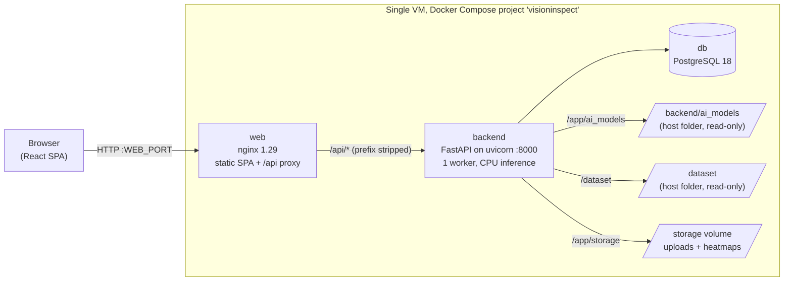
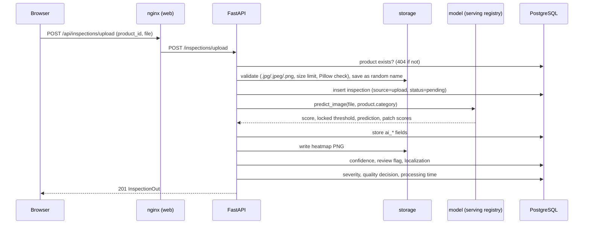

# Architecture

This document describes how VisionInspect AI is put together: the deployed services, the path of an upload and
of a dataset import through the backend, the two roles, the database tables and the API routes. Deployment steps
are in [DEPLOY.md](DEPLOY.md). The models and their evaluation are described in
[ML_METHODOLOGY.md](ML_METHODOLOGY.md).

## Deployed architecture

The stack is three Docker Compose services on one VM ([docker-compose.yml](../docker-compose.yml)). Only `web`
publishes a port: `WEB_PORT`, which defaults to 8080 and is set to 80 on the AWS demo. The backend and the
database are reachable only inside the Compose network.

- **web** ([frontend/Dockerfile](../frontend/Dockerfile), [frontend/nginx.conf](../frontend/nginx.conf)) serves the
  Vite build and proxies `/api/` to `http://backend:8000/`. It accepts request bodies up to 60 MB and allows 120 s
  per API request. It overwrites `X-Forwarded-For` with the client address it saw.
- **backend** ([backend/Dockerfile](../backend/Dockerfile),
  [backend/docker-entrypoint.sh](../backend/docker-entrypoint.sh)) waits for PostgreSQL, runs
  `alembic upgrade head` and starts uvicorn with `UVICORN_WORKERS` workers (default 1). It runs as uid 10001. The
  image build runs [backend/docker/check_image.py](../backend/docker/check_image.py), which fails the build if a
  package version differs from `requirements.txt`, if torch is not the CPU build, or if the Grid study modules do
  not match their pinned SHA-256.
- **db** is `postgres:18-alpine` with a named volume.
- **Models and dataset** are host folders mounted read-only and are never copied into an image. The frozen
  backbones (one ResNet-18 and one WRN-50-2) are loaded at most once per process. Up to
  `VISIONINSPECT_AI_MODEL_CACHE_SIZE` per-category models (default 3) are kept in memory and evicted least
  recently used first.

For local development, the Vite dev server (port 5173) talks directly to uvicorn on port 8000, and CORS is
controlled by `FRONTEND_ORIGINS`.

## Request flow: upload

`POST /inspections/upload` (quality engineer only). The code is in
[backend/app/inspections/router.py](../backend/app/inspections/router.py) and
[service.py](../backend/app/inspections/service.py).

1. The product must exist. The file must have an allowed extension, stay within `MAX_UPLOAD_SIZE_MB` (checked
   while streaming), and pass a Pillow format check. It is stored as `storage/uploads/<product_id>/<random>.<ext>`.
2. The inspection row is committed first, with `status = "pending"` (shown as "Unlabelled") and no ground truth.
3. **AI inference** is best-effort. The category is the product's `category`; when the product has none, no
   prediction is made. `predict_image` looks up the category's entry in `SERVING_CONFIGS`
   ([serving.py](../backend/app/ai/inference/serving.py)), loads the hash-verified model, scores the image and
   compares the score with the locked threshold. Any failure is logged, and the `ai_*` fields stay NULL; the
   inspection is kept.
4. **Reliability and localization.** The backend computes the margin confidence and applies the manual-review
   rule (confidence < 0.70, or the category gate is NOT_PRODUCTION_READY). For a defective prediction it also
   derives anomaly-map boxes and the defect form. A heatmap PNG is written for every patch-model result.
5. **Severity.** An AI-defective inspection with boxes gets `severity_v1` (size, location, form and
   confidence). Otherwise severity stays "not assessed", because an upload has no ground-truth mask.
6. **Quality decision**: `PASS`, `FAIL`, `MANUAL_REVIEW` or `NOT_ASSESSED`, from the settled fields.
7. **Processing time**: the server-side handling time in milliseconds, recorded last.

`POST /inspections/batch` runs the same pipeline for each file, one after another, with up to 20 files and 50 MB
in total.

## Request flow: dataset import

`POST /inspections/import` (quality engineer only) with `{product_id, category, split, defect_type, filename}`.
The Dataset page and the camera simulation both use this endpoint.

1. The product must exist. `build_dataset_relative_path` validates each path part and checks that the file exists
   under `DATASET_ROOT`. The original file is never copied or modified.
2. The row is inserted with `source = "mvtec_ad"`. Its `status` is `good` when the defect type is `good` and
   `defective` otherwise, and `defect_category` is set to the defect-type folder name. These two fields are
   ground truth.
3. AI inference, reliability and localization run as for an upload. The category comes from the dataset path,
   not from the product.
4. **Severity.** An AI-defective inspection with boxes gets `severity_v1`, as for an upload. Otherwise the
   ground-truth path is used. That path reads the defect area from the MVTec mask, but it only scores when all
   four factors (size, location, type, confidence) are available. Location and confidence are never available
   on that path, so it currently always returns "not assessed".
5. Quality decision and processing time are recorded as for an upload. AI results never change the ground-truth
   `status` or `defect_category`.

## Roles

There are two roles (`UserRole` in [backend/app/models/user.py](../backend/app/models/user.py)). The backend
enforces them with `require_role` in [backend/app/auth/dependencies.py](../backend/app/auth/dependencies.py). The
frontend hides controls a role cannot use (`RoleGate`, `RoleRoute`), but that only changes what is shown; the
backend checks every request.

| Action | Quality engineer | Factory supervisor |
|---|:---:|:---:|
| Register (public, always creates a factory supervisor) | n/a | n/a |
| Log in, view own profile | yes | yes |
| View dashboard, inspections, inspection detail, report, image, heatmap, enhancement preview | yes | yes |
| Browse the dataset, view the Models page | yes | yes |
| Create a product | yes | yes |
| Change a product's MVTec category, delete a product (only without inspections) | yes | no |
| Upload, batch upload, import from the dataset, camera simulation | yes | no |
| Delete an inspection | yes | no |
| List users, change a user's role (the last quality engineer cannot be demoted) | yes | no |

The first quality engineer is created with `backend/scripts/create_quality_engineer.py` (or the seed script).
Later ones are promoted on the Users page (`PATCH /users/{user_id}/role`).

## Database

PostgreSQL, managed by 9 Alembic migrations in [backend/migrations/versions/](../backend/migrations/versions/).
The ORM models are in [backend/app/models/](../backend/app/models/).

**users**

| Column | Type | Notes |
|---|---|---|
| `id` | integer PK | |
| `name` | varchar(255) | |
| `email` | varchar(255) | unique, indexed |
| `password_hash` | varchar(255) | bcrypt; never returned by the API |
| `role` | enum `user_role` | `quality_engineer` or `factory_supervisor` |
| `created_at` | timestamptz | |

**products**

| Column | Type | Notes |
|---|---|---|
| `id` | integer PK | |
| `product_name` | varchar(255) | |
| `product_code` | varchar(100) | unique, indexed |
| `category` | varchar(50), nullable | MVTec category; selects the model for uploads. NULL means uploads get no AI result |
| `created_at` | timestamptz | |

**inspections**

| Column group | Columns | Notes |
|---|---|---|
| Identity | `id`, `product_id` (FK products), `image_path`, `source` (enum `upload` / `mvtec_ad`), `inspection_date`, `created_at` | `image_path` is storage-relative and never serialized |
| Ground truth | `status`, `defect_category` | Uploads: `pending` and NULL. Imports: `good`/`defective` and the defect-type folder name |
| AI result | `ai_prediction`, `ai_reconstruction_error`, `ai_threshold`, `ai_model_name`, `ai_inference_time_ms` | `ai_reconstruction_error` holds the model's anomaly score (a patch-feature distance for the current models) |
| Reliability and localization | `ai_confidence`, `review_required`, `review_reason`, `localization` (JSONB), `heatmap_path` | `localization` holds boxes, area, centroid, defect form and analysed region |
| Severity | `severity_score`, `severity_level`, `quality_risk` | NULL when not assessed |
| Quality | `quality_decision`, `quality_assessment`, `quality_recommendation` | |
| Timing | `processing_time_ms` | Server-side handling time |

**defects** (`id`, `inspection_id` FK, `defect_type`, `confidence`, `created_at`) was created by the first
migration and has an ORM model, but no code writes to it. It is unused.

## API routes

There are 29 routes, counted from the route decorators in `backend/app/main.py` and the six routers. The paths
below are the backend paths. Through nginx they are served under `/api`, for example `/api/inspections/upload`.
"Any user" means any authenticated user (a valid bearer token); "QE" means a quality engineer only.

| Method | Path | Access |
|---|---|---|
| GET | `/health` | public |
| GET | `/health/db` | public |
| POST | `/auth/register` | public (creates a factory supervisor) |
| POST | `/auth/login` | public (rate-limited on failures) |
| GET | `/auth/me` | any user |
| GET | `/users` | QE |
| PATCH | `/users/{user_id}/role` | QE |
| POST | `/products` | any user |
| GET | `/products` | any user |
| PATCH | `/products/{product_id}/category` | QE |
| DELETE | `/products/{product_id}` | QE |
| GET | `/inspections` | any user |
| GET | `/inspections/analytics/summary` | any user |
| GET | `/inspections/analytics/by-category` | any user |
| POST | `/inspections/upload` | QE |
| POST | `/inspections/batch` | QE |
| POST | `/inspections/import` | QE |
| GET | `/inspections/{inspection_id}` | any user |
| GET | `/inspections/{inspection_id}/report` | any user |
| GET | `/inspections/{inspection_id}/image` | any user |
| GET | `/inspections/{inspection_id}/enhanced` | any user |
| GET | `/inspections/{inspection_id}/image-quality` | any user |
| GET | `/inspections/{inspection_id}/heatmap` | any user |
| DELETE | `/inspections/{inspection_id}` | QE |
| GET | `/dataset/categories` | any user |
| GET | `/dataset/categories/{category}` | any user |
| GET | `/dataset/categories/{category}/images` | any user |
| GET | `/dataset/categories/{category}/preview` | any user |
| GET | `/ai/models` | any user |

The analytics routes take `days` = 7, 14 or 30 (default 14); any other value gives 422. The Postman collection
in [postman/](../postman/) covers the same 29 operations, with expected status codes and negative tests; see
[postman/README.md](../postman/README.md). FastAPI's interactive docs page is not usable behind the `/api` prefix
in the Docker setup, so use the Postman collection instead.
