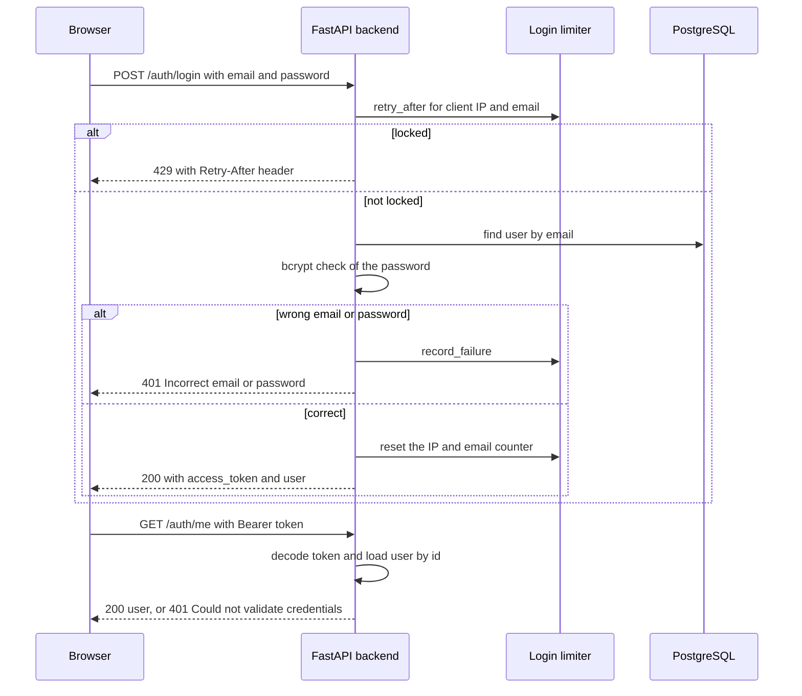
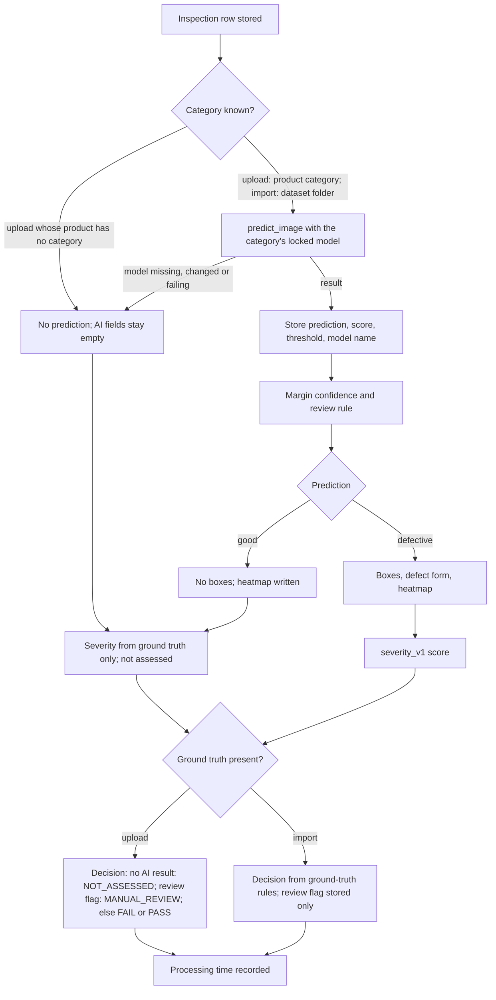
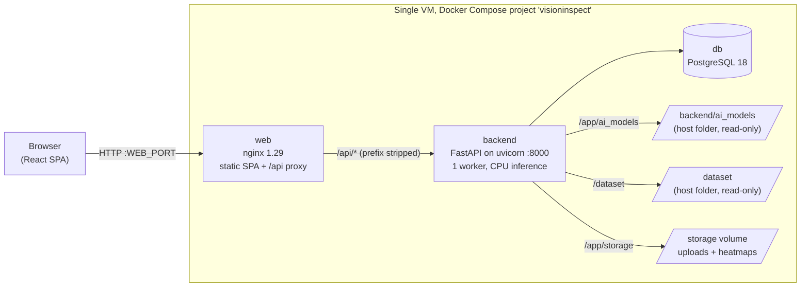
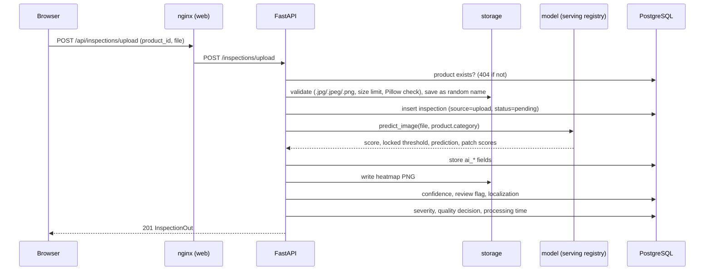

# VisionInspect AI: Project documentation

- **Author:** Shrimathi S
- **Date:** October 2026
- **Live deployment:** http://13.206.115.50 (one AWS (Amazon Web Services) EC2 (Elastic Compute Cloud) virtual
  machine, Docker Compose, plain HTTP (Hypertext Transfer Protocol))
- **Deployed code:** Deployed commit 903e54c; later commits change only documentation, the licence text and the
  documentation build script, none of which is part of the deployed images.

This file is generated by `docs/build_full_doc.py` from the milestone files in `docs/milestones/` and the shared documents in `docs/`. Edit those files, not this one.

## Reading guide

The table below points each common question to the sections that answer it.

| Question | Read |
|---|---|
| What does the system do, and how well? | [Executive summary](#executive-summary), then [Problem statement](#problem-statement) |
| What was built in each phase, and with which commits? | The "What was built", "Deliverables" and "Commits" sections of each milestone, starting at [Milestone 1](#milestone-1-project-setup-authentication-upload-and-dataset-integration) |
| How is the system put together? | [Architecture](#architecture) and the technical sections of [Milestone 1](milestones/MILESTONE_1.md#technical-documentation) |
| How do the models work, and how were they chosen? | [Milestone 2](milestones/MILESTONE_2.md#technical-documentation) and [ML methodology and results](#ml-methodology-and-results) |
| How are severity and the quality decision computed? | [Milestone 3](milestones/MILESTONE_3.md#technical-documentation) |
| What are the measured results and how were they validated? | [Milestone 4](milestones/MILESTONE_4.md#results) and its [Technical documentation](milestones/MILESTONE_4.md#technical-documentation) |
| Which requirements are met? | [Appendix A: Requirements traceability](#appendix-a-requirements-traceability) |
| How do I set it up, test it or fix a problem? | [Setup](#setup), [Testing](#testing), and the Troubleshooting section of each milestone, for example [Milestone 4](milestones/MILESTONE_4.md#troubleshooting) |
| What does a term mean? | The Glossary section of each milestone, starting at [Milestone 1](milestones/MILESTONE_1.md#glossary) |

## Contents

1. [Reading guide](#reading-guide)
2. [Introduction](#introduction)
3. [Executive summary](#executive-summary)
4. [Problem statement](#problem-statement)
5. [Milestone 1: Project setup, authentication, upload and dataset integration](#milestone-1-project-setup-authentication-upload-and-dataset-integration)
6. [Milestone 2: Image processing and defect detection](#milestone-2-image-processing-and-defect-detection)
7. [Milestone 3: Defect classification, severity and manufacturing analytics](#milestone-3-defect-classification-severity-and-manufacturing-analytics)
8. [Milestone 4: Validation, optimization, deployment and documentation](#milestone-4-validation-optimization-deployment-and-documentation)
9. [Appendix A: Requirements traceability](#appendix-a-requirements-traceability)
10. [Appendix B: Technology stack as built](#appendix-b-technology-stack-as-built)
11. [Architecture](#architecture)
12. [ML methodology and results](#ml-methodology-and-results)
13. [Setup](#setup)
14. [Testing](#testing)
15. [Known limitations](#known-limitations)
16. [Deployment](#deployment)
17. [Licence](#licence)

## Introduction

VisionInspect AI is a web application for visual quality inspection of manufactured parts. Images are uploaded or
imported from the MVTec AD dataset, scored by an anomaly-detection model chosen for their MVTec category, localized
with a heatmap and boxes, given a rule-based severity and a quality decision, and summarised on a dashboard. The
system was built in four milestones between 27 August and 17 October 2026. This document collects the four
milestone reports, a traceability appendix against the project's module and metric lists, a comparison of the
planned and the actual technology stack, and the architecture and machine-learning documents.

Each milestone report lists the commits that belong to it by content, with their dates. Work that completed a
milestone's task after that milestone's own dates is listed inside that milestone as delivered in a later
iteration. All dates come from the Git history, all metrics from the code and the stored result files.

| Milestone | Scope | Commit dates of the milestone's own work |
|---|---|---|
| 1 | Setup, authentication, upload, dataset integration, dashboard | 27 August to 5 September 2026 |
| 2 | Preprocessing, image quality, detection models, predictions, monitoring | 5 to 24 September 2026 |
| 3 | Defect category, severity, quality decision, reports, analytics, trends | 12 to 14 September 2026 |
| 4 | Validation, optimization, deployment, documentation | 20 September to 17 October 2026 |

The live deployment runs at http://13.206.115.50 (plain HTTP, one AWS EC2 VM). Setup, testing and deployment are
described in [README.md](../README.md) and [DEPLOY.md](DEPLOY.md).

## Executive summary

VisionInspect AI inspects images of manufactured parts with anomaly-detection models trained on defect-free images
only, so it needs no labelled defect data for training. All 15 MVTec AD (MVTec Anomaly Detection) categories are served, each by
one locked, hash-verified model: WRN-50 PatchCore for 9 categories and a ResNet-18 patch model for 6
(`backend/app/ai/inference/serving.py`). Every model and threshold was chosen on normal data and locked before its
category's test set was scored, under protocols declared in `backend/scripts/experiments/`.

On the official MVTec AD test split (1,725 images in total), the unweighted means over the 15 categories' final tests
are recall 91.1%, F1 (harmonic mean of precision and recall) 93.8%, false-positive rate 7.7%, AUROC (area under the
receiver operating characteristic curve) 0.9845 and image-level average precision 0.9946
(`serving.py`, the final-test reports and `backend/app/ai/ap_addendum.json`). By the project's evidence gates, 8
categories are EXCELLENT, 1 GOOD, 2 ACCEPTABLE and 4 NOT PRODUCTION READY; every result from the last group is routed
to manual review (`review_rule` in `backend/app/ai/inference/localization.py`).

Each defective prediction is localized with a heatmap and boxes cut from the model's anomaly map. Over the 15
categories the mean box AP@0.5 is 0.200 and the mean pixel AUROC 0.9759 (`backend/app/ai/box_eval_addendum.json`).
On 17 October 2026, 1712 backend tests and 324 frontend tests passed. The stack runs with Docker Compose on an AWS
EC2 virtual machine at http://13.206.115.50, with the end-to-end checks recorded in [DEPLOY.md](DEPLOY.md).

## Problem statement

The project inspects images of manufactured parts across the 15 MVTec AD categories and turns each image into a
quality decision that a quality engineer or a factory supervisor can act on. The data shape the design. The MVTec AD
training split holds 3,629 good images and no defective ones, and the test split holds 1,258 defective and 467 good
images with defect masks ([ML_METHODOLOGY.md](ML_METHODOLOGY.md#dataset)).

The system therefore has to:

- learn what normal looks like from good images only, per category;
- decide whether an image is defective against a threshold fixed before any test image is seen;
- show where the anomaly is, and rate its severity with a declared rule;
- turn the evidence into a pass, fail or review decision, and send uncertain results to a person;
- keep ground-truth labels and AI output separate;
- serve two roles with different rights;
- run on the CPU (central processing unit) of a single virtual machine.

The four milestones below describe how each requirement was implemented, measured and deployed.

## Milestone 1: Project setup, authentication, upload and dataset integration

- **Milestone:** 1 of 4
- **Period:** 2026-08-27 to 2026-09-05 (first to last commit of this milestone; the later-iteration commits listed
  under Commits run to 2026-10-08)
- **Deliverables:** 10 of 12 rows DONE; see Deliverables for the full status

### Contents

1. [Objective](milestones/MILESTONE_1.md#objective)
2. [What was built](milestones/MILESTONE_1.md#what-was-built)
3. [Technical documentation](milestones/MILESTONE_1.md#technical-documentation)
4. [Deliverables](milestones/MILESTONE_1.md#deliverables)
5. [Commits](milestones/MILESTONE_1.md#commits)
6. [Limitations](milestones/MILESTONE_1.md#limitations)
7. [Carried into the next milestone](milestones/MILESTONE_1.md#carried-into-the-next-milestone)
8. [How to verify](milestones/MILESTONE_1.md#how-to-verify)
9. [Troubleshooting](milestones/MILESTONE_1.md#troubleshooting)
10. [Glossary](milestones/MILESTONE_1.md#glossary)

### Objective

The first milestone sets up a working full-stack application before any AI (artificial intelligence) is added. A
user can sign in with a role, register products, upload product images, browse the MVTec AD (MVTec Anomaly
Detection) dataset and see the inspections on a dashboard.
The data model, authentication and image intake built here are the base every later milestone extends.

### What was built

The repository started on 27 August 2026 with a React frontend (Vite) and a FastAPI backend (`942ee6b`). The next day
PostgreSQL was added through SQLAlchemy and Alembic (`ccce87e`). The first migration created the `users`,
`products`, `inspections` and `defects` tables, and this schema is still the core of the data model. JWT (JSON Web Token)
authentication with bcrypt password hashes and a `require_role` dependency followed the same evening (`f7ed210`).
It introduced the two roles that the whole application still uses: quality engineer and factory supervisor.

The image intake came next (`5e582ea`). A product can be created, and an image uploaded against it is checked for
extension, size and decodability, stored under a random name, and recorded as an inspection. The same commit added
the first backend tests (`test_auth.py`, `test_inspections.py`, `test_products.py`, `test_health.py`). The frontend
gained its main workflow in `16b6b97`: login, products, the inspection list and detail views, the upload page with
a drop zone, and the shared component set. A light and dark theme followed in `4c3e30f`.

MVTec AD was integrated in `6726990`. The backend scans the dataset folder and lists categories, splits and defect
types, serves preview images, and can import any dataset image as an inspection. An import takes its ground-truth
label (`good` or `defective`) and its defect type from the folder it comes from. The Dataset page in the frontend
browses this tree. Milestone 1 closed on 5 September with `af7a252`, which added the dashboard (counts and an
activity chart), the image viewer, the product detail view and the inspection status banner.

At the end of the milestone, preprocessing meant only the display preview (RGB, red-green-blue, conversion and a bounded JPEG in
`backend/app/dataset/preprocessing.py`). The preprocessing pipeline for AI models was committed the same day as the
first Milestone 2 work (`72b3f77`) and is described there.

Several parts of this milestone were changed in later iterations:

- Until 3 October, registration took the role from the request. `6693b13` made self-registration always create a
  factory supervisor, and added QE-only (quality engineer only) role management and a script that creates the first quality engineer.
- `1b4b0ab` added the registration page and the Users page, and `0fad1e1` restricted the upload route to quality
  engineers in the frontend as well.
- `593184b` rejects passwords longer than 72 bytes (the bcrypt limit).
- `e83f94a` added a limiter for failed logins.
- `ce42d43` added batch upload and the camera simulation, which replays labelled dataset images as timed imports.

### Technical documentation

#### Scope

This milestone covers the application around the AI: accounts and roles, products, image intake from uploads and
from the dataset, image retrieval, the data model and the first dashboard. The roles, routes and tables are listed in
[ARCHITECTURE.md](ARCHITECTURE.md); this section adds the details that belong to this milestone.

#### Technology stack

The table below lists the components with the versions pinned in `backend/requirements.txt` and
`backend/Dockerfile`, or installed according to `frontend/package-lock.json`. The machine-learning packages are
listed in `requirements.txt` under its Milestone 2 comment; torch first appears there in `72b3f77`.

| Component | Version | Purpose |
|---|---|---|
| Python (backend image `python:3.14-slim`) | 3.14 | Backend runtime |
| FastAPI, uvicorn[standard] | 0.141.1, 0.52.4 | HTTP (Hypertext Transfer Protocol) API (application programming interface) framework and its ASGI (Asynchronous Server Gateway Interface) server |
| SQLAlchemy, Alembic, psycopg[binary] | 2.0.52, 1.19.1, 3.3.4 | Database sessions, migrations and the PostgreSQL driver |
| PostgreSQL (image `postgres:18-alpine`) | 18 | Database |
| bcrypt, PyJWT | 4.3.0, 2.13.0 | Password hashing; signing and checking access tokens |
| Pillow | 11.3.0 | Upload format check and dataset previews |
| python-dotenv, email-validator, python-multipart | 1.2.3, 2.3.0, 0.0.32 | `backend/.env` loading, email fields in the schemas, multipart uploads |
| NumPy, OpenCV headless, torch, scikit-learn | 2.5.2, 5.0.0.93, 2.14.0, 1.9.0 | Image processing, models and evaluation (Milestone 2) |
| matplotlib | 3.11.1 | Pinned and configured in the Dockerfile (`MPLCONFIGDIR`); no tracked module imports it |
| pytest, httpx | 8.4.2, 0.28.1 | Backend tests and the test client |
| React and React DOM (document object model renderer), React Router DOM, lucide-react | 19.2.8, 7.18.3, 1.37.0 | Frontend, client-side routes, icons |
| Vite, @vitejs/plugin-react, oxlint | 8.2.2, 6.1.0, 1.80.0 | Development server, build and linting |
| Vitest, Testing Library (React), jsdom | 5.0.1, 16.3.3, 30.1.0 | Frontend tests |
| Node.js (build image `node:24-alpine`), nginx (`nginx:1.29-alpine`) | 24, 1.29 | Frontend build and serving in Docker |

#### Authentication and token flow

`POST /auth/login` (`backend/app/auth/router.py`) first asks the login limiter whether the client IP (Internet Protocol) address and
email are locked, then checks the password with bcrypt. On success it returns a token signed with HS256 (a keyed
SHA-256 signature; SHA is the Secure Hash Algorithm) that carries the user id (`sub`), the role and an expiry 60 minutes ahead (`JWT_ACCESS_TOKEN_EXPIRE_MINUTES`,
`backend/app/auth/security.py`). The frontend stores the token in `localStorage` under `visioninspect.token`
(`frontend/src/auth/AuthContext.jsx`) and sends it in the `Authorization` header with the `Bearer` scheme. On every protected request
`get_current_user` (`backend/app/auth/dependencies.py`) decodes the token and loads the user from the database. When
the app starts it calls `GET /auth/me` to restore the session, and any 401 response logs the user out on the client.

The sequence below shows a login and one protected request, as implemented in the files named above.



The login request and response follow `UserLogin` and `Token` in `backend/app/auth/schemas.py`. The test helper
`login` in `backend/tests/conftest.py` sends exactly the two request fields and expects status 200.
`test_login_correct_credentials` in `backend/tests/test_auth.py` asserts `token_type` is `"bearer"` and that the user
object contains neither `password` nor `password_hash`. The table lists the request and response fields.

| Field | Direction | Type and content |
|---|---|---|
| `email` | request | email address, validated by email-validator |
| `password` | request | string, checked against the stored bcrypt hash |
| `access_token` | response | the signed JWT |
| `token_type` | response | `"bearer"` |
| `user` | response | `UserOut`: `id`, `name`, `email`, `role` (`quality_engineer` or `factory_supervisor`), `created_at` |

#### Access control

Each protected route declares either `get_current_user` (any signed-in user) or `require_role(...)`; a user without the
required role gets 403 `Insufficient permissions`. The role table in [ARCHITECTURE.md](ARCHITECTURE.md#roles) lists
what each role may do. In the frontend user interface (UI), `RoleRoute` guards three routes (`/inspections/upload`, `/camera`, `/users`)
and `RoleGate` hides controls. Its own comment calls this a display convenience: `require_role` in the backend is the
authorization boundary.

#### Upload validation and storage

The table below lists the checks applied to every uploaded file, in the order `save_upload_file` in
`backend/app/inspections/storage.py` runs them, followed by the batch and proxy limits, with the evidence for each.

| Check | Rule | Response when it fails | Evidence |
|---|---|---|---|
| Extension | `.jpg`, `.jpeg` or `.png` | 400 `Unsupported file type. Allowed formats: JPEG, PNG.` | `test_upload_rejects_invalid_file_type` |
| Size, measured while streaming | at most `MAX_UPLOAD_SIZE_MB`, 10 MB by default | 413 `File exceeds maximum size of 10 MB.` | `test_upload_rejects_oversized_file` |
| Empty file | at least 1 byte | 400 `Uploaded file is empty.` | code path in `save_upload_file`; no dedicated test |
| Content | Pillow verifies the file and its format is JPEG or PNG | 400 `Uploaded file is not a valid JPEG or PNG image.` | `test_upload_rejects_fake_image_with_image_extension` |
| Batch count (`POST /inspections/batch`) | at most 20 files | 400 `Too many files: at most 20 per batch.` | `test_batch_limits` |
| Batch size | at most 50 MB in total | 413 `Batch exceeds the maximum total size of 50 MB.` | `test_batch_limits` |
| Request body in Docker | nginx `client_max_body_size 60m` (`frontend/nginx.conf`) | 413 from nginx | a 61 MB request got 413 on AWS ([DEPLOY.md](DEPLOY.md)) |

An accepted file is stored under `storage/uploads/` as `{product_id}/{filename}` (the code's own template), with a filename made of
`uuid4().hex` followed by the extension. Only the storage-relative path is kept in `inspections.image_path`, and `InspectionOut` does not
serialize it (`test_quality_engineer_can_upload_inspection` asserts `image_path` is absent).

#### Image retrieval

`GET /inspections/{inspection_id}/image` returns the stored upload, or for an import the original file under
`DATASET_ROOT`. `resolve_image_path` resolves the path and refuses anything outside its root with 404 `Image not
found`; `test_delete_inspection_rejects_path_traversal_in_stored_image_path` covers the stored-path case.
`GET /dataset/categories/{category}/preview` returns a JPEG bounded to `max_dim` pixels, 320 by default and from 64 to
800 (`backend/app/dataset/router.py`). Its path parts are validated by `backend/app/dataset/service.py`, and seven
tests in `backend/tests/test_dataset.py` cover traversal in the category, defect type and filename, and an
absolute-path filename. The heatmap and the
enhancement preview were added in later iterations (Milestones 2 and 3).

#### Data model and its evolution

The table below lists the nine Alembic migrations in `backend/migrations/versions/`, with the date of the commit
that added each file and the milestone it belongs to. The current columns are described in
[ARCHITECTURE.md](ARCHITECTURE.md#database).

| Revision | Date | Adds | Milestone |
|---|---|---|---|
| `3dbc453c0101` | 2026-08-28 | `users`, `products`, `inspections` and `defects` tables | 1 |
| `3ba354d22dca` | 2026-08-29 | `inspections.source` (upload or dataset import) | 1 |
| `b33cf1824856` | 2026-09-05 | AI prediction columns | 2 |
| `756fc6cd50c8` | 2026-09-12 | `inspections.defect_category` | 3 |
| `e20f1b630737` | 2026-09-12 | Severity score, level and quality risk | 3 |
| `a96adcbc9a9e` | 2026-09-13 | Quality decision, assessment and recommendation | 3 |
| `e94d6730c867` | 2026-09-20 | Processing and inference time columns | 4 |
| `39bd1b8da129` | 2026-10-03 | `products.category` (later iteration of Milestone 2) | 2 |
| `5c1d7e2a9f40` | 2026-10-04 | Confidence, review, localization and heatmap columns (later iteration of Milestone 3) | 3 |

#### Frontend pages and routes

The routes below are declared in `frontend/src/App.jsx`. Every route except `/login` and `/register` sits inside
`ProtectedRoute`, so it needs a signed-in user; `/` and unknown paths redirect to `/dashboard`.

| Path | Page | Access | Added |
|---|---|---|---|
| `/login` | LoginPage | public | `16b6b97`, 2026-08-29 |
| `/register` | RegisterPage | public | `1b4b0ab`, 2026-10-03 |
| `/dashboard` | DashboardPage | both roles | `16b6b97`, 2026-08-29 |
| `/products` | ProductsPage | both roles | `16b6b97`, 2026-08-29 |
| `/inspections` | InspectionsPage | both roles | `16b6b97`, 2026-08-29 |
| `/inspections/upload` | InspectionUploadPage | quality engineer (route guard from `0fad1e1`, 2026-10-03) | `16b6b97`, 2026-08-29 |
| `/inspections/:id` | InspectionDetailPage | both roles | `16b6b97`, 2026-08-29 |
| `/dataset` | DatasetBrowserPage | both roles; import is quality engineer only | `6726990`, 2026-08-30 |
| `/models` | ModelPerformancePage | both roles | `5070829`, 2026-10-04 |
| `/camera` | CameraSimulationPage | quality engineer | `ce42d43`, 2026-10-04 |
| `/users` | UsersPage | quality engineer | `1b4b0ab`, 2026-10-03 |

#### Error responses

The backend returns errors as JSON with a `detail` field. The table below lists every `HTTPException` the code
raises, grouped by status. Pydantic validation errors, such as a missing field, are returned by FastAPI with
status 422.

| Status | Message | Raised by |
|---|---|---|
| 400 | `Unsupported file type. Allowed formats: JPEG, PNG.`, `Uploaded file is empty.`, `Uploaded file is not a valid JPEG or PNG image.`, `Too many files: at most 20 per batch.` | `inspections/storage.py`, `inspections/router.py` |
| 400 | `Invalid {field_name}.` (code template), `Split must be 'train' or 'test'.` | `dataset/service.py` |
| 401 | `Could not validate credentials` | `auth/dependencies.py` (missing, invalid or expired token) |
| 401 | `Incorrect email or password` | `auth/router.py` |
| 403 | `Insufficient permissions` | `require_role` |
| 404 | `Product not found`, `Inspection not found`, `Image not found`, `Heatmap not found`, `User not found` | routers and storage |
| 404 | `Category not found`, `Split not found`, `Defect type not found`, `Image not found` | `dataset/service.py` |
| 409 | `Email already registered`, `Product code already exists`, `Cannot delete product while inspections are associated with it`, `Cannot change the role of the last quality engineer; promote another user first` | auth, products and users routers |
| 413 | `File exceeds maximum size of 10 MB.`, `Batch exceeds the maximum total size of 50 MB.` | `inspections/storage.py`, `inspections/router.py` |
| 422 | Analytics `days` outside 7, 14 or 30 | `inspections/router.py` |
| 429 | `Too many failed login attempts. Please wait and try again later.`, with `Retry-After` | `auth/router.py` |
| 500 | `Failed to create inspection record` | `inspections/router.py` |
| 503 | `Database connection failed` | `GET /health/db` in `main.py` |

#### Design rationale

- **Roles are checked on the server.** Every write that only a quality engineer may make goes through
  `require_role`, so the frontend's role gating changes only what is displayed.
  `test_supervisor_cannot_list_users_or_change_roles` and `test_factory_supervisor_cannot_upload` cover the
  server side.
- **Ground truth and AI output live in separate columns.** For imports, `status` and `defect_category` come from the
  dataset folders, and the `ai_*` columns hold only model output (`backend/app/models/inspection.py`).
  `test_ground_truth_and_ai_prediction_remain_independent` checks that one never overwrites the other.
- **Passwords are never command-line arguments.** `create_quality_engineer.py` and `seed_demo_data.py` read them from
  environment variables or a hidden prompt, as their docstrings state.

#### Design challenges and how they were resolved

- **Role taken from the registration request.** Until 3 October, `POST /auth/register` used the role sent by the
  client. `6693b13` fixed the role to factory supervisor and added role changes for quality engineers only, with
  `test_register_cannot_choose_quality_engineer_role` and
  `test_demoting_the_last_quality_engineer_returns_409_and_changes_nothing`.
- **bcrypt's 72-byte input limit.** A password of up to 72 characters can exceed 72 bytes when it contains characters outside
  ASCII (the American Standard Code for Information Interchange). `593184b` (6 October) rejects such passwords at registration and in the bootstrap script, tested by
  `test_register_rejects_multibyte_password_over_72_bytes_with_422`.
- **Repeated failed logins.** `e83f94a` (8 October) added the limiter, covered by 29 tests in
  `backend/tests/test_login_rate_limit.py`.
- **Paths built from request values.** Dataset paths are assembled from category, split, defect type and filename.
  They are validated in `backend/app/dataset/service.py` and covered by the traversal tests in
  `backend/tests/test_dataset.py`.

### Deliverables

| Task or criterion | Status | Evidence |
|---|---|---|
| Inspection workflows and objectives | PARTIAL | The workflows exist in code from `5e582ea` and `6726990`; no planning document from this period is in the repository. They are described in [README.md](../README.md) and [ARCHITECTURE.md](ARCHITECTURE.md), both written on 17 October. |
| Architecture and database schema | DONE | `ccce87e`: SQLAlchemy models and the first migration (`3dbc453c0101`). The architecture is documented in [ARCHITECTURE.md](ARCHITECTURE.md). |
| UI wireframes and workflow planning | NOT DONE | No wireframe or design file exists in the repository or its history. |
| Frontend and backend environments | DONE | `942ee6b`, `ccce87e`, `5efe127` |
| Authentication and role-based access | DONE | `f7ed210`. Hardened in later iterations by `6693b13` (3 October), `1b4b0ab` (3 October), `593184b` (6 October) and `e83f94a` (8 October). |
| Load MVTec AD dataset | DONE | `6726990`: `backend/app/dataset/`, Dataset page |
| Image upload workflow | DONE | `5e582ea`, `16b6b97`. Batch upload delivered in a later iteration: `ce42d43` (4 October). |
| Inspection dashboard | DONE | `af7a252` |
| Initialization and architecture complete | DONE | as above |
| Authentication and upload implemented | DONE | `backend/tests/test_auth.py`, `backend/tests/test_inspections.py` |
| Dashboard functional | DONE | `af7a252` (`DashboardPage.jsx`, `ActivityChart.jsx`) |
| Dataset integration and preprocessing | DONE | Dataset integration in `6726990`. The AI preprocessing pipeline in `72b3f77` was committed on 5 September, the same day as `af7a252`. |

### Commits

| Commit | Date | Content |
|---|---|---|
| `0ebb77d` | 2026-08-27 | Repository created with a `.gitignore` |
| `942ee6b` | 2026-08-27 | React (Vite) frontend and FastAPI backend skeletons |
| `ccce87e` | 2026-08-28 | PostgreSQL, SQLAlchemy models and the first Alembic migration |
| `f7ed210` | 2026-08-28 | JWT authentication and role checks |
| `5e582ea` | 2026-08-29 | Products, image upload and storage, first backend tests |
| `16b6b97` | 2026-08-29 | Frontend workflow pages and shared components |
| `5efe127` | 2026-08-29 | Vite development server configuration fix |
| `4c3e30f` | 2026-08-30 | Light and dark theme (outside the milestone task list) |
| `6726990` | 2026-08-30 | MVTec AD dataset browsing and import |
| `af7a252` | 2026-09-05 | Dashboard, image viewer, product detail, end of Milestone 1 |

Delivered in a later iteration:

| Commit | Date | Content |
|---|---|---|
| `6693b13` | 2026-10-03 | Registration always creates a factory supervisor; QE-only role changes; first-QE script |
| `1b4b0ab` | 2026-10-03 | Registration page and Users page |
| `0fad1e1` | 2026-10-03 | Upload page restricted to quality engineers |
| `ce42d43` | 2026-10-04 | Batch upload and camera simulation (also severity and enhancement UI, see Milestone 3) |
| `593184b` | 2026-10-06 | Passwords over 72 bytes rejected |
| `e83f94a` | 2026-10-08 | Failed-login rate limiting per client IP and email |

### Limitations

The registration flaw described above existed until 3 October. Uploads carry no ground truth, so they are shown as
"Unlabelled" and only dataset imports have a known label. The camera simulation replays dataset images from the
server and is not a live camera feed. The `defects` table from the first migration is never written by any code.
The login limiter keeps its counters in memory, so they reset when the backend restarts.

### Carried into the next milestone

Milestone 2 builds on four things from this milestone. The `inspections` table is the place where AI results are
added as new columns. The upload and import endpoints are the two entry points where inference is attached. The
ground-truth labels of dataset imports are what model predictions can be compared with. The dashboard is where the AI
monitoring view is added.

### How to verify

- Live deployment: http://13.206.115.50. `/register` creates a factory supervisor, and a quality engineer can
  change roles on the Users page.
- Health checks: `curl -s http://13.206.115.50/api/health` and `curl -s http://13.206.115.50/api/health/db`.
- Tests, from `backend/`:
  `python -m pytest tests/test_auth.py tests/test_users.py tests/test_login_rate_limit.py tests/test_products.py tests/test_inspections.py tests/test_dataset.py`.
- The first quality engineer is created with `python scripts/create_quality_engineer.py` (see
  [README.md](../README.md#5-first-quality-engineer-and-demo-data)).

### Troubleshooting

The entries below cover problems that come from this milestone's authentication setup, with the cause and fix
recorded in the code and in [DEPLOY.md](DEPLOY.md).

| Symptom | Cause | Fix |
|---|---|---|
| Login is refused with 429 `Too many failed login attempts. Please wait and try again later.`, even with the right password | The client IP address and email reached 5 failed logins, or the IP reached 20, within 900 seconds (defaults of `LOGIN_MAX_ATTEMPTS`, `LOGIN_MAX_ATTEMPTS_PER_IP`, `LOGIN_WINDOW_SECONDS`; `backend/app/auth/rate_limit.py`) | Wait for the number of seconds in the `Retry-After` header. The counters are held in memory, so `docker compose --env-file .env.docker restart backend` clears all of them at once. |
| `docker compose up` stops with `set JWT_SECRET_KEY in .env.docker` | `docker-compose.yml` requires the variable (`${JWT_SECRET_KEY:?set JWT_SECRET_KEY in .env.docker}`) | Set `JWT_SECRET_KEY` in `.env.docker`; DEPLOY.md shows how to generate one |
| The backend fails to import in local development with `KeyError: 'JWT_SECRET_KEY'` | `backend/app/auth/security.py` reads `os.environ["JWT_SECRET_KEY"]` | Set `JWT_SECRET_KEY` in `backend/.env` (template: `backend/.env.example`) |

### Glossary

The terms below are introduced in this milestone and used in the later ones.

| Term | Meaning in this project |
|---|---|
| Quality engineer | The role that can upload, import, delete inspections, change product categories and manage user roles. |
| Factory supervisor | The role every self-registered account gets; it can create products and view inspections, analytics, the dataset and the Models page. |
| JWT (JSON Web Token) | The signed access token returned by `POST /auth/login`, carrying the user id, the role and a 60-minute expiry. |
| bcrypt | The password-hashing function used for stored passwords; it reads at most 72 bytes of input. |
| Role-based access | Allowing or refusing each API route by the caller's role, through `require_role` in the backend. |
| Ground truth | The known label of a dataset import (`good` or `defective`, and the defect folder name), kept apart from AI output. |
| MVTec AD (MVTec Anomaly Detection) | The public dataset of 15 product categories whose images, labels and defect masks the project uses. |
| Preprocessing | Preparing an image before use: in this milestone, the RGB conversion and resizing of dataset previews; in Milestone 2, the decoding, resizing and scaling before a model scores it. |
| Inspection | One image recorded against a product, either uploaded or imported from the dataset, with its results. |
| Login rate limit | The in-memory counter of failed logins per client IP address and email that answers 429 when exceeded. |

## Milestone 2: Image processing and defect detection

- **Milestone:** 2 of 4
- **Period:** 2026-09-05 to 2026-09-24 (first to last commit of this milestone; the later-iteration commits listed
  under Commits run to 2026-10-04)
- **Deliverables:** 10 of 10 rows DONE; see Deliverables for the full status

### Contents

1. [Objective](milestones/MILESTONE_2.md#objective)
2. [What was built](milestones/MILESTONE_2.md#what-was-built)
3. [Technical documentation](milestones/MILESTONE_2.md#technical-documentation)
4. [Deliverables](milestones/MILESTONE_2.md#deliverables)
5. [Commits](milestones/MILESTONE_2.md#commits)
6. [Results](milestones/MILESTONE_2.md#results)
7. [Limitations](milestones/MILESTONE_2.md#limitations)
8. [Carried into the next milestone](milestones/MILESTONE_2.md#carried-into-the-next-milestone)
9. [How to verify](milestones/MILESTONE_2.md#how-to-verify)
10. [Troubleshooting](milestones/MILESTONE_2.md#troubleshooting)
11. [Glossary](milestones/MILESTONE_2.md#glossary)

### Objective

The second milestone adds the computer-vision layer. Images are preprocessed and measured, anomaly-detection models
are trained on defect-free MVTec AD (MVTec Anomaly Detection) images, and every inspection receives a prediction that the frontend can show
and monitor. By the end of this milestone the application should make and store its own defect predictions,
rather than only record what the dataset folders say.

### What was built

The preprocessing pipeline was committed on 5 September (`72b3f77`). It decodes an image with OpenCV, converts it to
RGB (red, green, blue), resizes it with area interpolation and scales it to 0..1. The same commit added an image-quality module,
`backend/app/ai/analytics/quality.py`, which reports brightness (mean intensity), contrast (intensity standard
deviation) and sharpness (variance of the Laplacian), with a blur flag below a variance of 100. The training-data
layer in `backend/app/ai/training/` lists the MVTec samples and their labels. The training and evaluation code
uses this pipeline, and so do the six served ResNet-18 patch models (`_image_to_tensor` in
`backend/app/ai/inference/predict.py`). The nine served WRN-50 (Wide ResNet-50-2) models use their own preprocessing in
`backend/app/ai/preprocessing/patchcore_preprocess.py`.

The first model was a convolutional autoencoder trained on Bottle `train/good` (`92db936`) and evaluated in
`bf1d255`. With its first threshold (mean plus 3 standard deviations of the training errors) it found 29 of 63
defective test images (recall 46.0%) and flagged 1 of 20 good images (false-positive rate, FPR: 5%). The prediction engine
(`7a61371`) turned a trained model into an `app.ai.inference.predict_image` call. `5294ed5` connected it to the
inspection workflow: every dataset import now ran inference and stored `ai_prediction`, the score, the threshold
and the model name in new columns. If inference fails, the inspection is still created and those columns stay
empty. `1acff93` added the analytics summary endpoint and the AI (artificial intelligence) monitoring view on the dashboard, with counts of
analysed inspections and AI predictions.

On 15 September the Bottle model went through a validated evaluation in three steps:

- `972c203` added a held-out evaluation and threshold experiments.
- `19ddc59` retrained the autoencoder with a held-out validation split that was never used for training. This
  "Phase 3" model reached recall 73.0% at FPR 30.0% and was the served Bottle model until 4 October.
- `7b65b25` tried a controlled optimization ("Phase 4"). It gave recall 66.7% at FPR 40.0% and was not adopted.

Commit `4118bf7` (22 September) carries the title "Milestone 3: AI defect detection and model optimization", but by
content it belongs here. It added the frozen ImageNet ResNet-18 patch models (`backend/app/ai/models/patch_anomaly.py`,
`resnet18.py`), the synthetic-defect generator and the normal-data-only model-family study used to choose and lock
a model and threshold per category. `b224a77` (24 September) added the generic per-category training and
optimization engines and the serving registry (`backend/app/ai/inference/serving.py`). The registry pins each
category to exactly one locked, hash-verified model.

The autoencoder failed the project's gates in every category where it was tried. The ResNet-18 study produced
passing models for cable, leather, metal_nut, tile, toothbrush and transistor. The remaining nine categories were
later replaced by WRN-50 PatchCore models (Milestone 4). [ML_METHODOLOGY.md](ML_METHODOLOGY.md) has the
category-by-category history.

Delivered in a later iteration:

- Tile and Cable were registered for serving on 2 October (`9a44113`).
- Uploaded images received predictions from 3 October (`363816a`, `ae74168`). The product's MVTec category now
  selects the model for its uploads.
- All 15 categories were served from 4 October (`188c903`). This added the shared backbones, the cached
  per-category models and `GET /ai/models`.
- The image-quality measurements became visible to users on 4 October (`c847154`). This added
  `GET /inspections/{id}/image-quality` and an enhancement preview with denoising and CLAHE (contrast-limited adaptive histogram equalization) contrast. The preview
  is computed per request, is never stored, and is never used by the models.

### Technical documentation

#### Scope

This milestone covers the path from an image to a stored prediction: preprocessing, image-quality measurement, the
anomaly-detection models and how they are chosen, inference, and the monitoring view. The dataset, the protocol and
the full model history are in [ML_METHODOLOGY.md](ML_METHODOLOGY.md), and the upload sequence diagram is in
[ARCHITECTURE.md](ARCHITECTURE.md#request-flow-upload). This section adds the component details and the branches
of the inspection path.

#### Components

The table below gives, for each component on the prediction path, its module, input, output, key parameters read
from the code, and the test module that covers it.

| Component | Module | Input | Output | Key parameters | Tests |
|---|---|---|---|---|---|
| Preprocessing pipeline | `backend/app/ai/preprocessing/pipeline.py` | image path | float32 RGB array scaled to 0..1, with quality metrics | OpenCV decode, BGR (blue-green-red) to RGB, `INTER_AREA` resize, default 224x224 | `test_ai_preprocessing.py` (13 tests) |
| WRN-50 preprocessing | `backend/app/ai/preprocessing/patchcore_preprocess.py` | image path or bytes, input mode | ImageNet-normalized tensor | `crop224`: shorter side to 256, centre 224x224; `full256`: whole image to 256x256; Grid's `full320` from its addendum module | `test_ai_patchcore.py` (27 tests) |
| ResNet-18 patch model | `backend/app/ai/models/patch_anomaly.py` | tensor at 128x128 or 256x256 | image score and per-patch scores | layers 2 and 3 (384 values per patch), 3x3 average pooling; kNN (k-nearest-neighbour) with k = 1 to a bank of 10% per-image coresets, or a Gaussian with covariance shrinkage 1e-2; image score = mean of the top 1% of patch scores | `test_ai_anomaly_models.py` (45 tests) |
| WRN-50 PatchCore | `backend/app/ai/models/patchcore.py` | tensor at 224, 256 or 320 pixels | image score, per-patch scores, anomaly map | layers 2 and 3, 3x3 average pooling, greedy coreset of 10% (seed 0), k = 1; image score = maximum patch score | `test_ai_patchcore.py`, `test_ai_wrn50.py` (11 tests) |
| Serving registry | `backend/app/ai/inference/serving.py` | category name | the category's locked, hash-checked model and threshold | one entry per category, no default entry; at most `VISIONINSPECT_AI_MODEL_CACHE_SIZE` (default 3) models cached | `test_ai_serving.py` (37 tests), `test_ai_all_categories_serving.py` (61 tests) |
| Prediction | `backend/app/ai/inference/predict.py` | image path, category | prediction, score, threshold, model name, time | defective when the score is above the locked threshold | `test_ai_inference.py` (15 tests) |
| Localization | `backend/app/ai/inference/localization.py` | per-patch scores, threshold, analysed region | boxes, flagged area, centroid, heatmap | bilinear upsampling and Gaussian blur (sigma 4, 33 taps); mask at the threshold (fallback 0.9 x peak); components under 0.25% of the image dropped; at most 5 boxes; heatmap at most 320 pixels per side | `test_localization.py` (136 tests), `test_localization_api.py` (22 tests) |

The score comparison in `predict.py`, written out in plain text:

```
prediction = "defective" if score > threshold else "good"
```

#### Inspection path

The flowchart below shows what happens to an inspection once its row is stored. It follows `run_ai_inference`,
`apply_reliability_and_localization`, `apply_severity_assessment` and `apply_quality_assessment` in
`backend/app/inspections/service.py`.



Every step after the row is stored is best-effort: a failure is logged and leaves its fields empty, and the
inspection is kept. `test_upload_survives_a_raising_predictor_without_leaking_details` and
`test_tampered_model_never_fails_an_upload_and_leaks_nothing` cover this for the prediction step.

#### Example request: upload

`POST /inspections/upload` takes a multipart form with `product_id` and `file`, sent with a quality engineer's
token. `test_quality_engineer_can_upload_inspection` in `backend/tests/test_inspections.py` sends a 16x16 PNG
named `sample.png` and asserts status 201, `status` `"pending"`, `source` `"upload"`, and no `image_path` field. A
factory supervisor gets 403 (`test_factory_supervisor_cannot_upload`). The table below groups the response fields of
`InspectionOut` (`backend/app/inspections/schemas.py`).

| Group | Fields |
|---|---|
| Record | `id`, `product_id`, `product_category`, `status`, `source`, `inspection_date`, `created_at` |
| Dataset origin (imports) | `dataset_category`, `dataset_split`, `dataset_defect_type`, `dataset_filename`, `defect_category` |
| Prediction | `ai_prediction`, `ai_reconstruction_error` (the anomaly score), `ai_threshold`, `ai_model_name`, `model_gate`, `ai_inference_time_ms` |
| Reliability and localization | `ai_confidence`, `ai_reliability`, `review_required`, `review_reason`, `localization`, `has_heatmap`, `defect_form`, `defect_form_label` |
| Severity and decision | `severity_score`, `severity_level`, `severity_action`, `quality_risk`, `quality_decision`, `quality_assessment`, `quality_recommendation`, `processing_time_ms` |

#### Experiments

The table below summarises the detection experiments of this milestone, with the test-set counts from the stored
reports as recorded in [ML_METHODOLOGY.md](ML_METHODOLOGY.md#history-of-earlier-models). The reports themselves
are in the models ZIP (see the README). The protocol is described in ML_METHODOLOGY.md.

| Experiment | Settings | Result on the test set | Decision |
|---|---|---|---|
| First Bottle autoencoder (`92db936`, `bf1d255`) | threshold = mean + 3 standard deviations of training errors | recall 29/63 (46.0%), FPR 1/20 (5.0%) | Replaced by a validated evaluation |
| Bottle Phase 3 autoencoder (`19ddc59`) | held-out validation split | recall 46/63 (73.0%), FPR 6/20 (30.0%) | Served for Bottle until 4 October |
| Bottle Phase 4 optimization (`7b65b25`) | controlled optimization | recall 42/63 (66.7%), FPR 8/20 (40.0%) | Not adopted |
| Hazelnut Phase 3 and 4 autoencoders | as for Bottle | recall 26/70 (37.1%) and 30/70 (42.9%), FPR 0/40 | Phase 3 retained, later replaced by WRN-50 |
| Autoencoder baselines in 12 categories | `phase1_baseline/` of each category | recall 0% in 7 categories (cable, grid, metal_nut, screw, tile, toothbrush, wood); leather 64/92 at FPR 30/32 | Replaced by the ResNet-18 study |
| ResNet-18 model-family study, 12 categories (`4118bf7`) | 8 candidates x 8 threshold policies, 30 normal-only splits | gates passed in 6 categories (cable, leather, metal_nut, tile, toothbrush, transistor) | The six passing models are served |
| Same study, other 6 categories | as above | recall capsule 29/109, grid 13/57, pill 78/141, screw 9/119, zipper 79/119; wood 59/60 at FPR 4/19 | Replaced by WRN-50 (Milestone 4) |
| Carpet, ResNet-18 Gaussian model and its calibration | `pgauss_l23_256_top1pct_mean`, then a calibration optimization | recall 88/89 at FPR 16/28, then 87/89 at FPR 11/28 | Replaced by WRN-50 (Milestone 4) |

#### Design rationale

- **Training on defect-free images only.** The MVTec AD training split holds only good images, and the dataset has no
  labelled defective validation set ([ML_METHODOLOGY.md](ML_METHODOLOGY.md#dataset)). An anomaly model learns
  what normal looks like from those images and needs no labelled defects.
- **Thresholds chosen on normal data and locked before test scoring.** Each threshold is fixed from normal training
  images and synthetic defects, and written to a lock file before the category's test set is listed. The test result
  is not used to set the threshold (the runners check the lock before listing the test set).
- **Frozen-backbone patch models.** The autoencoder did not reach a gate in any category where it was tried (table
  above), while patch features from a frozen ImageNet backbone passed in six categories with no network training.
- **Boxes from the same anomaly map.** Boxes are cut from the per-patch scores of the model that made the
  prediction, at that model's threshold, so localization needs no labelled boxes and appears only for defective
  predictions (`_localize_and_render` in `service.py`).
- **One locked model per category.** The serving registry holds exactly one entry per category, with no default
  entry; `test_unknown_category_has_no_model_and_loads_nothing` covers a category without an entry.

#### Design challenges and how they were resolved

- **Threshold recomputed on every call.** Before the serving registry, inference loaded the autoencoder and
  recomputed a threshold from every `train/good` image on each call, as the docstring of `serving.py` records.
  `b224a77` (24 September) introduced the registry with thresholds copied from locked reports.
- **No predictions for uploads.** An upload had no category to choose a model with. `363816a` (3 October) added
  `products.category`, and `ae74168` added it to the user interface (UI);
  `test_upload_for_product_without_category_never_calls_predict_image` covers the case without one.
- **Memory with 15 categories.** `188c903` (4 October) shares one frozen backbone per model family and caches at most
  three category models, least recently used first (`test_lru_cache_evicts_the_least_recently_used_model`).
- **Changed model files.** Every model, configuration and backbone file is hash-checked on first load, and a mismatch
  is refused (`test_wrong_pinned_hash_refuses_to_load`, `test_wrong_pinned_backbone_hash_refuses_to_load`).

### Deliverables

| Task or criterion | Status | Evidence |
|---|---|---|
| Image preprocessing pipeline | DONE | `72b3f77`: `backend/app/ai/preprocessing/pipeline.py`, `backend/tests/test_ai_preprocessing.py` |
| Image quality analysis reports | DONE | `72b3f77`: `backend/app/ai/analytics/quality.py`. The endpoint was delivered in a later iteration: `c847154` (4 October). |
| Image analytics workflows | DONE | Quality metrics in the pipeline (`72b3f77`); before/after metrics of the enhancement preview (`c847154`, 4 October) |
| Train defect detection models | DONE | `92db936`, `19ddc59`, `4118bf7`; final models in Milestone 4 |
| Generate defect predictions | DONE | `7a61371`, `5294ed5`. Predictions for uploads were delivered in a later iteration: `363816a` (3 October). |
| Inspection monitoring dashboard | DONE | `1acff93`: `backend/app/inspections/analytics.py`, dashboard AI section |
| Processing and detection workflows implemented | DONE | as above |
| Defect prediction engine functional | DONE | `7a61371`: `backend/app/ai/inference/predict.py`, `backend/tests/test_ai_inference.py` |
| Inspection reports generated | DONE | The per-inspection report came with Milestone 3 (`d5a3b87`, 14 September); model evaluation reports are stored for every category |
| Computer vision models integrated | DONE | Bottle from `5294ed5`. Tile and Cable from `9a44113` (2 October) and all 15 categories from `188c903` (4 October), delivered in later iterations. |

### Commits

| Commit | Date | Content |
|---|---|---|
| `72b3f77` | 2026-09-05 | Preprocessing pipeline, image-quality analysis, training-data layer |
| `92db936` | 2026-09-05 | First convolutional autoencoder trained on Bottle |
| `bf1d255` | 2026-09-05 | Evaluation of that model |
| `7a61371` | 2026-09-05 | Inference engine (`predict_image`) |
| `5294ed5` | 2026-09-05 | AI prediction columns and inference on inspections |
| `1acff93` | 2026-09-05 | Analytics summary and AI monitoring dashboard |
| `972c203` | 2026-09-15 | Validated evaluation and threshold experiments (Bottle) |
| `19ddc59` | 2026-09-15 | Bottle model retrained with a held-out validation split |
| `7b65b25` | 2026-09-15 | Controlled optimization experiment (not adopted) |
| `4118bf7` | 2026-09-22 | ResNet-18 patch models and the model-family study (title says "Milestone 3") |
| `b224a77` | 2026-09-24 | Per-category training and optimization engines, serving registry |

Delivered in a later iteration:

| Commit | Date | Content |
|---|---|---|
| `9a44113` | 2026-10-02 | Tile and Cable patch models registered for serving |
| `363816a` | 2026-10-03 | Product MVTec category; predictions for uploads |
| `ae74168` | 2026-10-03 | Product category in the UI and AI-state messages for uploads |
| `188c903` | 2026-10-04 | All 15 categories served; shared backbones and model cache; `GET /ai/models` |
| `c847154` | 2026-10-04 | Image-quality endpoint and enhancement preview (also severity and defect form, see Milestone 3) |

### Results

At the end of this milestone's own dates, only Bottle was served, by the autoencoder at recall 73.0% and FPR 30.0%,
which does not meet any gate. The models that passed the gates in the ResNet-18 study are listed below, with AUROC
(area under the receiver operating characteristic curve), from
`backend/app/ai/inference/serving.py` and their stored final-test reports. The full 15-category results, with the
WRN-50 models that replaced the other nine, are in [Milestone 4](milestones/MILESTONE_4.md).

| Category | Model | Recall | FPR | AUROC | Gate |
|---|---|---:|---:|---:|---|
| cable | ResNet-18 kNN 128 | 85.9% | 1.7% | 0.9880 | GOOD |
| leather | ResNet-18 Gaussian 128 | 100.0% | 6.3% | 1.0000 | EXCELLENT |
| metal_nut | ResNet-18 kNN 256 | 96.8% | 4.5% | 0.9912 | EXCELLENT |
| tile | ResNet-18 kNN 256 | 91.7% | 0.0% | 0.9971 | EXCELLENT |
| toothbrush | ResNet-18 Gaussian 256 | 90.0% | 8.3% | 0.9722 | EXCELLENT |
| transistor | ResNet-18 kNN 256 | 92.5% | 0.0% | 0.9863 | EXCELLENT |

### Limitations

The autoencoder never reached a gate, so for most of this period the predictions had little practical value outside
the six ResNet-18 categories. Until 3 October, uploads received no prediction. The models detect anomalies; they do
not name the defect type. The enhancement preview is a display aid: it is neither stored nor used for scoring.

### Carried into the next milestone

Milestone 3 starts from the stored prediction of every inspection. The prediction, score and threshold feed the
quality decision. The per-patch scores of the served models feed the localization, the margin confidence and the
severity score that were added in later iterations. The analytics summary from `1acff93` is the endpoint that the
defect analytics and trend monitoring extend.

### How to verify

- Live deployment: http://13.206.115.50. Log in, import a dataset image on the Dataset page, then open the
  inspection to see the prediction, score, threshold and model.
- `GET /api/ai/models` (with a bearer token) lists the served model per category, as on the Models page.
- Tests, from `backend/`:
  `python -m pytest tests/test_ai_preprocessing.py tests/test_ai_inference.py tests/test_ai_serving.py tests/test_ai_all_categories_serving.py tests/test_inspection_ai_integration.py`.

### Troubleshooting

The entries below cover problems with the model files that this milestone's inference depends on. The setup steps
are in the README ([models](../README.md#2-models)).

| Symptom | Cause | Fix |
|---|---|---|
| Inspections are created but every AI field is empty, and the Docker log shows `WARNING: /app/ai_models/_pretrained/wide_resnet50_2-95faca4d.pth is missing` | The models ZIP was extracted one level too deep (`backend/ai_models/ai_models/...`), so `backend/ai_models/_pretrained/` does not exist (`backend/docker-entrypoint.sh`) | Move the contents up so that `backend/ai_models/<category>/` and `backend/ai_models/_pretrained/` exist, then restart the backend |
| AI fields are empty and the backend log shows `AI inference skipped for inspection ...` with `Pretrained weights not found` or `Pretrained weights hash mismatch` | A backbone file is missing from `backend/ai_models/_pretrained/` or differs from the pinned SHA-256 (`backend/app/ai/models/resnet18.py`, `wide_resnet50.py`) | Restore `resnet18-f37072fd.pth` and `wide_resnet50_2-95faca4d.pth` with the hashes listed in the README |
| An upload gets no AI result | Its product has no MVTec category, so no prediction is attempted (`test_upload_for_product_without_category_never_calls_predict_image`) | A quality engineer sets the product's category on the Products page; only inspections created afterwards are scored |
| An inspection of a category gets no AI result although the product has a category | The category's model files are missing, so `predict_image` raises `ModelArtifactNotFoundError` and the AI fields stay empty (`test_upload_for_category_without_served_model_leaves_ai_fields_null`) | Restore the category's folder from the models ZIP |

### Glossary

The terms below are introduced in this milestone. Terms from Milestone 1 (inspection, ground truth, MVTec AD,
preprocessing and the roles) are defined in its [glossary](milestones/MILESTONE_1.md#glossary). Confidence, severity, the
defect form and the quality decision, which appear in the inspection path above, are defined in the
[glossary of Milestone 3](milestones/MILESTONE_3.md#glossary).

| Term | Meaning in this project |
|---|---|
| Autoencoder | The first model type, a convolutional autoencoder (ConvAE), scored by how badly it reconstructs an image; it is no longer served. |
| Frozen backbone | An ImageNet-trained network used only to extract features, loaded in evaluation mode without training and hash-checked on load. |
| ResNet-18 patch model | The model used for six categories: ResNet-18 patch features scored against normal patches by kNN or a Gaussian. |
| Patch features | The feature vector of one small image region, taken from layers 2 and 3 of a frozen backbone. |
| PatchCore | The method used for nine categories: a memory bank of normal patch features and nearest-neighbour patch scores. |
| Coreset | The subset (10%) of normal patch features kept in a memory bank, chosen by greedy k-center selection. |
| kNN scoring | A patch's score is its distance to the nearest stored normal patch (k = 1). |
| Gaussian scoring | A patch's score is its Mahalanobis distance to one Gaussian fitted to all normal patches. |
| Anomaly score | An image's score: the maximum (WRN-50) or the mean of the top 1% (ResNet-18) of its patch scores. |
| Locked threshold | The per-category score limit chosen on normal data and fixed in a lock file before the test set is scored. |
| Lock file | The file that records a category's chosen model, threshold and file hashes before its test set is listed. |
| Synthetic defect | An artificial defect painted on a held-out normal image, used only to compare candidates before the test. |
| WRN-50 (Wide ResNet-50-2) | The larger frozen ImageNet backbone behind the PatchCore models of nine categories. |
| crop224, full256, full320 | WRN-50 input modes: shorter side to 256 and a 224x224 centre crop; whole image to 256x256; whole image to 320x320 (Grid only). |
| Anomaly map | The per-patch scores of an image, upsampled and blurred into a map of how unusual each region is. |
| Localization | The boxes, flagged area and centroid cut from the anomaly map of an image predicted defective, plus its heatmap. |
| Final test | The scoring of a category's official MVTec AD test split by its locked model and threshold, done once per locked model. |
| Recall | The share of defective test images that the model flags as defective. |
| FPR (false-positive rate) | The share of good test images that the model flags as defective. |
| AUROC | The probability that a random defective image scores higher than a random good one, from the image scores. |
| Gate | The evidence level of a category's model from its final test: EXCELLENT, GOOD, ACCEPTABLE or NOT PRODUCTION READY. |

## Milestone 3: Defect classification, severity and manufacturing analytics

- **Milestone:** 3 of 4
- **Period:** 2026-09-12 to 2026-09-14 (first to last commit of this milestone; the later-iteration commits listed
  under Commits run to 2026-10-07)
- **Deliverables:** 8 of 10 rows DONE; see Deliverables for the full status

### Contents

1. [Objective](milestones/MILESTONE_3.md#objective)
2. [What was built](milestones/MILESTONE_3.md#what-was-built)
3. [Technical documentation](milestones/MILESTONE_3.md#technical-documentation)
4. [Deliverables](milestones/MILESTONE_3.md#deliverables)
5. [Commits](milestones/MILESTONE_3.md#commits)
6. [Limitations](milestones/MILESTONE_3.md#limitations)
7. [Carried into the next milestone](milestones/MILESTONE_3.md#carried-into-the-next-milestone)
8. [How to verify](milestones/MILESTONE_3.md#how-to-verify)
9. [Troubleshooting](milestones/MILESTONE_3.md#troubleshooting)
10. [Glossary](milestones/MILESTONE_3.md#glossary)

### Objective

The third milestone turns individual predictions into quality information that a factory can act on. Each
inspection should carry a defect category, a severity with a quality risk, and a pass or fail decision with a
recommendation. The dashboard should show how defects and decisions develop over time and across products and
categories.

### What was built

The work was committed between 12 and 14 September 2026, in six steps labelled "Milestone 3 Phase 1" to "Phase 5"
plus a final trend-monitoring commit.

**Defect category** (`f0e59e8`). A `defect_category` column stores the known defect type of an inspection. For a
dataset import it is the name of the defect folder the image came from (for example `broken_large` or `good`). For
an upload it stays empty, because nothing is known about the image. This is categorization from ground truth, not
classification: no part of the system predicts the defect type of an image.

**Severity and quality risk** (`55f6438`). `backend/app/inspections/severity.py` implements the four-factor score
of the project specification: size 30%, location 25%, defect type 25% and confidence 20%. Scores map to Critical
(80 to 100), High (60 to 79), Medium (40 to 59) and Low (0 to 39), and each level maps to a quality risk ("Critical
Risk" to "Low Risk"). As committed, the engine only scored when all four factors had real evidence. Location and
confidence had none, so every inspection was "Not assessed". The size factor could already be measured from the
MVTec AD (MVTec Anomaly Detection) ground-truth masks.

**Quality decision and recommendations** (`d505c68`). `backend/app/inspections/quality.py` derives a decision from
the ground-truth status, the AI (artificial intelligence) prediction, the defect category and the severity, and adds an assessment text and a
recommendation. The rules are ordered and deterministic. A Critical or High severity fails the inspection, unless
the ground truth and the AI disagree. Disagreement between ground truth and AI gives NOT_ASSESSED, not a forced
answer. Otherwise a ground-truth defect, or an agreeing AI defect, fails, and a ground-truth good passes.

**Production quality report** (`d5a3b87`). `GET /inspections/{id}/report` returns one structured report per
inspection, with inspection, dataset, defect, severity and quality sections and a summary.

**Defect analytics** (`b481377`). The analytics summary gained defect-category, quality-decision and severity
distributions and a per-product breakdown.

**Trend monitoring** (`37ccfd7`). This added a daily series, per-category trends and deterministic insights that
compare the current window with the previous one. All values are aggregated in PostgreSQL.

Several parts were completed in later iterations:

- **Confidence, review rule and localization** (`a07b1a1`, 4 October). The margin confidence is
  `sigmoid(10 * |ln(score / threshold)|)` (`margin_confidence` in `backend/app/ai/inference/localization.py`). Its
  display bands are high at 0.95 or more, medium from 0.70, and low below 0.70 (`reliability_level`). The review
  rule (`review_rule`) flags an inspection when the confidence is below 0.70 or the category's model gate is
  NOT_PRODUCTION_READY. For uploads, which have no ground truth, a flagged result gets the decision
  `MANUAL_REVIEW`. For dataset imports the flag is stored, but the ground-truth rules above still decide. The
  same commit added the anomaly-map boxes that the severity rule needs.
- **Severity that produces scores** (`c847154`, 4 October; `fc699cb`, 7 October). `severity_v1` scores every
  inspection that the AI found defective and localized, uploads and imports alike, with the same weights and
  bands. It also introduced the rule-based defect form (`backend/app/inspections/defect_form.py`).
- **Interface and analytics** (`5070829`, `ce42d43`). These added the interface for localization, confidence,
  manual review and severity. `d2b6915` labels uploads without ground truth as "Unlabelled". `509a6cd` added the
  per-category analytics endpoint and dashboard breakdown.

### Technical documentation

#### Scope

This milestone covers what the system concludes from a prediction: the defect category, confidence and the review
rule, severity and quality risk, the quality decision with its recommendation, the per-inspection report, and the
analytics and trends over many inspections. The columns behind these results are listed in
[ARCHITECTURE.md](ARCHITECTURE.md#database).

#### Components

The table below gives, for each component, its module, input, output, key parameters read from the code, and the
test module that covers it.

| Component | Module | Input | Output | Key parameters | Tests |
|---|---|---|---|---|---|
| Margin confidence | `margin_confidence` in `backend/app/ai/inference/localization.py` | score, threshold | value from 0.5 up to 1 | slope 10 | `test_localization.py` (136 tests) |
| Reliability band | `reliability_level`, same module | confidence | `high`, `medium` or `low` | high at 0.95 or more, low below 0.70 | `test_localization.py` |
| Review rule | `review_rule`, same module | confidence, model gate | review flag and reason | flag when confidence < 0.70 or gate is NOT_PRODUCTION_READY | `test_localization.py` |
| Defect form | `classify_defect_form` in `backend/app/inspections/defect_form.py` | boxes, flagged area, image size | form and its score | 3 boxes, 15% area, aspect ratio 3, 2% area | `test_defect_form_severity.py` (180 tests) |
| Severity | `assess_ai_severity` in `backend/app/inspections/severity.py` | flagged area, centroid, form score, confidence | score 0 to 100, level, quality risk | weights 30/25/25/20; bands at 80, 60 and 40 | `test_defect_form_severity.py`, `test_severity_scoring.py` (39 tests) |
| Quality decision | `assess_quality` in `backend/app/inspections/quality.py` | ground-truth status, prediction, defect category, severity, review flag | decision, assessment, recommendation | ordered rules (table below) | `test_quality_assessment.py` (41 tests) |
| Production report | `build_production_quality_report` in `backend/app/inspections/report.py` | one inspection | six report sections | none | `test_production_report.py` (20 tests) |

The two scores are computed as follows, in plain text:

```
confidence = 1 / (1 + exp(-10 * |ln(score / threshold)|))
severity   = 0.30 * size + 0.25 * location + 0.25 * type + 0.20 * confidence     (each factor from 0 to 100)
```

The confidence is undefined, and stored as empty, when the score or the threshold is missing or not above 0.

#### Quality decision rules

`assess_quality` applies the first matching rule. The table below lists the rules in that order, separately for
inspections with a ground-truth status (dataset imports) and without one (uploads), as documented in
`backend/app/inspections/quality.py`.

| Inspection | Rule | Decision |
|---|---|---|
| Import | Severity is Critical or High, and ground truth and AI do not disagree | FAIL |
| Import | Ground truth and AI prediction disagree | NOT_ASSESSED |
| Import | Ground truth is defective, or the AI prediction is defective | FAIL |
| Import | Ground truth is good | PASS |
| Upload | No AI prediction | NOT_ASSESSED |
| Upload | Review flag set | MANUAL_REVIEW |
| Upload | AI prediction is defective, at any severity | FAIL |
| Upload | AI prediction is good | PASS |

`test_weak_category_defective_upload_goes_to_manual_review_with_severity_stored` and
`test_false_positive_import_gets_severity_but_keeps_its_ground_truth` in `backend/tests/test_batch_enhancement_api.py`
cover the review rule for an upload and a disagreement for an import.

#### Analytics and trend computation

`GET /inspections/analytics/summary` and `GET /inspections/analytics/by-category`
(`backend/app/inspections/analytics.py`) aggregate in PostgreSQL with `COUNT`, `AVG` and `FILTER`, over a trailing
window of 7, 14 or 30 days (default 14; any other value gives 422). The rules behind the trend values are:

- **Direction.** A rate change between the current and the previous window is "stable" when it is below 0.05
  (`TREND_STABLE_THRESHOLD`), otherwise "up" or "down".
- **Minimum sample.** A window comparison needs at least 5 inspections on both sides
  (`MIN_SAMPLE_SIZE_FOR_DEFECT_RATE_INSIGHT`); below that, the summary returns a single "insufficient_trend_history"
  insight.
- **Category trends.** At most 5 category trends are returned (`MAX_CATEGORY_TRENDS`).
- **Automation rate.** The share of decided inspections whose decision is PASS or FAIL.
- **Per-category defect rate.** Comes from AI predictions, not ground truth.

#### Examples: report and analytics summary

The two API (application programming interface) examples below follow the schemas and the tests.
`GET /inspections/{inspection_id}/report` returns `ProductionQualityReport` (`backend/app/inspections/schemas.py`).
`backend/tests/test_production_report.py` asserts status 200 for a signed-in user, 401 without a token, 404 for an
unknown id, and that `report_summary.overall_result` equals the inspection's `quality_decision`. The table below
lists the report sections and their fields.

| Section | Fields |
|---|---|
| `inspection` | `id`, `product_id`, `product_name`, `status`, `source`, `inspection_date`, `created_at` |
| `dataset` (imports only) | `category`, `split`, `defect_type`, `filename` |
| `defect` | `category`, `ai_prediction`, `ai_reconstruction_error`, `ai_threshold`, `ai_model_name`, `ai_confidence`, `ai_reliability`, `review_required`, `review_reason`, `localization`, `has_heatmap`, `model_gate`, `defect_form`, `defect_form_label` |
| `severity` | `score`, `level`, `quality_risk`, `recommended_action` |
| `quality` | `decision`, `assessment`, `recommendation` |
| `report_summary` | `overall_result`, `report_status` (`COMPLETE`, or `PARTIAL` for a row without a quality decision), `summary` |

`GET /inspections/analytics/summary?days=14` returns `InspectionAnalyticsSummary`.
`test_analytics_summary_accessible_to_quality_engineer` and `test_analytics_summary_accessible_to_factory_supervisor`
in `backend/tests/test_inspection_analytics.py` assert status 200 for both roles, and
`test_analytics_summary_requires_authentication` asserts 401 without a token. The table below lists its top-level
fields.

| Group | Fields |
|---|---|
| Totals | `total_inspections`, `by_status`, `by_source`, `ai_analyzed_count`, `ai_prediction_counts`, `ai_defect_rate`, `avg_reconstruction_error` |
| Activity and products | `activity_by_day`, `by_product` |
| Distributions | `defect_categories`, `quality_decisions`, `severity_distribution` |
| Insights and trends | `operational_insights`, `trend_monitoring` |
| Performance and automation | `performance`, `manual_review_count`, `automation_rate`, `automation_counts` |

#### Severity as implemented, and its deviations

`severity_v1` (`assess_ai_severity` in `backend/app/inspections/severity.py`) computes four factor scores from 0 to
100 and applies the specification's weights.

| Factor | Weight | How it is computed | Code |
|---|---:|---|---|
| Size | 30% | min(100, flagged area in percent x 5) | `size_score_from_area_pct` |
| Location | 25% | 100 at the image centre, falling linearly to 40 at a corner | `location_score_from_centroid` |
| Defect type | 25% | score of the defect form | `DEFECT_FORM_SCORES` in `defect_form.py` |
| Confidence | 20% | margin confidence x 100 | `margin_confidence` in `localization.py` |

Two of these factors deviate from the specification:

- **Deviation, defect type factor.** No defect-type classifier exists, so the 25% defect-type factor is filled by
  `defect_form_v1` (`classify_defect_form` in `backend/app/inspections/defect_form.py`). This is a shape rule on the
  flagged region. It assigns, in order:
  - at least 3 regions: multiple regions, score 75;
  - flagged area at least 15%: large area, 85;
  - largest box aspect ratio at least 3: linear, 60;
  - flagged area under 2%: small spot, 30;
  - otherwise: localized patch, 50.

  The form describes what the region looks like. It does not identify the MVTec defect type.
- **Deviation, location factor.** No per-product data defines which areas are critical, so the location factor is a
  centre-weighted proxy for "critical area" (`location_score_from_centroid`). The image centre counts as most
  critical.

The size factor is measured on regions of a blurred anomaly map, which overestimates the defect area. The code
records one check in which a bar covering 9.9% of an image produced a 41% region. None of the factors is
calibrated against real severity outcomes.

#### Design rationale

- **Rule-based severity.** The project has no records of real severity outcomes to learn from or calibrate against,
  as `backend/app/inspections/severity.py` notes, so the score is a declared rule with fixed weights and bands that
  can be read and tested.
- **A disagreement is NOT_ASSESSED.** When ground truth and the AI disagree on an import, the decision is
  NOT_ASSESSED instead of either side winning (rule 2 in `quality.py`), so the conflict reaches a person.
- **Review before failing an upload.** For uploads, the review rule is checked before a defective prediction fails
  the product, so a result from a NOT_PRODUCTION_READY model or with low confidence goes to manual review
  (`_assess_ai_only` in `quality.py`).
- **Category from ground truth only.** `defect_category` is the dataset folder name and is not derived from AI output,
  so it stays a ground-truth field (`backend/app/models/inspection.py`).

#### Design challenges and how they were resolved

- **Severity with no scores.** The engine of `55f6438` required all four factors, and location and confidence had no
  source, so every severity was "Not assessed". `c847154` (4 October) added `severity_v1`, which takes the four
  factors from the localization, the defect form and the margin confidence; `fc699cb` (7 October) applied it to
  imports.
- **An AI false positive on a good import.** With `severity_v1`, an import with good ground truth can carry an AI
  severity. Rule 1 therefore excludes disagreements, which fall through to NOT_ASSESSED
  (`test_false_positive_import_gets_severity_but_keeps_its_ground_truth`).
- **Uploads without ground truth.** Uploads keep `status` `pending`. `d2b6915` (7 October) shows them as "Unlabelled"
  rather than as a ground-truth value.

### Deliverables

| Task or criterion | Status | Evidence |
|---|---|---|
| Defect categorization workflow | PARTIAL | `f0e59e8`: category taken from the dataset folder for imports; uploads have none |
| Severity scoring and risk assessment | DONE | `55f6438`; scores produced by `severity_v1`, delivered in a later iteration: `c847154` (4 October), `fc699cb` (7 October). Two factors are deviations (see above). |
| Quality assessment module | DONE | `d505c68`: `backend/app/inspections/quality.py`; `MANUAL_REVIEW` delivered in a later iteration: `a07b1a1` (4 October) |
| Production quality reports | DONE | `d5a3b87`: `GET /inspections/{id}/report`, `backend/tests/test_production_report.py` |
| Defect analytics dashboard | DONE | `b481377`, `backend/tests/test_defect_analytics.py`; per-category analytics delivered in a later iteration: `509a6cd` (6 October) |
| Trend monitoring workflow | DONE | `37ccfd7`, `backend/tests/test_defect_trends.py` |
| Classification and analytics dashboard implemented | PARTIAL | The analytics dashboard is done. Defect type classification is partial: there is no model that predicts the defect type, imports carry the ground-truth folder name, and the defect form is a shape rule. |
| Quality and severity reports functional | DONE | Reports from `d5a3b87`; severity scores from `c847154` |
| Production quality analytics generated | DONE | `b481377`, `37ccfd7` |
| Trend monitoring integrated | DONE | `37ccfd7` |

### Commits

| Commit | Date | Content |
|---|---|---|
| `f0e59e8` | 2026-09-12 | Defect category column and its use for imports |
| `55f6438` | 2026-09-12 | Severity engine and quality risk |
| `d505c68` | 2026-09-13 | Quality decision, assessment and recommendations |
| `d5a3b87` | 2026-09-14 | Production quality report per inspection |
| `b481377` | 2026-09-14 | Defect analytics in the summary and the dashboard |
| `37ccfd7` | 2026-09-14 | Trend monitoring and operational insights |

Delivered in a later iteration:

| Commit | Date | Content |
|---|---|---|
| `a07b1a1` | 2026-10-04 | Anomaly-map localization, margin confidence, review rule, AI decisions for uploads |
| `5070829` | 2026-10-04 | Localization overlay, confidence and review interface, Models page |
| `c847154` | 2026-10-04 | Defect form and `severity_v1` (also the enhancement preview, see Milestone 2) |
| `ce42d43` | 2026-10-04 | Severity and enhancement interface (also batch upload and camera simulation, see Milestone 1) |
| `509a6cd` | 2026-10-06 | Per-category analytics and dashboard refinements |
| `fc699cb` | 2026-10-07 | `severity_v1` applied to dataset imports |
| `d2b6915` | 2026-10-07 | Uploads without ground truth shown as "Unlabelled" |

### Limitations

Defect type classification is only partly met, as described above. Severity is rule-based and uncalibrated. Its
defect-type and location factors are the deviations listed above, and its size factor runs high because of the
blurred map. Confidence is a margin heuristic, not a calibrated probability. Until 4 October every severity was
"Not assessed".

### Carried into the next milestone

Milestone 4 validates and deploys what this milestone produces. The quality decision and the review rule are where
a category's evidence gate takes effect, so the final-test gates set in Milestone 4 decide which categories go to
manual review. The analytics summary carries the timing fields that Milestone 4 adds. The production report and the
dashboard are part of the end-to-end checks on the live deployment.

### How to verify

- Live deployment: http://13.206.115.50. An inspection's detail page shows the defect category (imports), the
  severity card with its factors, the quality decision and recommendation, and the manual-review banner when it
  applies. The dashboard shows the distributions, the trend and the per-category breakdown for 7, 14 or 30 days.
- API, with a bearer token: `GET /api/inspections/{id}/report`, `GET /api/inspections/analytics/summary?days=14`
  and `GET /api/inspections/analytics/by-category?days=14`.
- Tests, from `backend/`:
  `python -m pytest tests/test_defect_categorization.py tests/test_severity_scoring.py tests/test_defect_form_severity.py tests/test_quality_assessment.py tests/test_production_report.py tests/test_defect_analytics.py tests/test_defect_trends.py`.

### Troubleshooting

No setup or runtime problem specific to this milestone's components is recorded in the repository. Problems with
logins, model files, the dataset and the deployment are listed in the Troubleshooting sections of
[Milestone 1](milestones/MILESTONE_1.md#troubleshooting), [Milestone 2](milestones/MILESTONE_2.md#troubleshooting) and
[Milestone 4](milestones/MILESTONE_4.md#troubleshooting).

### Glossary

The terms below are introduced in this milestone. Earlier terms (inspection, ground truth, anomaly score, locked
threshold) are defined in the glossaries of [Milestone 1](milestones/MILESTONE_1.md#glossary) and
[Milestone 2](milestones/MILESTONE_2.md#glossary).

| Term | Meaning in this project |
|---|---|
| Confidence (margin) | How far an image's score lies from its locked threshold on a log scale, from 0.5 at the threshold towards 1; a heuristic, not a probability. |
| Reliability band | The display band of the confidence: high at 0.95 or more, medium from 0.70, low below 0.70. |
| Manual review | The flag set when confidence is below 0.70 or the category's model gate is NOT_PRODUCTION_READY; for uploads it gives the decision MANUAL_REVIEW. |
| Severity | A score from 0 to 100 with a level (Low, Medium, High, Critical) and a quality risk, computed for AI-defective inspections with boxes. |
| severity_v1 | The current severity rule: weighted size, location, defect form and confidence taken from the AI result. |
| Defect form | The shape class of the flagged region (multiple regions, large area, linear, small spot, localized patch), from `defect_form_v1`. |
| Quality decision | PASS, FAIL, MANUAL_REVIEW or NOT_ASSESSED, from the ordered rules in `quality.py`. |
| Automation rate | The share of decided inspections whose decision is PASS or FAIL, reported by the analytics summary. |

## Milestone 4: Validation, optimization, deployment and documentation

- **Milestone:** 4 of 4
- **Period:** 2026-09-20 to 2026-10-17 (first to last commit listed under Commits)
- **Deliverables:** 7 of 8 rows DONE; see Deliverables for the full status

### Contents

1. [Objective](milestones/MILESTONE_4.md#objective)
2. [What was built](milestones/MILESTONE_4.md#what-was-built)
3. [Technical documentation](milestones/MILESTONE_4.md#technical-documentation)
4. [Deliverables](milestones/MILESTONE_4.md#deliverables)
5. [Commits](milestones/MILESTONE_4.md#commits)
6. [Results](milestones/MILESTONE_4.md#results)
7. [Limitations](milestones/MILESTONE_4.md#limitations)
8. [How to verify](milestones/MILESTONE_4.md#how-to-verify)
9. [Troubleshooting](milestones/MILESTONE_4.md#troubleshooting)
10. [Glossary](milestones/MILESTONE_4.md#glossary)

### Objective

The last milestone takes the platform from a development setup to a measured, deployed system. The detection models
are validated on held-out test data under a declared protocol, and the weak ones are replaced. Inspection
performance and the dashboard are improved. The full stack runs with Docker on a cloud VM (virtual machine), and the system is
documented for other engineers.

### What was built

**Performance instrumentation** (`82a319f`, 20 September). Every inspection now records its server-side handling
time (`processing_time_ms`) and the time of the model call (`ai_inference_time_ms`). The dashboard shows these over
the selected 7, 14 or 30-day window. The analytics summary also reports an automation rate: the share of decided
inspections whose decision was PASS or FAIL rather than `MANUAL_REVIEW` or NOT_ASSESSED. It is computed live from
the database, and no value is stored in the repository.

**Model validation and replacement** (3 to 4 October). By the end of September, nine categories (bottle, capsule,
carpet, grid, hazelnut, pill, screw, wood and zipper) had no model that met its gate. A WRN-50 (Wide ResNet-50-2) PatchCore study
replaced all nine:

- `60447b1` added the detector and declared the evaluation protocol.
- `936be59` declared the study details.
- `0506f95` selected and locked a model and threshold per category, using normal training images and synthetic
  defects only.
- `8a7bc0a` and `b84534d` declared and ran an addendum that added a 320x320 input mode for Grid, again on normal
  data only.
- `9b5c781` declared the final-test procedure.
- `e914b82` scored each of the nine test sets once with its locked model.

The protocol made the WRN-50 model the final model for all nine categories whatever its test result. `188c903`
then served all 15 categories, sharing one frozen backbone per model family and caching at most three
per-category models (`VISIONINSPECT_AI_MODEL_CACHE_SIZE`, default 3).

**Further evaluation.**
- `3bb9829` (7 October) computed image-level average precision for the six ResNet-18 categories from their saved
  final-test scores, without re-scoring.
- `531d111` and `903e54c` (9 October) declared and ran a localization evaluation: box AP@0.5 (average precision of boxes at an intersection over union of 0.5) and pixel AUROC (area under the
  receiver operating characteristic curve, computed per pixel) of
  the anomaly-map boxes. It is disclosed as a second scoring of the test sets, used for localization only.
- `c8b4706` archived the per-category experiment scripts with a SHA-256 (Secure Hash Algorithm, 256-bit) manifest.

[ML_METHODOLOGY.md](ML_METHODOLOGY.md) describes the protocol and every disclosed exception.

**Testing.**
- `fe2b4c5` moved the backend tests to a separate test database and added the seed script for demo data
  (extended in `79804e2`).
- `fc1cab0` and `09c639e` added the Postman collection, which covers all 29 API (application programming interface) operations and has a negative-test
  folder.

**Dashboard and interface.**
- `509a6cd` refined the dashboard and added the per-category breakdown.
- `1d1ae52` fixed the mobile layout of the inspection list and the dashboard.
- `9f28c4c` and `455ee2b` fixed details of the camera and severity views.

**Deployment.**
- `d0f72e0` (6 October) added the Dockerfiles, `docker-compose.yml` and [DEPLOY.md](DEPLOY.md).
  `docker-compose.yml` runs three services: `web` (nginx and the built frontend), `backend` and `db`.
- `99f2656` recorded a tested local Docker build.
- `7a507ec` (17 October) recorded the deployment on an AWS (Amazon Web Services) EC2 (Elastic Compute Cloud) VM in ap-south-1 (Mumbai) and the redeploy
  procedure.

**Documentation.**
- `2b57933`, `5b28e85` and `e013c0c` added [README.md](../README.md), [ARCHITECTURE.md](ARCHITECTURE.md),
  [ML_METHODOLOGY.md](ML_METHODOLOGY.md) and the licence.
- `df7499d` removed an absolute path from the experiments README.

### Technical documentation

#### Scope

This milestone covers the validation of the 15 served models, the replacement study for nine categories, the
localization evaluation, the test suites, and the Docker deployment on AWS. The machine-learning (ML) protocol is in
[ML_METHODOLOGY.md](ML_METHODOLOGY.md#evaluation-protocol) and the deployment steps are in
[DEPLOY.md](DEPLOY.md); this section adds the milestone's experiments, analysis, tests and safeguards.

#### Experiments

The table below lists the evaluation runs of this milestone in commit order, with the protocol documents in
`backend/scripts/experiments/` that declared each one before it ran.

| Run | Settings | Result | Decision |
|---|---|---|---|
| WRN-50 study, 9 categories (`0506f95`) | 4 candidates (crop224 or full256, max or top-1% mean) x 3 threshold policies; 5-fold out-of-fold scores on `train/good`; synthetic defects | one model and threshold locked per category (`patchcore_wrn50/PROTOCOL.md`) | Final test |
| Grid full320 addendum (`b84534d`) | 6 extra rows at 320x320 pooled with Grid's 12 rows; normal data only | a full320 row won (`ADDENDUM_1_GRID_FULL320.md`) | Grid scored with full320 |
| WRN-50 final test (`e914b82`) | each test set scored once with its locked model | 3 EXCELLENT, 2 ACCEPTABLE, 4 NOT PRODUCTION READY (`serving.py`) | Served from `188c903`, whatever the result, as declared |
| Image-level AP addendum (`3bb9829`) | AP from the saved per-image scores of the six ResNet-18 final tests; no re-scoring | `backend/app/ai/ap_addendum.json` | Shown on the Models page |
| Localization evaluation (`903e54c`) | all 15 test sets scored a second time, for localization only (`localization_map/PROTOCOL.md`) | `backend/app/ai/box_eval_addendum.json` | Shown on the Models page |

#### How to read box AP@0.5

Box AP@0.5 measures how well the boxes match the defects. The boxes are cut from the anomaly map of a model trained
on defect-free images only, at that model's image-level threshold. They are scored against boxes drawn around each
connected region of the ground-truth masks of the official MVTec AD (MVTec Anomaly Detection) test split; a box counts as a match when its IoU
(intersection over union) with a ground-truth box is at least 0.5. The figure therefore combines three things: the
image-level decision (only images predicted defective get boxes), the extent of the blurred map, and the minimum box
area of 0.25% of the image (`backend/app/ai/inference/localization.py`). Pixel AUROC instead ranks every pixel of
the map against the mask and does not depend on the threshold.

#### Localization analysis

The figures below come from `backend/app/ai/box_eval_addendum.json` (tracked). Per-defect-type counts and false
positives come from the final-test reports in the models ZIP (`final_test_result.json` and `per_image.csv` under
`backend/ai_models/<category>/`).

**Pixel AUROC.** The mean is 0.9759 over 15 categories, ranging from 0.9410 for wood to 0.9912 for screw.

**Counts behind box overlap.** The table lists, per category, the ground-truth (GT) boxes, those below the minimum
box area, those not fully inside the analysed area (only crop224 models analyse a centre crop), and the defective
images that received no box.

| Category | GT boxes | Below minimum area | Outside analysed area | Defective images without a box |
|---|---:|---:|---:|---:|
| grid | 170 | 112 | 0 | 4 of 57 |
| pill | 245 | 109 | 5 | 57 of 141 |
| toothbrush | 66 | 40 | 0 | 3 of 30 |
| hazelnut | 136 | 51 | 0 | 1 of 70 |
| screw | 135 | 56 | 0 | 50 of 119 |
| capsule | 114 | 33 | 3 | 34 of 109 |
| carpet | 97 | 8 | 11 | 2 of 89 |
| bottle | 68 | 4 | 4 | 0 of 63 |

**Per-defect-type recall.** The table shows the defect types with the lowest recall in pill, screw and capsule (the
categories whose recall is below 80%) and in cable, as detected defective images out of that type's test images.

| Category | Defect types with the lowest recall |
|---|---|
| pill | crack 8/26, color 16/25, faulty_imprint 13/19, contamination 15/21 |
| screw | thread_side 12/23, manipulated_front 13/24, scratch_head 14/24 |
| capsule | scratch 13/23, faulty_imprint 16/22, poke 16/21 |
| cable | poke_insulation 4/10, missing_wire 7/10 |

**False positives.** The table gives the good test images flagged as defective, with the Wilson 95% interval of the
false-positive rate (FPR) stored in each report, and the range of those images' scores divided by the locked
threshold.

| Category | Flagged good images | Wilson 95% interval of FPR | Score / threshold of those images |
|---|---:|---|---|
| wood | 7 of 19 | 19.1% to 59.0% | 1.003 to 1.194 |
| carpet | 9 of 28 | 17.9% to 50.7% | 1.049 to 1.246 |
| zipper | 4 of 32 | 5.0% to 28.1% | 1.001 to 1.326 |

Hypothesis, not proven by the data: since every flagged good image of wood and carpet scored within 1.25 times the
threshold, threshold placement explains more of their false-positive rate than the features do.

#### Tests

The table shows the backend tests per area, from `pytest --collect-only` on 17 October 2026 (1712 tests in 60
modules), and the frontend tests per folder from the Vitest JSON report (324 tests in 42 files).

| Suite | Area | Tests | Modules or files |
|---|---|---:|---:|
| Backend | Model training, evaluation and study logic | 670 | 30 |
| Backend | Localization, confidence, severity, defect form, quality, report | 458 | 8 |
| Backend | Model serving and inference | 172 | 6 |
| Backend | Analytics, trends, performance | 148 | 5 |
| Backend | Products, uploads, dataset, health | 108 | 6 |
| Backend | Demo data seed script | 68 | 1 |
| Backend | Authentication, users, login limit | 66 | 3 |
| Backend | Batch upload and enhancement preview | 22 | 1 |
| Frontend | Pages (`frontend/src/pages/`) | 159 | 15 |
| Frontend | Components (`frontend/src/components/`) | 88 | 15 |
| Frontend | Utilities, hooks, API clients, constants, app routes | 77 | 12 |

The backend suite runs against its own `{POSTGRES_DB}_test` database. `backend/tests/conftest.py` stops the run if
that resolves to the development database, and it writes uploads to a temporary folder. The Postman collection adds
requests against a running backend for all 29 operations, with negative tests; requests that write run only when
`allowWrites` is `true` ([postman/README.md](../postman/README.md)).

#### Guarantees and where they are enforced

The table lists the statements the code enforces, each with the test or code path that checks it.

| Statement | Enforced by |
|---|---|
| A changed model, configuration or backbone file is refused at load | `test_wrong_pinned_hash_refuses_to_load`, `test_wrong_pinned_backbone_hash_refuses_to_load`, `test_tampered_wrn50_bank_in_place_is_refused` |
| A category without a registry entry loads no model; there is no fallback to another category | `test_unknown_category_has_no_model_and_loads_nothing`; `SERVING_CONFIGS` has no default entry |
| A product without a category gets no AI (artificial intelligence) result | `test_upload_for_product_without_category_never_calls_predict_image` |
| A failing or changed model does not fail the upload | `test_upload_survives_a_raising_predictor_without_leaking_details`, `test_tampered_model_never_fails_an_upload_and_leaks_nothing` |
| Ground truth and AI output stay independent | `test_ground_truth_and_ai_prediction_remain_independent`, `test_false_positive_import_gets_severity_but_keeps_its_ground_truth` |
| Self-registration cannot create a quality engineer; the last quality engineer cannot be demoted | `test_register_cannot_choose_quality_engineer_role`, `test_demoting_the_last_quality_engineer_returns_409_and_changes_nothing` |
| Password hashes do not appear in responses | `test_register_login_and_me_never_expose_password_hash` |
| A locked login stays locked with the right password, and an unknown email gets the same 429 | `test_lockout_after_max_failures_even_with_the_right_password`, `test_unknown_email_gets_the_same_429_as_a_real_account` |
| Dataset and stored paths cannot leave their root | the seven path tests in `test_dataset.py`, `test_delete_inspection_rejects_path_traversal_in_stored_image_path` |
| At most three category models are cached, least recently used evicted first | `test_lru_cache_evicts_the_least_recently_used_model` |
| The enhancement preview is not used for scoring | code path: `service._resolve_absolute_path` gives inference the original file |

#### Security measures

The table lists each threat the code addresses, the measure, and the scope of that measure.

| Threat | Measure | Scope and notes |
|---|---|---|
| Self-assigned role | Registration sets the role to factory supervisor | Quality engineers are created by `create_quality_engineer.py` or promoted by another quality engineer |
| Password guessing | Limiter: 5 failures per client IP (Internet Protocol) address and email, 20 per IP, within 900 seconds | Counters are in memory per worker and reset on restart ([DEPLOY.md](DEPLOY.md#login-rate-limiting)) |
| Stored passwords | bcrypt hashes; passwords over 72 bytes refused | No response includes the hash (`test_register_login_and_me_never_expose_password_hash`) |
| Forged or old tokens | HS256 (keyed SHA-256) signature with `JWT_SECRET_KEY`; 60-minute expiry; user reloaded per request | Logout clears the token in the browser; the token stays valid until it expires |
| Harmful uploads | Extension, size, emptiness and Pillow checks; random file names | Limits in [Milestone 1](milestones/MILESTONE_1.md#upload-validation-and-storage) |
| Path traversal | Validated dataset paths; `resolve_image_path` containment | Covered by the traversal tests above |
| Changed model files | SHA-256 pins in `serving.py` and the backbone loaders | Checked on first load of each model |
| Forged client IP | nginx overwrites `X-Forwarded-For`; only `web` publishes a port | Holds while the backend port stays unpublished ([DEPLOY.md](DEPLOY.md)) |
| Secrets in the repository | `.env.docker` and `backend/.env` are Git-ignored; the example files hold values to be replaced | Secrets are generated on the VM (DEPLOY.md section 5) |
| Traffic in transit | Plain HTTP (Hypertext Transfer Protocol) on the demo VM | DEPLOY.md section 9 describes HTTPS (encrypted HTTP) through a reverse proxy |

#### End-to-end flows

These three flows connect the milestones on the live deployment; each step names the page or endpoint involved.

1. **Upload by a quality engineer.** Log in, set the product's MVTec category on the Products page, upload on the
   Upload page (`POST /inspections/upload`), then open the inspection to see the prediction, heatmap, boxes, severity
   and decision, and its report (`GET /inspections/{id}/report`).
2. **Import or camera simulation by a quality engineer.** Pick a dataset image on the Dataset page
   (`POST /inspections/import`), or start a run on the Camera simulation page, which imports images on a timer.
3. **Review by a factory supervisor.** Log in, follow the dashboard and the per-category breakdown, open inspections
   flagged for manual review, and compare categories on the Models page (`GET /ai/models`).

#### Design rationale

- **WRN-50 for nine categories.** None of the nine had a model that met its gate after the earlier studies, and the
  protocol made the WRN-50 model final whatever its test result, so no choice depended on test data.
- **Grid at 320x320.** Grid's best synthetic recall in the locked study was 0.853, the lowest of the nine; the
  addendum tested a larger input on normal data only, before any WRN-50 test scoring.
- **One backend worker.** The login counters are correct only with one worker, and each worker keeps its own
  backbones and model cache ([DEPLOY.md](DEPLOY.md#known-limits)).

#### Design challenges and how they were resolved

- **Tests on the development database.** Before `fe2b4c5` (4 October), the tests used the application's own
  database session. `fe2b4c5` moved them to a separate test database with a guard against the development database.
- **Grid memory.** Holding the full320 features of 264 images at once needs about 2.6 GB, so the addendum built each
  fold's bank from a buffer and the final bank in two streaming passes, with an equivalence check
  (`ADDENDUM_1_GRID_FULL320.md`).
- **Dataset permissions on Linux.** The MVTec archives extract with directories other users cannot read; DEPLOY.md
  records `chmod -R a+rX dataset` as the fix.
- **Download links.** On 17 October the full-dataset link and 9 of the 15 per-category links returned 404; the
  categories were copied from a verified copy, checked file by file (6,642 files, DEPLOY.md).
- **Models outside Git.** The models ZIP (2.14 GB) was moved to the VM in 500 MB parts, each SHA-256-checked, and its
  files' write permissions were removed after extraction (DEPLOY.md).
- **Client IP behind nginx.** The backend logs on AWS showed each client's real public IP, so the per-IP limit
  applies per user (DEPLOY.md).

#### Future work

These are possible directions, each tied to a measured result above.

- Calibrate the thresholds of wood and carpet, whose flagged good images all scored within 1.25 times the threshold.
- Try larger inputs or other feature layers for the pill and screw defect types with the lowest recall.
- Check that an upload matches its product's category; today the product's category is used as given.
- Serve HTTPS through a reverse proxy with the real-IP setup in DEPLOY.md section 9.
- Move the login counters to a shared store so that several workers can run.
- Try a finer map or a smaller minimum box area for the many small defect pieces of grid, pill and toothbrush.

### Deliverables

| Task or criterion | Status | Evidence |
|---|---|---|
| Validate detection and classification | PARTIAL | Detection: final tests of all 15 categories and the localization evaluation (`e914b82`, `3bb9829`, `903e54c`). Classification: no defect-type classifier exists, so there is no classification accuracy to validate. The defect form has not been compared with ground truth. |
| Optimize models and inspection performance | DONE | WRN-50 study and Grid addendum (`0506f95` to `e914b82`); shared backbones and model cache (`188c903`); timing columns (`82a319f`) |
| Improve dashboard and reporting | DONE | `82a319f`, `509a6cd`, `1d1ae52` |
| Docker and AWS deployment | DONE | `d0f72e0`, `99f2656`, `7a507ec`; "Tested on AWS" in [DEPLOY.md](DEPLOY.md) |
| Technical documentation | DONE | [README.md](../README.md), [ARCHITECTURE.md](ARCHITECTURE.md), [ML_METHODOLOGY.md](ML_METHODOLOGY.md), [DEPLOY.md](DEPLOY.md), [postman/README.md](../postman/README.md) |
| End-to-end checks on the live deployment | DONE | [DEPLOY.md](DEPLOY.md), "Tested on AWS": health, login for both roles, uploads, heatmap, analytics, dataset and camera listings, upload size limits and the login limit, all through the public address |
| Frontend and backend fully deployed | DONE | http://13.206.115.50 |
| Model testing and validation completed | DONE | Final tests of all 15 categories; 1712 backend and 324 frontend tests passing |

### Commits

| Commit | Date | Content |
|---|---|---|
| `82a319f` | 2026-09-20 | Processing-time columns, performance overview and dashboard reporting |
| `c8b4706` | 2026-10-03 | Experiment scripts archived with a SHA-256 manifest |
| `60447b1` | 2026-10-03 | WRN-50 PatchCore detector and evaluation protocol |
| `936be59` | 2026-10-03 | WRN-50 study details declared before running |
| `0506f95` | 2026-10-04 | Nine categories locked on normal data |
| `8a7bc0a` | 2026-10-04 | Grid 320x320 addendum declared |
| `b84534d` | 2026-10-04 | Grid addendum run on normal data |
| `9b5c781` | 2026-10-04 | Final-test procedure declared |
| `e914b82` | 2026-10-04 | Nine test sets scored once |
| `188c903` | 2026-10-04 | All 15 categories served (also listed in Milestone 2) |
| `fe2b4c5` | 2026-10-04 | Separate test database; seed script |
| `fc1cab0` | 2026-10-06 | Postman collection and environment |
| `79804e2` | 2026-10-06 | Seed script: ID reset and upload-style inspections |
| `509a6cd` | 2026-10-06 | Dashboard refinements and per-category analytics (also listed in Milestone 3) |
| `1d1ae52` | 2026-10-06 | Mobile layout fixes |
| `09c639e` | 2026-10-06 | Per-category analytics request in the Postman collection |
| `d0f72e0` | 2026-10-06 | Docker, Docker Compose and the deployment guide |
| `99f2656` | 2026-10-07 | Tested Docker configuration recorded |
| `3bb9829` | 2026-10-07 | Image-level AP for the ResNet-18 categories |
| `9f28c4c` | 2026-10-08 | Camera page explains missing dataset categories |
| `455ee2b` | 2026-10-08 | Camera banner and severity card layout fixes |
| `df7499d` | 2026-10-08 | Absolute path removed from the experiments README |
| `531d111` | 2026-10-09 | Localization evaluation protocol and script |
| `903e54c` | 2026-10-09 | Localization evaluation results |
| `7a507ec` | 2026-10-17 | AWS deployment and redeploy procedure in the deployment guide |
| `2b57933` | 2026-10-17 | README, architecture and ML methodology documents |
| `5b28e85` | 2026-10-17 | README restructured |
| `e013c0c` | 2026-10-17 | MIT licence and remaining documentation |

### Results

#### Detection

Final-test point estimates (F1 is the harmonic mean of precision and recall; kNN is k-nearest-neighbour), from
`backend/app/ai/inference/serving.py`, the final-test reports,
`backend/app/ai/ap_addendum.json` and `backend/app/ai/box_eval_addendum.json`. Image AP is image-level average
precision, not detection mAP. Box AP@0.5 is the box-level measure from the localization evaluation.

| Category | Model | Recall | F1 | FPR | AUROC | Image AP | Box AP@0.5 | Pixel AUROC | Gate |
|---|---|---:|---:|---:|---:|---:|---:|---:|---|
| bottle | WRN-50 crop224 | 100.0% | 100.0% | 0.0% | 1.0000 | 1.0000 | 0.707 | 0.9834 | EXCELLENT |
| cable | ResNet-18 kNN 128 | 85.9% | 91.9% | 1.7% | 0.9880 | 0.9929 | 0.230 | 0.9770 | GOOD |
| capsule | WRN-50 crop224 | 78.9% | 87.8% | 4.3% | 0.9781 | 0.9952 | 0.095 | 0.9877 | ACCEPTABLE |
| carpet | WRN-50 crop224 | 98.9% | 94.6% | 32.1% | 0.9892 | 0.9968 | 0.029 | 0.9887 | NOT PRODUCTION READY |
| grid | WRN-50 full320 | 98.2% | 98.2% | 4.8% | 0.9908 | 0.9971 | 0.050 | 0.9859 | EXCELLENT |
| hazelnut | WRN-50 crop224 | 100.0% | 100.0% | 0.0% | 1.0000 | 1.0000 | 0.137 | 0.9843 | EXCELLENT |
| leather | ResNet-18 Gaussian 128 | 100.0% | 98.9% | 6.3% | 1.0000 | 1.0000 | 0.000 | 0.9706 | EXCELLENT |
| metal_nut | ResNet-18 kNN 256 | 96.8% | 97.8% | 4.5% | 0.9912 | 0.9982 | 0.504 | 0.9816 | EXCELLENT |
| pill | WRN-50 crop224 | 66.0% | 79.1% | 3.8% | 0.9479 | 0.9899 | 0.097 | 0.9762 | NOT PRODUCTION READY |
| screw | WRN-50 full256 | 70.6% | 82.8% | 0.0% | 0.9508 | 0.9835 | 0.057 | 0.9912 | NOT PRODUCTION READY |
| tile | ResNet-18 kNN 256 | 91.7% | 95.7% | 0.0% | 0.9971 | 0.9989 | 0.604 | 0.9442 | EXCELLENT |
| toothbrush | ResNet-18 Gaussian 256 | 90.0% | 93.1% | 8.3% | 0.9722 | 0.9885 | 0.059 | 0.9876 | EXCELLENT |
| transistor | ResNet-18 kNN 256 | 92.5% | 96.1% | 0.0% | 0.9863 | 0.9854 | 0.290 | 0.9524 | EXCELLENT |
| wood | WRN-50 full256 | 98.3% | 93.7% | 36.8% | 0.9868 | 0.9962 | 0.052 | 0.9410 | NOT PRODUCTION READY |
| zipper | WRN-50 full256 | 99.2% | 97.9% | 12.5% | 0.9892 | 0.9970 | 0.082 | 0.9870 | ACCEPTABLE |

| Group | Recall | F1 | FPR | AUROC | Image AP | Box AP@0.5 | Pixel AUROC |
|---|---:|---:|---:|---:|---:|---:|---:|
| All 15 | 91.1% | 93.8% | 7.7% | 0.9845 | 0.9946 | 0.200 | 0.9759 |
| 9 WRN-50 PatchCore | 90.0% | 92.7% | 10.5% | 0.9814 | 0.9951 | 0.145 | 0.9806 |
| 6 ResNet-18 | 92.8% | 95.6% | 3.5% | 0.9891 | 0.9940 | 0.281 | 0.9689 |

Gate counts: EXCELLENT 8, GOOD 1, ACCEPTABLE 2, NOT PRODUCTION READY 4. Over the same final tests, the mean accuracy
is 91.5% and the mean precision 97.7%.

#### Speed

The final-test reports store the time per image, measured on the development machine (8 CPUs, 4 PyTorch threads,
one image at a time). It covers reading and preprocessing the image, the model and, for WRN-50, the anomaly map.

| Category | ms per image | Category | ms per image | Category | ms per image |
|---|---:|---|---:|---|---:|
| toothbrush | 51 | metal_nut | 169 | zipper | 773 |
| cable | 79 | bottle | 462 | hazelnut | 806 |
| leather | 111 | capsule | 504 | wood | 809 |
| tile | 140 | pill | 589 | screw | 966 |
| transistor | 150 | carpet | 627 | grid | 1943 |

On the AWS VM (2 vCPUs), [DEPLOY.md](DEPLOY.md) records these backend inference times and client wall times
from India:
- Tile: 0.57 s on the first request and 0.32 s warm (1.4 s and 1.2 s wall).
- Grid: 5.1 s and 3.9 s (5.7 s and 4.4 s wall).
- Wood: 1.9 s.

Inference is synchronous on one worker. DEPLOY.md expects roughly 2 inspections per second on 8 cores for the
lighter models. The repository has a concurrency check, `backend/scripts/concurrency_check.py`, but it writes its
results outside the repository and no result is stored.

#### Tests

On 17 October 2026, `python -m pytest` in `backend/` passed 1712 tests with none skipped, and `npx vitest run` in
`frontend/` passed 324 tests in 42 files.

### Limitations

- **Gates:** four categories are NOT PRODUCTION READY. Wood and Carpet fail on FPR, and Pill and Screw on recall.
  Every result from them is flagged for review.
- **Box AP:** box AP@0.5 is low (mean 0.200) because the boxes come from a blurred anomaly map, even though pixel
  AUROC is high.
- **Test sets:** before the WRN-50 final test, the nine replaced categories' test sets had already been scored by
  earlier models, as the protocol discloses. Some test sets are small; Toothbrush has 12 good images and Wood 19.
- **Deployment:** the deployment is a single VM over plain HTTP, with one backend worker and an in-memory login
  limiter. The demo data's timestamps age until it is seeded again.

### How to verify

- Live deployment: http://13.206.115.50, and `curl -s http://13.206.115.50/api/health`. The Models page lists every
  category's model, gate and metrics.
- Local Docker: `cp .env.docker.example .env.docker`, then `docker compose --env-file .env.docker up -d --build`
  (see [README.md](../README.md#4-run) and [DEPLOY.md](DEPLOY.md)).
- Tests: `python -m pytest` in `backend/`; `npx vitest run` in `frontend/`.
- The protocols and declarations are in `backend/scripts/experiments/patchcore_wrn50/` and
  `backend/scripts/experiments/localization_map/`.

### Troubleshooting

The entries below cover problems recorded for the deployment and the dataset, with causes and fixes from
[DEPLOY.md](DEPLOY.md) and the code.

| Symptom | Cause | Fix |
|---|---|---|
| Some categories are missing from the dataset listing, and the seed script stops with `404: Category not found` | The MVTec AD archives extract with directories that other users cannot read (`dr-xr-x---`), so the backend user (uid 10001) cannot list them | Run `chmod -R a+rX dataset` on the host; this grants read access only |
| An official MVTec AD download link returns 404 | On 17 October the full-dataset link and 9 of the 15 per-category links returned 404 | Check the official page for current links |
| The dataset browser, dataset import and camera simulation show no data, and the backend log shows `WARNING: /dataset is missing or empty; the dataset browser and import will not work.` | `DATASET_DIR` points at a missing or empty folder (`backend/docker-entrypoint.sh`) | Place the dataset at `DATASET_DIR` (default `./dataset`) and restart the backend |
| Memory use on the VM is high, especially while the seed script runs or with more workers | Each worker keeps its own backbones and up to `VISIONINSPECT_AI_MODEL_CACHE_SIZE` category models; the seed process loads its own copy of the models | Use at least 4 GB of RAM (random access memory), 8 GB recommended; lower `VISIONINSPECT_AI_MODEL_CACHE_SIZE` before adding workers. On AWS the backend used 1.18 GiB with three categories loaded |
| The first Grid inspection after a start is slow | The first prediction for a category loads and hash-checks its model and backbone | Expected: on AWS, Grid took 5.1 s on the first request and 3.9 s warm |
| The dashboard charts end several days before today | Seeded inspections get timestamps spread over the `--days` before the seed ran | Reseed with `--reset --reset-ids --yes` (deletes every inspection; back up first, DEPLOY.md section 11) |
| A large request gets 413 from nginx | nginx accepts request bodies up to 60 MB (`client_max_body_size 60m` in `frontend/nginx.conf`) | Send fewer or smaller files per request; a single upload is limited to 10 MB anyway |
| Behind a reverse proxy, all users are locked out of login together | Every request reaches nginx from the proxy's address, so all users share the per-IP limit | Configure nginx to take the client address from the proxy, as in DEPLOY.md section 9 |

### Glossary

The terms below are introduced in this milestone. Earlier terms are defined in the glossaries of
[Milestone 1](milestones/MILESTONE_1.md#glossary), [Milestone 2](milestones/MILESTONE_2.md#glossary) and
[Milestone 3](milestones/MILESTONE_3.md#glossary), among them gate, recall, FPR, AUROC, anomaly map and localization.

| Term | Meaning in this project |
|---|---|
| Out-of-fold score | The score of a normal training image from a memory bank built without that image's fold, used to set WRN-50 thresholds. |
| Image-level AP | Average precision of the image scores against the defective or good labels: the area under the image-level precision-recall curve. |
| Box AP@0.5 | Average precision of the anomaly-map boxes, where a box matches a ground-truth box at IoU 0.5 or more. |
| Pixel AUROC | AUROC of the anomaly map's pixel values against the ground-truth mask, over the analysed area. |
| IoU (intersection over union) | The overlap of two boxes divided by the area they cover together. |
| Wilson 95% interval | The confidence interval for a proportion, such as recall or FPR, stored in each WRN-50 final-test report. |
| Precision | The share of images predicted defective that are defective. |

## Appendix A: Requirements traceability

### Modules

Status as of 17 October 2026. DONE means implemented and covered by tests or stored results; PARTIAL means part of
the requirement is implemented and the rest is stated; a deviation means the requirement is met in a different way
than specified.

| Module | Requirement | Status | Evidence |
|---|---|---|---|
| User management | Quality engineer accounts | DONE | `backend/scripts/create_quality_engineer.py`; promotion through `PATCH /users/{user_id}/role` |
| User management | Factory supervisor accounts | DONE | `POST /auth/register` always creates a factory supervisor |
| User management | Authentication and authorization | DONE | JWT and bcrypt in `backend/app/auth/`; `require_role` on every protected route; failed-login limiter |
| User management | Role management | DONE | Users page; the last quality engineer cannot be demoted (`backend/app/users/service.py`) |
| Image acquisition | Product image upload | DONE | `POST /inspections/upload` |
| Image acquisition | Camera integration simulation | DONE | Camera simulation page: timed imports of labelled dataset images; not a live camera |
| Image acquisition | Batch image processing | DONE | `POST /inspections/batch`, up to 20 files and 50 MB |
| Image acquisition | Image validation | DONE | Extension, streamed size limit and Pillow format check in `backend/app/inspections/storage.py` |
| Image processing | Image preprocessing | DONE | `backend/app/ai/preprocessing/pipeline.py`, used by training, evaluation and the six served ResNet-18 models (`predict._image_to_tensor`); the nine WRN-50 models use `patchcore_preprocess.py` |
| Image processing | Noise removal | PARTIAL | Non-local-means denoising in the enhancement preview (`backend/app/ai/analytics/enhancement.py`); computed per request, not stored and not used by the models |
| Image processing | Image enhancement | PARTIAL | CLAHE contrast in the same preview, with the same limits |
| Image processing | Feature extraction | DONE | Frozen ImageNet ResNet-18 and Wide ResNet-50-2 patch features (layers 2 and 3) |
| Defect detection | Defect identification | DONE | Image-level prediction against a locked threshold for all 15 categories (`backend/app/ai/inference/serving.py`) |
| Defect detection | Anomaly detection | DONE | ResNet-18 patch models and WRN-50 PatchCore, trained on defect-free images only |
| Defect detection | Object detection | Deviation | No object detector or segmentation model is used; boxes are derived from the anomaly map |
| Defect detection | Defect localization | DONE | Heatmap and up to 5 boxes per image (`backend/app/ai/inference/localization.py`); box AP@0.5 mean 0.200, pixel AUROC mean 0.9759 |
| Defect classification | Defect type classification | PARTIAL | Imports carry the ground-truth defect folder name; `defect_form_v1` describes the shape of the flagged region. No model predicts the defect type. |
| Defect classification | Severity scoring | DONE, with two deviations | Weights 30/25/25/20 and bands Critical 80-100, High 60-79, Medium 40-59, Low 0-39 in `backend/app/inspections/severity.py`. Deviation: the defect-type factor is filled by `defect_form_v1` (`backend/app/inspections/defect_form.py`) because no defect-type classifier exists. Deviation: the location factor is a centre-weighted proxy for critical area (`location_score_from_centroid`). |
| Defect classification | Defect categorization | PARTIAL | `defect_category` from the dataset folder for imports; uploads have none |
| Defect classification | Confidence analysis | DONE | Margin confidence; high at 0.95 or more, manual review below 0.70 (`reliability_level`, `review_rule` in `localization.py`) |
| Quality control | Pass/fail decision | DONE | PASS, FAIL, MANUAL_REVIEW or NOT_ASSESSED (`backend/app/inspections/quality.py`) |
| Quality control | Inspection reporting | DONE | `GET /inspections/{id}/report` |
| Quality control | Quality recommendations | DONE | Recommendation text per decision in `quality.py` |
| Quality control | Production monitoring | DONE | Dashboard and `GET /inspections/analytics/summary` |
| Analytics dashboard | Defect trend analysis | DONE | Daily series, category trends and window comparison (`trend_monitoring`) |
| Analytics dashboard | Production quality reports | DONE | Per-inspection report; distributions and per-product breakdown in the summary |
| Analytics dashboard | Inspection statistics | DONE | Summary and `GET /inspections/analytics/by-category` |
| Analytics dashboard | Operational insights | DONE | Deterministic current-versus-previous-window insights |

### Performance metrics

| Metric | Status | Where it is computed or measured, and the value |
|---|---|---|
| Detection accuracy | DONE | Final-test reports; mean over 15 categories 91.5% |
| Precision | DONE | Final-test reports; mean 97.7% |
| Recall | DONE | Mean 91.1%; per category in Milestone 4 |
| F1-score | DONE | Mean 93.8% |
| mAP score | DONE, labelled | mAP@0.5 of the anomaly-map boxes (mean over the 15 categories of per-category box AP at IoU 0.5): 0.200. Image-level AP (area under the image-level precision-recall curve): mean 0.9946. The boxes come from the anomaly map, not from a trained detector. |
| Inspection automation rate | DONE | `automation_rate` in `GET /inspections/analytics/summary`: share of decided inspections decided PASS or FAIL. A live value; none is stored in the repository. |
| Defect identification accuracy | DONE | Reported as recall (the reports state `defect_identification_accuracy` equals recall) |
| False defect detection rate | DONE | Reported as FPR; mean 7.7% |
| Image processing speed | DONE | Final-test reports: 51 ms (toothbrush) to 1943 ms (grid) per image on the development machine |
| Inspection response time | DONE | `processing_time_ms` and `ai_inference_time_ms` per inspection, shown on the dashboard; on the AWS VM Grid takes 3.9 s warm ([DEPLOY.md](DEPLOY.md)) |
| Concurrent inspection capability | PARTIAL | One synchronous worker; DEPLOY.md expects roughly 2 inspections per second on 8 cores for the lighter models. `backend/scripts/concurrency_check.py` exists, but no result of it is stored. |

## Appendix B: Technology stack as built

Checked against `backend/requirements.txt`, `frontend/package.json`, the Dockerfiles and `docs/DEPLOY.md`.

| Planned | As built |
|---|---|
| FastAPI | Used (backend API) |
| React.js or Next.js | React 19 with Vite; Next.js not used |
| PostgreSQL and MongoDB | PostgreSQL (18 in Docker); MongoDB not used |
| OpenCV | Used (decoding, resizing, connected components, enhancement preview) |
| TensorFlow | Not used |
| PyTorch | Used, CPU build |
| YOLO | Not used; boxes are derived from the anomaly map |
| CNN models | Frozen ImageNet ResNet-18 and Wide ResNet-50-2 as feature extractors |
| scikit-learn | Used (AUROC and average precision in evaluation) |
| NumPy | Used |
| Pandas | Not used |
| Image augmentation pipeline | Not used; synthetic defects on held-out normal images are used for model selection only |
| Defect segmentation models | Not used; anomaly maps give heatmaps and boxes |
| Docker | Docker Compose with web, backend and db services |
| AWS or Azure | AWS EC2, ap-south-1 (Mumbai) |
| Tailwind CSS | Not used; CSS Modules |
| JWT | Used (PyJWT, HS256) |
| Git and GitHub | Used |
| Postman | Collection and environment in `postman/` |
| Logging and monitoring (optional) | Python standard logging; no monitoring service |

## Architecture

This document describes how VisionInspect AI is put together: the deployed services, the path of an upload and
of a dataset import through the backend, the two roles, the database tables and the API routes. Deployment steps
are in [DEPLOY.md](DEPLOY.md). The models and their evaluation are described in
[ML_METHODOLOGY.md](ML_METHODOLOGY.md).

### Deployed architecture

The stack is three Docker Compose services on one VM ([docker-compose.yml](../docker-compose.yml)). Only `web`
publishes a port: `WEB_PORT`, which defaults to 8080 and is set to 80 on the AWS demo. The backend and the
database are reachable only inside the Compose network.



- **web** ([frontend/Dockerfile](../frontend/Dockerfile), [frontend/nginx.conf](../frontend/nginx.conf)) serves the
  Vite build and proxies `/api/` to `http://backend:8000/`. It accepts request bodies up to 60 MB and allows 120 s
  per API request. It overwrites `X-Forwarded-For` with the client address it saw.
- **backend** ([backend/Dockerfile](../backend/Dockerfile),
  [backend/docker-entrypoint.sh](../backend/docker-entrypoint.sh)) waits for PostgreSQL, runs
  `alembic upgrade head` and starts uvicorn with `UVICORN_WORKERS` workers (default 1). It runs as uid 10001. The
  image build runs [backend/docker/check_image.py](../backend/docker/check_image.py), which fails the build if a
  package version differs from `requirements.txt`, if torch is not the CPU build, or if the Grid study modules do
  not match their pinned SHA-256.
- **db** is `postgres:18-alpine` with a named volume.
- **Models and dataset** are host folders mounted read-only and are never copied into an image. The frozen
  backbones (one ResNet-18 and one WRN-50-2) are loaded at most once per process. Up to
  `VISIONINSPECT_AI_MODEL_CACHE_SIZE` per-category models (default 3) are kept in memory and evicted least
  recently used first.

For local development, the Vite dev server (port 5173) talks directly to uvicorn on port 8000, and CORS is
controlled by `FRONTEND_ORIGINS`.

### Request flow: upload

`POST /inspections/upload` (quality engineer only). The code is in
[backend/app/inspections/router.py](../backend/app/inspections/router.py) and
[service.py](../backend/app/inspections/service.py).



1. The product must exist. The file must have an allowed extension, stay within `MAX_UPLOAD_SIZE_MB` (checked
   while streaming), and pass a Pillow format check. It is stored as `storage/uploads/<product_id>/<random>.<ext>`.
2. The inspection row is committed first, with `status = "pending"` (shown as "Unlabelled") and no ground truth.
3. **AI inference** is best-effort. The category is the product's `category`; when the product has none, no
   prediction is made. `predict_image` looks up the category's entry in `SERVING_CONFIGS`
   ([serving.py](../backend/app/ai/inference/serving.py)), loads the hash-verified model, scores the image and
   compares the score with the locked threshold. Any failure is logged, and the `ai_*` fields stay NULL; the
   inspection is kept.
4. **Reliability and localization.** The backend computes the margin confidence and applies the manual-review
   rule (confidence < 0.70, or the category gate is NOT_PRODUCTION_READY). For a defective prediction it also
   derives anomaly-map boxes and the defect form. A heatmap PNG is written for every patch-model result.
5. **Severity.** An AI-defective inspection with boxes gets `severity_v1` (size, location, form and
   confidence). Otherwise severity stays "not assessed", because an upload has no ground-truth mask.
6. **Quality decision**: `PASS`, `FAIL`, `MANUAL_REVIEW` or `NOT_ASSESSED`, from the settled fields.
7. **Processing time**: the server-side handling time in milliseconds, recorded last.

`POST /inspections/batch` runs the same pipeline for each file, one after another, with up to 20 files and 50 MB
in total.

### Request flow: dataset import

`POST /inspections/import` (quality engineer only) with `{product_id, category, split, defect_type, filename}`.
The Dataset page and the camera simulation both use this endpoint.

1. The product must exist. `build_dataset_relative_path` validates each path part and checks that the file exists
   under `DATASET_ROOT`. The original file is never copied or modified.
2. The row is inserted with `source = "mvtec_ad"`. Its `status` is `good` when the defect type is `good` and
   `defective` otherwise, and `defect_category` is set to the defect-type folder name. These two fields are
   ground truth.
3. AI inference, reliability and localization run as for an upload. The category comes from the dataset path,
   not from the product.
4. **Severity.** An AI-defective inspection with boxes gets `severity_v1`, as for an upload. Otherwise the
   ground-truth path is used. That path reads the defect area from the MVTec mask, but it only scores when all
   four factors (size, location, type, confidence) are available. Location and confidence are never available
   on that path, so it currently always returns "not assessed".
5. Quality decision and processing time are recorded as for an upload. AI results never change the ground-truth
   `status` or `defect_category`.

### Roles

There are two roles (`UserRole` in [backend/app/models/user.py](../backend/app/models/user.py)). The backend
enforces them with `require_role` in [backend/app/auth/dependencies.py](../backend/app/auth/dependencies.py). The
frontend hides controls a role cannot use (`RoleGate`, `RoleRoute`), but that only changes what is shown; the
backend checks every request.

| Action | Quality engineer | Factory supervisor |
|---|:---:|:---:|
| Register (public, always creates a factory supervisor) | n/a | n/a |
| Log in, view own profile | yes | yes |
| View dashboard, inspections, inspection detail, report, image, heatmap, enhancement preview | yes | yes |
| Browse the dataset, view the Models page | yes | yes |
| Create a product | yes | yes |
| Change a product's MVTec category, delete a product (only without inspections) | yes | no |
| Upload, batch upload, import from the dataset, camera simulation | yes | no |
| Delete an inspection | yes | no |
| List users, change a user's role (the last quality engineer cannot be demoted) | yes | no |

The first quality engineer is created with `backend/scripts/create_quality_engineer.py` (or the seed script).
Later ones are promoted on the Users page (`PATCH /users/{user_id}/role`).

### Database

PostgreSQL, managed by 9 Alembic migrations in [backend/migrations/versions/](../backend/migrations/versions/).
The ORM models are in [backend/app/models/](../backend/app/models/).

**users**

| Column | Type | Notes |
|---|---|---|
| `id` | integer PK | |
| `name` | varchar(255) | |
| `email` | varchar(255) | unique, indexed |
| `password_hash` | varchar(255) | bcrypt; never returned by the API |
| `role` | enum `user_role` | `quality_engineer` or `factory_supervisor` |
| `created_at` | timestamptz | |

**products**

| Column | Type | Notes |
|---|---|---|
| `id` | integer PK | |
| `product_name` | varchar(255) | |
| `product_code` | varchar(100) | unique, indexed |
| `category` | varchar(50), nullable | MVTec category; selects the model for uploads. NULL means uploads get no AI result |
| `created_at` | timestamptz | |

**inspections**

| Column group | Columns | Notes |
|---|---|---|
| Identity | `id`, `product_id` (FK products), `image_path`, `source` (enum `upload` / `mvtec_ad`), `inspection_date`, `created_at` | `image_path` is storage-relative and never serialized |
| Ground truth | `status`, `defect_category` | Uploads: `pending` and NULL. Imports: `good`/`defective` and the defect-type folder name |
| AI result | `ai_prediction`, `ai_reconstruction_error`, `ai_threshold`, `ai_model_name`, `ai_inference_time_ms` | `ai_reconstruction_error` holds the model's anomaly score (a patch-feature distance for the current models) |
| Reliability and localization | `ai_confidence`, `review_required`, `review_reason`, `localization` (JSONB), `heatmap_path` | `localization` holds boxes, area, centroid, defect form and analysed region |
| Severity | `severity_score`, `severity_level`, `quality_risk` | NULL when not assessed |
| Quality | `quality_decision`, `quality_assessment`, `quality_recommendation` | |
| Timing | `processing_time_ms` | Server-side handling time |

**defects** (`id`, `inspection_id` FK, `defect_type`, `confidence`, `created_at`) was created by the first
migration and has an ORM model, but no code writes to it. It is unused.

### API routes

There are 29 routes, counted from the route decorators in `backend/app/main.py` and the six routers. The paths
below are the backend paths. Through nginx they are served under `/api`, for example `/api/inspections/upload`.
"Any user" means any authenticated user (a valid bearer token); "QE" means a quality engineer only.

| Method | Path | Access |
|---|---|---|
| GET | `/health` | public |
| GET | `/health/db` | public |
| POST | `/auth/register` | public (creates a factory supervisor) |
| POST | `/auth/login` | public (rate-limited on failures) |
| GET | `/auth/me` | any user |
| GET | `/users` | QE |
| PATCH | `/users/{user_id}/role` | QE |
| POST | `/products` | any user |
| GET | `/products` | any user |
| PATCH | `/products/{product_id}/category` | QE |
| DELETE | `/products/{product_id}` | QE |
| GET | `/inspections` | any user |
| GET | `/inspections/analytics/summary` | any user |
| GET | `/inspections/analytics/by-category` | any user |
| POST | `/inspections/upload` | QE |
| POST | `/inspections/batch` | QE |
| POST | `/inspections/import` | QE |
| GET | `/inspections/{inspection_id}` | any user |
| GET | `/inspections/{inspection_id}/report` | any user |
| GET | `/inspections/{inspection_id}/image` | any user |
| GET | `/inspections/{inspection_id}/enhanced` | any user |
| GET | `/inspections/{inspection_id}/image-quality` | any user |
| GET | `/inspections/{inspection_id}/heatmap` | any user |
| DELETE | `/inspections/{inspection_id}` | QE |
| GET | `/dataset/categories` | any user |
| GET | `/dataset/categories/{category}` | any user |
| GET | `/dataset/categories/{category}/images` | any user |
| GET | `/dataset/categories/{category}/preview` | any user |
| GET | `/ai/models` | any user |

The analytics routes take `days` = 7, 14 or 30 (default 14); any other value gives 422. The Postman collection
in [postman/](../postman/) covers the same 29 operations, with expected status codes and negative tests; see
[postman/README.md](../postman/README.md). FastAPI's interactive docs page is not usable behind the `/api` prefix
in the Docker setup, so use the Postman collection instead.

## ML methodology and results

This document covers the dataset, the two model families that are served, how each model and threshold was chosen
before its test set was scored, the exceptions to that protocol, the full results, the localization evaluation and
the history of earlier models. The values come from `backend/app/ai/inference/serving.py`, the final-test reports
under `backend/ai_models/<category>/` (not in Git, see the README), `backend/app/ai/ap_addendum.json` and
`backend/app/ai/box_eval_addendum.json`. The protocols and declarations are in
[backend/scripts/experiments/](../backend/scripts/experiments/).

Terms used throughout:

- **Defective is the positive class.** Recall is the share of defective test images flagged. FPR is the share of
  good test images flagged.
- **Image-level AP** is the area under the image-level precision-recall curve (sklearn
  `average_precision_score`). It is **not** object-detection mAP. Box-level results are reported separately as
  box AP@0.5.
- **Gates** (`category_phase1.gate_classification`, applied to the final-test point estimates):

  | Gate | Recall | F1 | FPR |
  |---|---|---|---|
  | EXCELLENT | >= 0.90 | >= 0.85 | <= 0.10 |
  | GOOD | >= 0.85 | >= 0.80 | <= 0.10 |
  | ACCEPTABLE | >= 0.75 | >= 0.70 | <= 0.15 |
  | NOT PRODUCTION READY | otherwise | | |

### Dataset

MVTec AD (Bergmann et al., CVPR 2019; CC BY-NC-SA 4.0), used with its official train/test split. Training and
threshold selection use only `train/good`. MVTec AD has no labelled defective validation set, so defects seen
before the final test are synthetic (painted onto held-out normal images). The counts below were taken from
`dataset/` on disk. They agree with the image counts in the final-test reports and the localization evaluation.

| Category | Train good | Test good | Test defective | Test total | Defect types | GT masks |
|---|---:|---:|---:|---:|---:|---:|
| bottle | 209 | 20 | 63 | 83 | 3 | 63 |
| cable | 224 | 58 | 92 | 150 | 8 | 92 |
| capsule | 219 | 23 | 109 | 132 | 5 | 109 |
| carpet | 280 | 28 | 89 | 117 | 5 | 89 |
| grid | 264 | 21 | 57 | 78 | 5 | 57 |
| hazelnut | 391 | 40 | 70 | 110 | 4 | 70 |
| leather | 245 | 32 | 92 | 124 | 5 | 92 |
| metal_nut | 220 | 22 | 93 | 115 | 4 | 93 |
| pill | 267 | 26 | 141 | 167 | 7 | 141 |
| screw | 320 | 41 | 119 | 160 | 5 | 119 |
| tile | 230 | 33 | 84 | 117 | 5 | 84 |
| toothbrush | 60 | 12 | 30 | 42 | 1 | 30 |
| transistor | 213 | 60 | 40 | 100 | 4 | 40 |
| wood | 247 | 19 | 60 | 79 | 5 | 60 |
| zipper | 240 | 32 | 119 | 151 | 7 | 119 |
| **Total** | **3,629** | **467** | **1,258** | **1,725** | **73** | **1,258** |

Some test sets are small. Toothbrush has 12 good images, so one false positive is 8.3 percentage points of FPR.
Wood has 19 good images, so one false positive is 5.3 points.

### Models

Both families use a frozen ImageNet backbone; no network weights are trained. "Fitting" a model means storing
patch features of the normal training images. An image's score is its distance from that normal data, and the
image is called defective when the score is above the category's locked threshold.

#### WRN-50 PatchCore (9 categories)

bottle, capsule, carpet, grid, hazelnut, pill, screw, wood, zipper.

- Wide ResNet-50-2 (torchvision ImageNet weights, SHA-256 `95faca4d...50b8`), layer 2 and layer 3 features, 3x3
  average pooling.
- Memory bank: a 10% greedy coreset (seed 0) of all train/good patch features.
- Patch score: distance to the nearest patch in the bank (k = 1). Image score: the maximum patch score.
- Input modes: `crop224` (shorter side resized to 256, centre 224x224 crop), `full256` (whole image resized to
  256x256), and, for Grid only, `full320` (whole image resized to 320x320, from Addendum 1).

#### ResNet-18 patch models (6 categories)

cable, leather, metal_nut, tile, toothbrush, transistor.

- ResNet-18 (ImageNet weights, SHA-256 `f37072fd...07ec`), layer 2 and layer 3 features (384-d), 3x3 average
  pooling, input 128x128 or 256x256.
- Two scorers: `knn` (Euclidean distance to the nearest patch in a bank built from 10% per-image coresets) and
  `gauss` (Mahalanobis distance to one Gaussian fitted to all normal patches, covariance shrinkage 1e-2).
- Image score: the mean of the top 1% of patch scores.

#### Served configuration per category

| Category | Model name | Input | Image score | Threshold policy | Locked threshold |
|---|---|---|---|---|---:|
| bottle | wrn50_patchcore_crop224 | crop224 | max | mean + 2.5 sd | 1.68587 |
| capsule | wrn50_patchcore_crop224 | crop224 | max | mean + 2.5 sd | 1.55368 |
| carpet | wrn50_patchcore_crop224 | crop224 | max | mean + 2.5 sd | 1.55949 |
| grid | wrn50_patchcore_full320 | full320 | max | mean + 2.5 sd | 1.88393 |
| hazelnut | wrn50_patchcore_crop224 | crop224 | max | 99th percentile | 2.54067 |
| pill | wrn50_patchcore_crop224 | crop224 | max | mean + 2.5 sd | 2.07142 |
| screw | wrn50_patchcore_full256 | full256 | max | mean + 2.5 sd | 1.69212 |
| wood | wrn50_patchcore_full256 | full256 | max | mean + 2.5 sd | 1.88538 |
| zipper | wrn50_patchcore_full256 | full256 | max | mean + 2.5 sd | 1.41639 |
| cable | knn_l23_128 | 128x128 | top 1% mean | mean + 3 sd | 2.24479 |
| leather | gauss_l23_128 | 128x128 | top 1% mean | 99th percentile | 29.94421 |
| metal_nut | knn_l23_256 | 256x256 | top 1% mean | mean + 3 sd | 2.01713 |
| tile | knn_l23_256 | 256x256 | top 1% mean | mean + 3 sd | 1.73931 |
| toothbrush | gauss_l23_256 | 256x256 | top 1% mean | mean + 2.5 sd | 37.87112 |
| transistor | knn_l23_256 | 256x256 | top 1% mean | 99th percentile | 2.00267 |

The thresholds are shown rounded; `serving.py` holds them at full precision. On first load, serving verifies the
model file, its config and the backbone weights against SHA-256 values pinned in `serving.py`. A category is only
ever served by its own locked model, with no fallback to another file.

### Evaluation protocol

#### Common rules

1. **Normal data only before the test.** Candidates and thresholds are chosen using `train/good` and synthetic
   defects painted on held-out normal images. Test images, test labels and masks are not used.
2. **Lock before scoring.** The chosen configuration, threshold and file hashes are written to a lock file before
   the category's test directory is listed. Each runner checks the lock again before and after scoring.
3. **Test set scored once.** Each final model scores its category's test set once, and the result is reported
   whatever it is. Later runners write one-shot sentinel files (`final_test_sentinel.json`,
   `final_test_consumed.json`) to block a second run.
4. **Gates are fixed in advance** (table above).

#### WRN-50 PatchCore study

Declared in `patchcore_wrn50/PROTOCOL.md`, `STUDY_DECLARATION.md` and `FINAL_TEST_DECLARATION.md`, each
committed before the step it governs.

- **Candidates:** 4 per category, from 2 preprocessing modes ({crop224, full256}) times 2 image scores ({max,
  top1pct_mean}).
- **Threshold policies:** 3. These are mean + 2.5 sd and mean + 3 sd (population sd), and the 99th percentile,
  each computed on pooled out-of-fold normal scores.
- **Out-of-fold scoring:** train/good is split into 5 folds deterministically (sorted file names, fold = index
  mod 5). Each fold is scored by a bank built from the other four, so every normal image gets exactly one
  out-of-fold score. 4 synthetic defects are painted on each held-out image and scored against the same fold
  bank.
- **Selection:** among the 12 (candidate, policy) pairs with worst-fold FPR <= 10%, take the highest synthetic
  recall. Ties go to lower worst-fold FPR, then crop224, then max. When no pair meets the limit, take the lowest
  worst-fold FPR.
- **Final model:** a bank fitted on all train/good images. The selected threshold is kept unchanged.
- **Replacement regardless of result:** the WRN-50 model became the final model for all nine categories
  whatever its test result. No choice between the old and new models used test results.
- **Dataset-access record:** every file open and directory listing during the study and the final test was
  recorded and checked. The study read only `train/good`; the final test read only `<category>/test/` and never
  the mask folder.

#### ResNet-18 model-family study

Declared in the docstring of `backend/app/ai/evaluation/model_family_study.py` before any candidate was scored,
and applied unchanged to each category.

- **Candidates:** 8, from {gauss, knn} times {layer 2 at 128, layer 3 at 128, layers 2+3 at 128, layers 2+3 at
  256}.
- **Threshold policies:** 8: mean + K sd for K in {1.5, 2.0, 2.5, 3.0}, and the 95th, 97th, 98th and 99th
  percentiles. That gives 64 configurations.
- **Normal-only evaluation:** 30 deterministic splits of train/good (random 5-fold with seeds 42, 43 and 44,
  contiguous 5-fold, and 10 repeated 80/20 splits). Calibration images get leave-one-image-out scores. A synthetic
  diagnostic of 5 defect types times 3 severities is applied to each held-out image of the canonical split.
- **Selection:** worst-fold FPR over the 30 splits <= 10% is required. Synthetic recall >= 0.75 is preferred.
  Ties go to lower worst-fold FPR, then higher synthetic recall, then lower threshold variation, then the simpler
  model.
- **Locked threshold:** the winning policy applied to leave-one-image-out scores of all train/good images.

#### Disclosed exceptions

- **The nine WRN-50 test sets had already been scored by earlier models.** `PROTOCOL.md` states: "every test set
  of the nine categories is scored a further time (Carpet a third time)". So the WRN-50 result was not a first
  look at those test sets. The stored reports record these earlier image-level scorings:
  - **Carpet:** the Phase 3 ConvAE, the frozen ResNet-18 model-selection run and its calibration optimization,
    before WRN-50. Counting only the patch models, the WRN-50 test was Carpet's third scoring.
  - **Grid:** the Phase 1 ConvAE and the ResNet-18 model-family study, before WRN-50. Counting only the patch
    models, the WRN-50 test was Grid's second scoring.
  - **The other seven** had each been scored by a ConvAE and, except for Bottle and Hazelnut, by the ResNet-18
    model-family study.
- **Grid full320 (Addendum 1).** Grid's best normal-data synthetic recall in the locked study was 0.853, the
  lowest of the nine. A third input mode (full320) was therefore added as a separate addendum
  (`ADDENDUM_1_GRID_FULL320.md`). The addendum used normal data only and was committed before any WRN-50 test
  scoring. Its 6 rows were pooled with Grid's 12 existing rows, a full320 row won, and Grid's test set was scored
  once with that model. The original crop224 Grid lock was never scored. The addendum records that it was an
  author-initiated change, added after the original plan without outside approval, and disclosed for that reason.
- **Image-level AP for the six ResNet-18 categories was computed afterwards.** Their final-test reports store no
  AP. On 2026-10-07 it was computed from the per-image scores those reports saved, with no re-scoring and no use
  in any selection (`backend/app/ai/ap_addendum.json`).
- **The localization evaluation is a second scoring of all 15 test sets, for localization only.** The rules
  were declared before scoring (`localization_map/PROTOCOL.md`), and no model, threshold, lock or box rule was
  changed. See [Localization](ML_METHODOLOGY.md#localization).
- **Overall leakage-check flag false for Capsule, Carpet, Pill and Wood.** In the leakage checks of these four
  WRN-50 final tests, the only failed item is `metrics_match_project_metrics_from_predictions`. It compares the runner's F1 with the F1
  from the project's metrics function using exact floating-point equality, and the two values differ only in the
  last digit (for example 0.8775510204081634 against 0.8775510204081632 for Capsule). Every data-access check for
  those four categories passed: the lock was verified and the sentinel written before listing, no mask path was built or
  opened, and every dataset access stayed inside `<category>/test/`.

### Results

Final-test point estimates. Recall, F1, FPR, AUROC and image AP come from each category's single final test.
Box AP@0.5 and pixel AUROC come from the localization evaluation. AUROC and AP are rounded to 4 decimals, box AP
to 3.

| Category | Model | Recall | F1 | FPR | AUROC | Image AP | Box AP@0.5 | Pixel AUROC | Gate |
|---|---|---:|---:|---:|---:|---:|---:|---:|---|
| bottle | WRN-50 crop224 | 100.0% | 100.0% | 0.0% | 1.0000 | 1.0000 | 0.707 | 0.9834 | EXCELLENT |
| cable | ResNet-18 kNN 128 | 85.9% | 91.9% | 1.7% | 0.9880 | 0.9929 | 0.230 | 0.9770 | GOOD |
| capsule | WRN-50 crop224 | 78.9% | 87.8% | 4.3% | 0.9781 | 0.9952 | 0.095 | 0.9877 | ACCEPTABLE |
| carpet | WRN-50 crop224 | 98.9% | 94.6% | 32.1% | 0.9892 | 0.9968 | 0.029 | 0.9887 | NOT PRODUCTION READY |
| grid | WRN-50 full320 | 98.2% | 98.2% | 4.8% | 0.9908 | 0.9971 | 0.050 | 0.9859 | EXCELLENT |
| hazelnut | WRN-50 crop224 | 100.0% | 100.0% | 0.0% | 1.0000 | 1.0000 | 0.137 | 0.9843 | EXCELLENT |
| leather | ResNet-18 Gaussian 128 | 100.0% | 98.9% | 6.3% | 1.0000 | 1.0000 | 0.000 | 0.9706 | EXCELLENT |
| metal_nut | ResNet-18 kNN 256 | 96.8% | 97.8% | 4.5% | 0.9912 | 0.9982 | 0.504 | 0.9816 | EXCELLENT |
| pill | WRN-50 crop224 | 66.0% | 79.1% | 3.8% | 0.9479 | 0.9899 | 0.097 | 0.9762 | NOT PRODUCTION READY |
| screw | WRN-50 full256 | 70.6% | 82.8% | 0.0% | 0.9508 | 0.9835 | 0.057 | 0.9912 | NOT PRODUCTION READY |
| tile | ResNet-18 kNN 256 | 91.7% | 95.7% | 0.0% | 0.9971 | 0.9989 | 0.604 | 0.9442 | EXCELLENT |
| toothbrush | ResNet-18 Gaussian 256 | 90.0% | 93.1% | 8.3% | 0.9722 | 0.9885 | 0.059 | 0.9876 | EXCELLENT |
| transistor | ResNet-18 kNN 256 | 92.5% | 96.1% | 0.0% | 0.9863 | 0.9854 | 0.290 | 0.9524 | EXCELLENT |
| wood | WRN-50 full256 | 98.3% | 93.7% | 36.8% | 0.9868 | 0.9962 | 0.052 | 0.9410 | NOT PRODUCTION READY |
| zipper | WRN-50 full256 | 99.2% | 97.9% | 12.5% | 0.9892 | 0.9970 | 0.082 | 0.9870 | ACCEPTABLE |

Unweighted means:

| Group | Recall | F1 | FPR | AUROC | Image AP | Box AP@0.5 | Pixel AUROC |
|---|---:|---:|---:|---:|---:|---:|---:|
| All 15 | 91.1% | 93.8% | 7.7% | 0.9845 | 0.9946 | 0.200 | 0.9759 |
| 9 WRN-50 PatchCore | 90.0% | 92.7% | 10.5% | 0.9814 | 0.9951 | 0.145 | 0.9806 |
| 6 ResNet-18 | 92.8% | 95.6% | 3.5% | 0.9891 | 0.9940 | 0.281 | 0.9689 |

Gate counts: EXCELLENT 8, GOOD 1, ACCEPTABLE 2, NOT PRODUCTION READY 4. The WRN-50 categories have 3 EXCELLENT,
2 ACCEPTABLE and 4 NOT PRODUCTION READY; the ResNet-18 categories have 5 EXCELLENT and 1 GOOD.

Confusion counts (TP / TN / FP / FN): bottle 63/20/0/0, cable 79/57/1/13, capsule 86/22/1/23, carpet
88/19/9/1, grid 56/20/1/1 (recall 56/57 = 98.2%), hazelnut 70/40/0/0, leather 92/30/2/0, metal_nut 90/21/1/3,
pill 93/25/1/48, screw 84/41/0/35, tile 77/33/0/7, toothbrush 27/11/1/3, transistor 37/60/0/3, wood 59/12/7/1,
zipper 118/28/4/1.

How to read the failures:

- **Wood and Carpet fail on FPR** (7 of 19 and 9 of 28 good images flagged), even though their recall and AUROC
  are high. The thresholds came from normal training data and did not transfer to the test set's good images.
- **Pill and Screw fail on recall** (48 and 35 missed defects) at FPR 3.8% and 0%. AUROC is 0.948 and 0.951, so
  the scores rank most defects above normal images, but the normal-only threshold is too conservative.
- **Capsule** passes ACCEPTABLE with recall 78.9%. **Zipper** passes ACCEPTABLE with recall 99.2% but FPR 12.5%.

The application flags every result from a NOT PRODUCTION READY category for manual review.

### Localization

#### How boxes and heatmaps are made

Rule `anomaly_map_threshold_v1` in `backend/app/ai/inference/localization.py`:

1. The per-patch score grid that the image score was taken from is bilinearly upsampled to the model's input size
   and blurred with a Gaussian (sigma 4). This gives the anomaly map.
2. For a defective prediction, the mask is the set of pixels at or above the model's own threshold. When blurring
   has pulled the whole map below the threshold, pixels at or above 0.9 times the map's peak are used instead.
3. The mask is split into 8-connected components. Components under 0.25% of the original image area are dropped,
   and at most 5 are kept, ordered by peak.
4. Boxes, the flagged area and the centroid are converted to original-image coordinates. For crop224 models only
   the centre crop was analysed, so pixels outside it are outside the analysed region.
5. The heatmap is an RGBA PNG. It is transparent below half the threshold and outside the analysed region, and
   its alpha rises to 180 (of 255) at the threshold and above.

There is no trained detector, no box regressor and no defect-type classifier. A good prediction gets no boxes.

#### Evaluation protocol

`backend/scripts/experiments/localization_map/PROTOCOL.md`, declared on 2026-10-09 before scoring:

- Every test image of the 15 categories is run through the served model exactly as in production. Boxes are made
  only for images predicted defective.
- **Ground-truth boxes, primary view:** each 8-connected component of the defect mask is one box, with no minimum
  area. **Merged view:** one box per defective image, around all its defect pixels.
- **Box AP@0.5:** all predicted boxes of a category are pooled and sorted by confidence (peak / threshold). A
  prediction is a true positive when its IoU with an unmatched ground-truth box of the same image is >= 0.5.
  Boxes on good images are false positives. Defective images predicted good leave their ground-truth boxes
  unmatched. AP is the all-point interpolated area under the precision-recall curve.
- **Pixel AUROC:** the mask is cropped to the analysed region and resized to the map resolution. Pixels outside
  the analysed region are excluded. AUROC is computed from a fixed 14,000-bin histogram of `map / threshold`.

#### Results

| Category | GT boxes | GT boxes below min area | Predicted boxes | TP | Defective images with no box | Box AP@0.5 | Box AP@0.5, merged | Pixel AUROC |
|---|---:|---:|---:|---:|---:|---:|---:|---:|
| bottle | 68 | 4 | 67 | 54 | 0 | 0.707 | 0.741 | 0.9834 |
| cable | 151 | 36 | 82 | 44 | 15 | 0.230 | 0.420 | 0.9770 |
| capsule | 114 | 33 | 76 | 25 | 34 | 0.095 | 0.103 | 0.9877 |
| carpet | 97 | 8 | 116 | 14 | 2 | 0.029 | 0.043 | 0.9887 |
| grid | 170 | 112 | 91 | 27 | 4 | 0.050 | 0.042 | 0.9859 |
| hazelnut | 136 | 51 | 69 | 35 | 1 | 0.137 | 0.421 | 0.9843 |
| leather | 99 | 32 | 101 | 0 | 0 | 0.000 | 0.000 | 0.9706 |
| metal_nut | 132 | 17 | 111 | 73 | 4 | 0.504 | 0.533 | 0.9816 |
| pill | 245 | 109 | 94 | 36 | 57 | 0.097 | 0.189 | 0.9762 |
| screw | 135 | 56 | 80 | 23 | 50 | 0.057 | 0.076 | 0.9912 |
| tile | 86 | 2 | 84 | 54 | 7 | 0.604 | 0.618 | 0.9442 |
| toothbrush | 66 | 40 | 41 | 8 | 3 | 0.059 | 0.148 | 0.9876 |
| transistor | 44 | 1 | 49 | 14 | 3 | 0.290 | 0.308 | 0.9524 |
| wood | 168 | 49 | 139 | 31 | 1 | 0.052 | 0.109 | 0.9410 |
| zipper | 177 | 1 | 173 | 48 | 2 | 0.082 | 0.025 | 0.9870 |

Means of box AP@0.5 (primary view): 0.200 over all 15, 0.145 over the 9 WRN-50 categories and 0.281 over the 6
ResNet-18 categories. With merged ground-truth boxes the means are 0.252, 0.194 and 0.338. The means of pixel
AUROC are 0.976, 0.981 and 0.969.

Why box AP is low while pixel AUROC is high:

- The map is blurred (sigma 4) and the mask is cut at the image-level threshold. Flagged regions are therefore
  wider than the defect, and boxes around thin or small defects rarely reach IoU 0.5. Leather has 101 predicted
  boxes and none matches.
- Ground-truth pieces under the 0.25% minimum area can never be matched by design. They are 112 of 170 GT boxes
  for Grid, 109 of 245 for Pill and 40 of 66 for Toothbrush.
- Pixel AUROC only asks whether defect pixels score higher than normal pixels. The maps do rank pixels well
  (mean 0.976), even where the boxes drawn from them are poor.

### History of earlier models

This section is history: none of these models is served now. Each claim was checked against the stored reports
in `backend/ai_models/<category>/`.

**Convolutional autoencoder (ConvAE).** The first model was a whole-image convolutional autoencoder scored by
reconstruction MSE. It never passed a gate in any category where it was tried:

- Phase 1 baselines (`phase1_baseline/`), test-set recall: 0% for cable, grid, metal_nut, screw, tile, toothbrush
  and wood; 3.4% zipper, 5.7% pill, 7.5% transistor, 11.9% capsule. Leather reached 69.6% recall, but at 93.8%
  FPR. Screw and Wood had AUROC 0.967 and 0.924 with 0% recall, so the ranking was there and the threshold was
  the problem.
- Bottle: the validated Phase 3 ConvAE reached recall 73.0% at FPR 30.0% and was served until WRN-50 replaced it.
  A Phase 4 optimization gave recall 66.7% at FPR 40.0% and was not adopted.
- Hazelnut: Phase 3 ConvAE recall 37.1% (FPR 0%). Phase 4 gave 42.9%, and the report records "PHASE 3 BASELINE
  RETAINED".
- Carpet: Phase 3 ConvAE recall 0%.

**Carpet frozen ResNet-18 attempts.** A Gaussian patch model (`pgauss_l23_256_top1pct_mean`) reached recall 98.9%
at FPR 57.1%. A calibration
optimization then gave recall 97.8% at FPR 39.3%. Both failed on FPR. The WRN-50 model (recall 98.9%, FPR 32.1%)
still fails on FPR.

**ResNet-18 model-family study, 12 categories.** It produced the six served ResNet-18 models (table above). It
failed for the other six, which WRN-50 later replaced: capsule (recall 26.6%), grid (22.8%), pill (55.3%), screw
(7.6%), zipper (66.4%), and wood (recall 98.3% but FPR 21.1%).

**WRN-50 PatchCore replacement.** The WRN-50 study replaced the previous final model in all nine categories,
regardless of the test result (`backend/ai_models/patchcore_wrn50_summary.md`):

| Category | Previous recall | Previous FPR | WRN-50 recall | WRN-50 FPR |
|---|---:|---:|---:|---:|
| bottle | 73.0% | 30.0% | 100.0% | 0.0% |
| capsule | 26.6% | 0.0% | 78.9% | 4.3% |
| carpet | 97.8% | 39.3% | 98.9% | 32.1% |
| grid | 22.8% | 0.0% | 98.2% | 4.8% |
| hazelnut | 37.1% | 0.0% | 100.0% | 0.0% |
| pill | 55.3% | 0.0% | 66.0% | 3.8% |
| screw | 7.6% | 0.0% | 70.6% | 0.0% |
| wood | 98.3% | 21.1% | 98.3% | 36.8% |
| zipper | 66.4% | 9.4% | 99.2% | 12.5% |

Wood's FPR was higher with WRN-50 than with the model it replaced. The replacement was kept, as the protocol
requires.

## Setup

Models, dataset, Docker Compose and local development setup are described step by step in
[README.md](../README.md#setup).

## Testing

The backend suite (`python -m pytest` in `backend/`) and the frontend suite (`npx vitest run` in `frontend/`), the
test database they use and the Postman collection are described in [README.md](../README.md#testing).

## Known limitations

The current limitations of models, localization, severity, confidence, data and deployment are listed in
[README.md](../README.md#known-limitations).

## Deployment

Deployment on a Linux VM with Docker Compose, the tested configurations (including AWS), backup and the redeploy
procedure are in [DEPLOY.md](DEPLOY.md).

## Licence

The code is licensed under the MIT License ([LICENSE.txt](../LICENSE.txt)). The dataset, the pretrained weights and
the trained model files are not covered by it; see [README.md](../README.md#licence).
