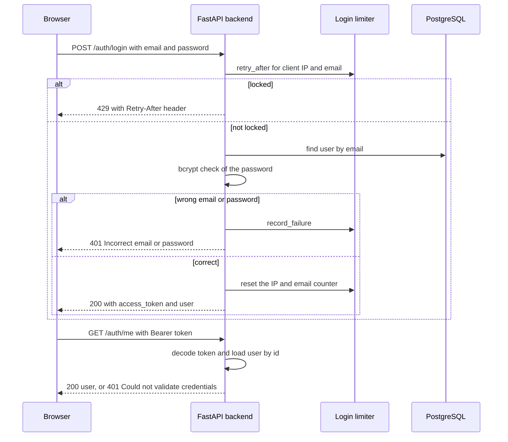

# Milestone 1: Project setup, authentication, upload and dataset integration

- **Milestone:** 1 of 4
- **Period:** 2026-08-27 to 2026-09-05 (first to last commit of this milestone; the later-iteration commits listed
  under Commits run to 2026-10-08)
- **Deliverables:** 10 of 12 rows DONE; see Deliverables for the full status

## Contents

1. [Objective](#objective)
2. [What was built](#what-was-built)
3. [Technical documentation](#technical-documentation)
4. [Deliverables](#deliverables)
5. [Commits](#commits)
6. [Limitations](#limitations)
7. [Carried into the next milestone](#carried-into-the-next-milestone)
8. [How to verify](#how-to-verify)
9. [Troubleshooting](#troubleshooting)
10. [Glossary](#glossary)

## Objective

The first milestone sets up a working full-stack application before any AI (artificial intelligence) is added. A
user can sign in with a role, register products, upload product images, browse the MVTec AD (MVTec Anomaly
Detection) dataset and see the inspections on a dashboard.
The data model, authentication and image intake built here are the base every later milestone extends.

## What was built

The repository started on 27 August 2026 with a React frontend (Vite) and a FastAPI backend (`942ee6b`). The next day
PostgreSQL was added through SQLAlchemy and Alembic (`ccce87e`). The first migration created the `users`,
`products`, `inspections` and `defects` tables, and this schema is still the core of the data model. JWT (JSON Web Token)
authentication with bcrypt password hashes and a `require_role` dependency followed the same evening (`f7ed210`).
It introduced the two roles that the whole application still uses: quality engineer and factory supervisor.

The image intake came next (`5e582ea`). A product can be created, and an image uploaded against it is checked for
extension, size and decodability, stored under a random name, and recorded as an inspection. The same commit added
the first backend tests (`test_auth.py`, `test_inspections.py`, `test_products.py`, `test_health.py`). The frontend
gained its main workflow in `16b6b97`: login, products, the inspection list and detail views, the upload page with
a drop zone, and the shared component set. A light and dark theme followed in `4c3e30f`.

MVTec AD was integrated in `6726990`. The backend scans the dataset folder and lists categories, splits and defect
types, serves preview images, and can import any dataset image as an inspection. An import takes its ground-truth
label (`good` or `defective`) and its defect type from the folder it comes from. The Dataset page in the frontend
browses this tree. Milestone 1 closed on 5 September with `af7a252`, which added the dashboard (counts and an
activity chart), the image viewer, the product detail view and the inspection status banner.

At the end of the milestone, preprocessing meant only the display preview (RGB, red-green-blue, conversion and a bounded JPEG in
`backend/app/dataset/preprocessing.py`). The preprocessing pipeline for AI models was committed the same day as the
first Milestone 2 work (`72b3f77`) and is described there.

Several parts of this milestone were changed in later iterations:

- Until 3 October, registration took the role from the request. `6693b13` made self-registration always create a
  factory supervisor, and added QE-only (quality engineer only) role management and a script that creates the first quality engineer.
- `1b4b0ab` added the registration page and the Users page, and `0fad1e1` restricted the upload route to quality
  engineers in the frontend as well.
- `593184b` rejects passwords longer than 72 bytes (the bcrypt limit).
- `e83f94a` added a limiter for failed logins.
- `ce42d43` added batch upload and the camera simulation, which replays labelled dataset images as timed imports.

## Technical documentation

### Scope

This milestone covers the application around the AI: accounts and roles, products, image intake from uploads and
from the dataset, image retrieval, the data model and the first dashboard. The roles, routes and tables are listed in
[ARCHITECTURE.md](../ARCHITECTURE.md); this section adds the details that belong to this milestone.

### Technology stack

The table below lists the components with the versions pinned in `backend/requirements.txt` and
`backend/Dockerfile`, or installed according to `frontend/package-lock.json`. The machine-learning packages are
listed in `requirements.txt` under its Milestone 2 comment; torch first appears there in `72b3f77`.

| Component | Version | Purpose |
|---|---|---|
| Python (backend image `python:3.14-slim`) | 3.14 | Backend runtime |
| FastAPI, uvicorn[standard] | 0.141.1, 0.52.4 | HTTP (Hypertext Transfer Protocol) API (application programming interface) framework and its ASGI (Asynchronous Server Gateway Interface) server |
| SQLAlchemy, Alembic, psycopg[binary] | 2.0.52, 1.19.1, 3.3.4 | Database sessions, migrations and the PostgreSQL driver |
| PostgreSQL (image `postgres:18-alpine`) | 18 | Database |
| bcrypt, PyJWT | 4.3.0, 2.13.0 | Password hashing; signing and checking access tokens |
| Pillow | 11.3.0 | Upload format check and dataset previews |
| python-dotenv, email-validator, python-multipart | 1.2.3, 2.3.0, 0.0.32 | `backend/.env` loading, email fields in the schemas, multipart uploads |
| NumPy, OpenCV headless, torch, scikit-learn | 2.5.2, 5.0.0.93, 2.14.0, 1.9.0 | Image processing, models and evaluation (Milestone 2) |
| matplotlib | 3.11.1 | Pinned and configured in the Dockerfile (`MPLCONFIGDIR`); no tracked module imports it |
| pytest, httpx | 8.4.2, 0.28.1 | Backend tests and the test client |
| React and React DOM (document object model renderer), React Router DOM, lucide-react | 19.2.8, 7.18.3, 1.37.0 | Frontend, client-side routes, icons |
| Vite, @vitejs/plugin-react, oxlint | 8.2.2, 6.1.0, 1.80.0 | Development server, build and linting |
| Vitest, Testing Library (React), jsdom | 5.0.1, 16.3.3, 30.1.0 | Frontend tests |
| Node.js (build image `node:24-alpine`), nginx (`nginx:1.29-alpine`) | 24, 1.29 | Frontend build and serving in Docker |

### Authentication and token flow

`POST /auth/login` (`backend/app/auth/router.py`) first asks the login limiter whether the client IP (Internet Protocol) address and
email are locked, then checks the password with bcrypt. On success it returns a token signed with HS256 (a keyed
SHA-256 signature; SHA is the Secure Hash Algorithm) that carries the user id (`sub`), the role and an expiry 60 minutes ahead (`JWT_ACCESS_TOKEN_EXPIRE_MINUTES`,
`backend/app/auth/security.py`). The frontend stores the token in `localStorage` under `visioninspect.token`
(`frontend/src/auth/AuthContext.jsx`) and sends it in the `Authorization` header with the `Bearer` scheme. On every protected request
`get_current_user` (`backend/app/auth/dependencies.py`) decodes the token and loads the user from the database. When
the app starts it calls `GET /auth/me` to restore the session, and any 401 response logs the user out on the client.

The sequence below shows a login and one protected request, as implemented in the files named above.

The login request and response follow `UserLogin` and `Token` in `backend/app/auth/schemas.py`. The test helper
`login` in `backend/tests/conftest.py` sends exactly the two request fields and expects status 200.
`test_login_correct_credentials` in `backend/tests/test_auth.py` asserts `token_type` is `"bearer"` and that the user
object contains neither `password` nor `password_hash`. The table lists the request and response fields.

| Field | Direction | Type and content |
|---|---|---|
| `email` | request | email address, validated by email-validator |
| `password` | request | string, checked against the stored bcrypt hash |
| `access_token` | response | the signed JWT |
| `token_type` | response | `"bearer"` |
| `user` | response | `UserOut`: `id`, `name`, `email`, `role` (`quality_engineer` or `factory_supervisor`), `created_at` |

### Access control

Each protected route declares either `get_current_user` (any signed-in user) or `require_role(...)`; a user without the
required role gets 403 `Insufficient permissions`. The role table in [ARCHITECTURE.md](../ARCHITECTURE.md#roles) lists
what each role may do. In the frontend user interface (UI), `RoleRoute` guards three routes (`/inspections/upload`, `/camera`, `/users`)
and `RoleGate` hides controls. Its own comment calls this a display convenience: `require_role` in the backend is the
authorization boundary.

### Upload validation and storage

The table below lists the checks applied to every uploaded file, in the order `save_upload_file` in
`backend/app/inspections/storage.py` runs them, followed by the batch and proxy limits, with the evidence for each.

| Check | Rule | Response when it fails | Evidence |
|---|---|---|---|
| Extension | `.jpg`, `.jpeg` or `.png` | 400 `Unsupported file type. Allowed formats: JPEG, PNG.` | `test_upload_rejects_invalid_file_type` |
| Size, measured while streaming | at most `MAX_UPLOAD_SIZE_MB`, 10 MB by default | 413 `File exceeds maximum size of 10 MB.` | `test_upload_rejects_oversized_file` |
| Empty file | at least 1 byte | 400 `Uploaded file is empty.` | code path in `save_upload_file`; no dedicated test |
| Content | Pillow verifies the file and its format is JPEG or PNG | 400 `Uploaded file is not a valid JPEG or PNG image.` | `test_upload_rejects_fake_image_with_image_extension` |
| Batch count (`POST /inspections/batch`) | at most 20 files | 400 `Too many files: at most 20 per batch.` | `test_batch_limits` |
| Batch size | at most 50 MB in total | 413 `Batch exceeds the maximum total size of 50 MB.` | `test_batch_limits` |
| Request body in Docker | nginx `client_max_body_size 60m` (`frontend/nginx.conf`) | 413 from nginx | a 61 MB request got 413 on AWS ([DEPLOY.md](../DEPLOY.md)) |

An accepted file is stored under `storage/uploads/` as `{product_id}/{filename}` (the code's own template), with a filename made of
`uuid4().hex` followed by the extension. Only the storage-relative path is kept in `inspections.image_path`, and `InspectionOut` does not
serialize it (`test_quality_engineer_can_upload_inspection` asserts `image_path` is absent).

### Image retrieval

`GET /inspections/{inspection_id}/image` returns the stored upload, or for an import the original file under
`DATASET_ROOT`. `resolve_image_path` resolves the path and refuses anything outside its root with 404 `Image not
found`; `test_delete_inspection_rejects_path_traversal_in_stored_image_path` covers the stored-path case.
`GET /dataset/categories/{category}/preview` returns a JPEG bounded to `max_dim` pixels, 320 by default and from 64 to
800 (`backend/app/dataset/router.py`). Its path parts are validated by `backend/app/dataset/service.py`, and seven
tests in `backend/tests/test_dataset.py` cover traversal in the category, defect type and filename, and an
absolute-path filename. The heatmap and the
enhancement preview were added in later iterations (Milestones 2 and 3).

### Data model and its evolution

The table below lists the nine Alembic migrations in `backend/migrations/versions/`, with the date of the commit
that added each file and the milestone it belongs to. The current columns are described in
[ARCHITECTURE.md](../ARCHITECTURE.md#database).

| Revision | Date | Adds | Milestone |
|---|---|---|---|
| `3dbc453c0101` | 2026-08-28 | `users`, `products`, `inspections` and `defects` tables | 1 |
| `3ba354d22dca` | 2026-08-29 | `inspections.source` (upload or dataset import) | 1 |
| `b33cf1824856` | 2026-09-05 | AI prediction columns | 2 |
| `756fc6cd50c8` | 2026-09-12 | `inspections.defect_category` | 3 |
| `e20f1b630737` | 2026-09-12 | Severity score, level and quality risk | 3 |
| `a96adcbc9a9e` | 2026-09-13 | Quality decision, assessment and recommendation | 3 |
| `e94d6730c867` | 2026-09-20 | Processing and inference time columns | 4 |
| `39bd1b8da129` | 2026-10-03 | `products.category` (later iteration of Milestone 2) | 2 |
| `5c1d7e2a9f40` | 2026-10-04 | Confidence, review, localization and heatmap columns (later iteration of Milestone 3) | 3 |

### Frontend pages and routes

The routes below are declared in `frontend/src/App.jsx`. Every route except `/login` and `/register` sits inside
`ProtectedRoute`, so it needs a signed-in user; `/` and unknown paths redirect to `/dashboard`.

| Path | Page | Access | Added |
|---|---|---|---|
| `/login` | LoginPage | public | `16b6b97`, 2026-08-29 |
| `/register` | RegisterPage | public | `1b4b0ab`, 2026-10-03 |
| `/dashboard` | DashboardPage | both roles | `16b6b97`, 2026-08-29 |
| `/products` | ProductsPage | both roles | `16b6b97`, 2026-08-29 |
| `/inspections` | InspectionsPage | both roles | `16b6b97`, 2026-08-29 |
| `/inspections/upload` | InspectionUploadPage | quality engineer (route guard from `0fad1e1`, 2026-10-03) | `16b6b97`, 2026-08-29 |
| `/inspections/:id` | InspectionDetailPage | both roles | `16b6b97`, 2026-08-29 |
| `/dataset` | DatasetBrowserPage | both roles; import is quality engineer only | `6726990`, 2026-08-30 |
| `/models` | ModelPerformancePage | both roles | `5070829`, 2026-10-04 |
| `/camera` | CameraSimulationPage | quality engineer | `ce42d43`, 2026-10-04 |
| `/users` | UsersPage | quality engineer | `1b4b0ab`, 2026-10-03 |

### Error responses

The backend returns errors as JSON with a `detail` field. The table below lists every `HTTPException` the code
raises, grouped by status. Pydantic validation errors, such as a missing field, are returned by FastAPI with
status 422.

| Status | Message | Raised by |
|---|---|---|
| 400 | `Unsupported file type. Allowed formats: JPEG, PNG.`, `Uploaded file is empty.`, `Uploaded file is not a valid JPEG or PNG image.`, `Too many files: at most 20 per batch.` | `inspections/storage.py`, `inspections/router.py` |
| 400 | `Invalid {field_name}.` (code template), `Split must be 'train' or 'test'.` | `dataset/service.py` |
| 401 | `Could not validate credentials` | `auth/dependencies.py` (missing, invalid or expired token) |
| 401 | `Incorrect email or password` | `auth/router.py` |
| 403 | `Insufficient permissions` | `require_role` |
| 404 | `Product not found`, `Inspection not found`, `Image not found`, `Heatmap not found`, `User not found` | routers and storage |
| 404 | `Category not found`, `Split not found`, `Defect type not found`, `Image not found` | `dataset/service.py` |
| 409 | `Email already registered`, `Product code already exists`, `Cannot delete product while inspections are associated with it`, `Cannot change the role of the last quality engineer; promote another user first` | auth, products and users routers |
| 413 | `File exceeds maximum size of 10 MB.`, `Batch exceeds the maximum total size of 50 MB.` | `inspections/storage.py`, `inspections/router.py` |
| 422 | Analytics `days` outside 7, 14 or 30 | `inspections/router.py` |
| 429 | `Too many failed login attempts. Please wait and try again later.`, with `Retry-After` | `auth/router.py` |
| 500 | `Failed to create inspection record` | `inspections/router.py` |
| 503 | `Database connection failed` | `GET /health/db` in `main.py` |

### Design rationale

- **Roles are checked on the server.** Every write that only a quality engineer may make goes through
  `require_role`, so the frontend's role gating changes only what is displayed.
  `test_supervisor_cannot_list_users_or_change_roles` and `test_factory_supervisor_cannot_upload` cover the
  server side.
- **Ground truth and AI output live in separate columns.** For imports, `status` and `defect_category` come from the
  dataset folders, and the `ai_*` columns hold only model output (`backend/app/models/inspection.py`).
  `test_ground_truth_and_ai_prediction_remain_independent` checks that one never overwrites the other.
- **Passwords are never command-line arguments.** `create_quality_engineer.py` and `seed_demo_data.py` read them from
  environment variables or a hidden prompt, as their docstrings state.

### Design challenges and how they were resolved

- **Role taken from the registration request.** Until 3 October, `POST /auth/register` used the role sent by the
  client. `6693b13` fixed the role to factory supervisor and added role changes for quality engineers only, with
  `test_register_cannot_choose_quality_engineer_role` and
  `test_demoting_the_last_quality_engineer_returns_409_and_changes_nothing`.
- **bcrypt's 72-byte input limit.** A password of up to 72 characters can exceed 72 bytes when it contains characters outside
  ASCII (the American Standard Code for Information Interchange). `593184b` (6 October) rejects such passwords at registration and in the bootstrap script, tested by
  `test_register_rejects_multibyte_password_over_72_bytes_with_422`.
- **Repeated failed logins.** `e83f94a` (8 October) added the limiter, covered by 29 tests in
  `backend/tests/test_login_rate_limit.py`.
- **Paths built from request values.** Dataset paths are assembled from category, split, defect type and filename.
  They are validated in `backend/app/dataset/service.py` and covered by the traversal tests in
  `backend/tests/test_dataset.py`.

## Deliverables

| Task or criterion | Status | Evidence |
|---|---|---|
| Inspection workflows and objectives | PARTIAL | The workflows exist in code from `5e582ea` and `6726990`; no planning document from this period is in the repository. They are described in [README.md](../../README.md) and [ARCHITECTURE.md](../ARCHITECTURE.md), both written on 17 October. |
| Architecture and database schema | DONE | `ccce87e`: SQLAlchemy models and the first migration (`3dbc453c0101`). The architecture is documented in [ARCHITECTURE.md](../ARCHITECTURE.md). |
| UI wireframes and workflow planning | NOT DONE | No wireframe or design file exists in the repository or its history. |
| Frontend and backend environments | DONE | `942ee6b`, `ccce87e`, `5efe127` |
| Authentication and role-based access | DONE | `f7ed210`. Hardened in later iterations by `6693b13` (3 October), `1b4b0ab` (3 October), `593184b` (6 October) and `e83f94a` (8 October). |
| Load MVTec AD dataset | DONE | `6726990`: `backend/app/dataset/`, Dataset page |
| Image upload workflow | DONE | `5e582ea`, `16b6b97`. Batch upload delivered in a later iteration: `ce42d43` (4 October). |
| Inspection dashboard | DONE | `af7a252` |
| Initialization and architecture complete | DONE | as above |
| Authentication and upload implemented | DONE | `backend/tests/test_auth.py`, `backend/tests/test_inspections.py` |
| Dashboard functional | DONE | `af7a252` (`DashboardPage.jsx`, `ActivityChart.jsx`) |
| Dataset integration and preprocessing | DONE | Dataset integration in `6726990`. The AI preprocessing pipeline in `72b3f77` was committed on 5 September, the same day as `af7a252`. |

## Commits

| Commit | Date | Content |
|---|---|---|
| `0ebb77d` | 2026-08-27 | Repository created with a `.gitignore` |
| `942ee6b` | 2026-08-27 | React (Vite) frontend and FastAPI backend skeletons |
| `ccce87e` | 2026-08-28 | PostgreSQL, SQLAlchemy models and the first Alembic migration |
| `f7ed210` | 2026-08-28 | JWT authentication and role checks |
| `5e582ea` | 2026-08-29 | Products, image upload and storage, first backend tests |
| `16b6b97` | 2026-08-29 | Frontend workflow pages and shared components |
| `5efe127` | 2026-08-29 | Vite development server configuration fix |
| `4c3e30f` | 2026-08-30 | Light and dark theme (outside the milestone task list) |
| `6726990` | 2026-08-30 | MVTec AD dataset browsing and import |
| `af7a252` | 2026-09-05 | Dashboard, image viewer, product detail, end of Milestone 1 |

Delivered in a later iteration:

| Commit | Date | Content |
|---|---|---|
| `6693b13` | 2026-10-03 | Registration always creates a factory supervisor; QE-only role changes; first-QE script |
| `1b4b0ab` | 2026-10-03 | Registration page and Users page |
| `0fad1e1` | 2026-10-03 | Upload page restricted to quality engineers |
| `ce42d43` | 2026-10-04 | Batch upload and camera simulation (also severity and enhancement UI, see Milestone 3) |
| `593184b` | 2026-10-06 | Passwords over 72 bytes rejected |
| `e83f94a` | 2026-10-08 | Failed-login rate limiting per client IP and email |

## Limitations

The registration flaw described above existed until 3 October. Uploads carry no ground truth, so they are shown as
"Unlabelled" and only dataset imports have a known label. The camera simulation replays dataset images from the
server and is not a live camera feed. The `defects` table from the first migration is never written by any code.
The login limiter keeps its counters in memory, so they reset when the backend restarts.

## Carried into the next milestone

Milestone 2 builds on four things from this milestone. The `inspections` table is the place where AI results are
added as new columns. The upload and import endpoints are the two entry points where inference is attached. The
ground-truth labels of dataset imports are what model predictions can be compared with. The dashboard is where the AI
monitoring view is added.

## How to verify

- Live deployment: http://13.206.115.50. `/register` creates a factory supervisor, and a quality engineer can
  change roles on the Users page.
- Health checks: `curl -s http://13.206.115.50/api/health` and `curl -s http://13.206.115.50/api/health/db`.
- Tests, from `backend/`:
  `python -m pytest tests/test_auth.py tests/test_users.py tests/test_login_rate_limit.py tests/test_products.py tests/test_inspections.py tests/test_dataset.py`.
- The first quality engineer is created with `python scripts/create_quality_engineer.py` (see
  [README.md](../../README.md#5-first-quality-engineer-and-demo-data)).

## Troubleshooting

The entries below cover problems that come from this milestone's authentication setup, with the cause and fix
recorded in the code and in [DEPLOY.md](../DEPLOY.md).

| Symptom | Cause | Fix |
|---|---|---|
| Login is refused with 429 `Too many failed login attempts. Please wait and try again later.`, even with the right password | The client IP address and email reached 5 failed logins, or the IP reached 20, within 900 seconds (defaults of `LOGIN_MAX_ATTEMPTS`, `LOGIN_MAX_ATTEMPTS_PER_IP`, `LOGIN_WINDOW_SECONDS`; `backend/app/auth/rate_limit.py`) | Wait for the number of seconds in the `Retry-After` header. The counters are held in memory, so `docker compose --env-file .env.docker restart backend` clears all of them at once. |
| `docker compose up` stops with `set JWT_SECRET_KEY in .env.docker` | `docker-compose.yml` requires the variable (`${JWT_SECRET_KEY:?set JWT_SECRET_KEY in .env.docker}`) | Set `JWT_SECRET_KEY` in `.env.docker`; DEPLOY.md shows how to generate one |
| The backend fails to import in local development with `KeyError: 'JWT_SECRET_KEY'` | `backend/app/auth/security.py` reads `os.environ["JWT_SECRET_KEY"]` | Set `JWT_SECRET_KEY` in `backend/.env` (template: `backend/.env.example`) |

## Glossary

The terms below are introduced in this milestone and used in the later ones.

| Term | Meaning in this project |
|---|---|
| Quality engineer | The role that can upload, import, delete inspections, change product categories and manage user roles. |
| Factory supervisor | The role every self-registered account gets; it can create products and view inspections, analytics, the dataset and the Models page. |
| JWT (JSON Web Token) | The signed access token returned by `POST /auth/login`, carrying the user id, the role and a 60-minute expiry. |
| bcrypt | The password-hashing function used for stored passwords; it reads at most 72 bytes of input. |
| Role-based access | Allowing or refusing each API route by the caller's role, through `require_role` in the backend. |
| Ground truth | The known label of a dataset import (`good` or `defective`, and the defect folder name), kept apart from AI output. |
| MVTec AD (MVTec Anomaly Detection) | The public dataset of 15 product categories whose images, labels and defect masks the project uses. |
| Preprocessing | Preparing an image before use: in this milestone, the RGB conversion and resizing of dataset previews; in Milestone 2, the decoding, resizing and scaling before a model scores it. |
| Inspection | One image recorded against a product, either uploaded or imported from the dataset, with its results. |
| Login rate limit | The in-memory counter of failed logins per client IP address and email that answers 429 when exceeded. |
