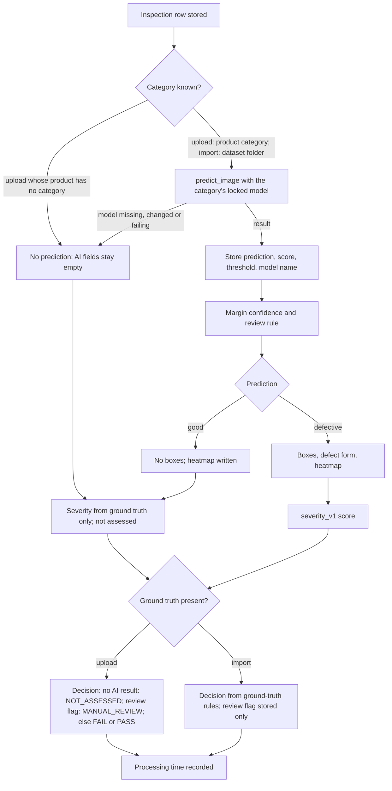

# Milestone 2: Image processing and defect detection

- **Milestone:** 2 of 4
- **Period:** 2026-09-05 to 2026-09-24 (first to last commit of this milestone; the later-iteration commits listed
  under Commits run to 2026-10-04)
- **Deliverables:** 10 of 10 rows DONE; see Deliverables for the full status

## Contents

1. [Objective](#objective)
2. [What was built](#what-was-built)
3. [Technical documentation](#technical-documentation)
4. [Deliverables](#deliverables)
5. [Commits](#commits)
6. [Results](#results)
7. [Limitations](#limitations)
8. [Carried into the next milestone](#carried-into-the-next-milestone)
9. [How to verify](#how-to-verify)
10. [Troubleshooting](#troubleshooting)
11. [Glossary](#glossary)

## Objective

The second milestone adds the computer-vision layer. Images are preprocessed and measured, anomaly-detection models
are trained on defect-free MVTec AD (MVTec Anomaly Detection) images, and every inspection receives a prediction that the frontend can show
and monitor. By the end of this milestone the application should make and store its own defect predictions,
rather than only record what the dataset folders say.

## What was built

The preprocessing pipeline was committed on 5 September (`72b3f77`). It decodes an image with OpenCV, converts it to
RGB (red, green, blue), resizes it with area interpolation and scales it to 0..1. The same commit added an image-quality module,
`backend/app/ai/analytics/quality.py`, which reports brightness (mean intensity), contrast (intensity standard
deviation) and sharpness (variance of the Laplacian), with a blur flag below a variance of 100. The training-data
layer in `backend/app/ai/training/` lists the MVTec samples and their labels. The training and evaluation code
uses this pipeline, and so do the six served ResNet-18 patch models (`_image_to_tensor` in
`backend/app/ai/inference/predict.py`). The nine served WRN-50 (Wide ResNet-50-2) models use their own preprocessing in
`backend/app/ai/preprocessing/patchcore_preprocess.py`.

The first model was a convolutional autoencoder trained on Bottle `train/good` (`92db936`) and evaluated in
`bf1d255`. With its first threshold (mean plus 3 standard deviations of the training errors) it found 29 of 63
defective test images (recall 46.0%) and flagged 1 of 20 good images (false-positive rate, FPR: 5%). The prediction engine
(`7a61371`) turned a trained model into an `app.ai.inference.predict_image` call. `5294ed5` connected it to the
inspection workflow: every dataset import now ran inference and stored `ai_prediction`, the score, the threshold
and the model name in new columns. If inference fails, the inspection is still created and those columns stay
empty. `1acff93` added the analytics summary endpoint and the AI (artificial intelligence) monitoring view on the dashboard, with counts of
analysed inspections and AI predictions.

On 15 September the Bottle model went through a validated evaluation in three steps:

- `972c203` added a held-out evaluation and threshold experiments.
- `19ddc59` retrained the autoencoder with a held-out validation split that was never used for training. This
  "Phase 3" model reached recall 73.0% at FPR 30.0% and was the served Bottle model until 4 October.
- `7b65b25` tried a controlled optimization ("Phase 4"). It gave recall 66.7% at FPR 40.0% and was not adopted.

Commit `4118bf7` (22 September) carries the title "Milestone 3: AI defect detection and model optimization", but by
content it belongs here. It added the frozen ImageNet ResNet-18 patch models (`backend/app/ai/models/patch_anomaly.py`,
`resnet18.py`), the synthetic-defect generator and the normal-data-only model-family study used to choose and lock
a model and threshold per category. `b224a77` (24 September) added the generic per-category training and
optimization engines and the serving registry (`backend/app/ai/inference/serving.py`). The registry pins each
category to exactly one locked, hash-verified model.

The autoencoder failed the project's gates in every category where it was tried. The ResNet-18 study produced
passing models for cable, leather, metal_nut, tile, toothbrush and transistor. The remaining nine categories were
later replaced by WRN-50 PatchCore models (Milestone 4). [ML_METHODOLOGY.md](../ML_METHODOLOGY.md) has the
category-by-category history.

Delivered in a later iteration:

- Tile and Cable were registered for serving on 2 October (`9a44113`).
- Uploaded images received predictions from 3 October (`363816a`, `ae74168`). The product's MVTec category now
  selects the model for its uploads.
- All 15 categories were served from 4 October (`188c903`). This added the shared backbones, the cached
  per-category models and `GET /ai/models`.
- The image-quality measurements became visible to users on 4 October (`c847154`). This added
  `GET /inspections/{id}/image-quality` and an enhancement preview with denoising and CLAHE (contrast-limited adaptive histogram equalization) contrast. The preview
  is computed per request, is never stored, and is never used by the models.

## Technical documentation

### Scope

This milestone covers the path from an image to a stored prediction: preprocessing, image-quality measurement, the
anomaly-detection models and how they are chosen, inference, and the monitoring view. The dataset, the protocol and
the full model history are in [ML_METHODOLOGY.md](../ML_METHODOLOGY.md), and the upload sequence diagram is in
[ARCHITECTURE.md](../ARCHITECTURE.md#request-flow-upload). This section adds the component details and the branches
of the inspection path.

### Components

The table below gives, for each component on the prediction path, its module, input, output, key parameters read
from the code, and the test module that covers it.

| Component | Module | Input | Output | Key parameters | Tests |
|---|---|---|---|---|---|
| Preprocessing pipeline | `backend/app/ai/preprocessing/pipeline.py` | image path | float32 RGB array scaled to 0..1, with quality metrics | OpenCV decode, BGR (blue-green-red) to RGB, `INTER_AREA` resize, default 224x224 | `test_ai_preprocessing.py` (13 tests) |
| WRN-50 preprocessing | `backend/app/ai/preprocessing/patchcore_preprocess.py` | image path or bytes, input mode | ImageNet-normalized tensor | `crop224`: shorter side to 256, centre 224x224; `full256`: whole image to 256x256; Grid's `full320` from its addendum module | `test_ai_patchcore.py` (27 tests) |
| ResNet-18 patch model | `backend/app/ai/models/patch_anomaly.py` | tensor at 128x128 or 256x256 | image score and per-patch scores | layers 2 and 3 (384 values per patch), 3x3 average pooling; kNN (k-nearest-neighbour) with k = 1 to a bank of 10% per-image coresets, or a Gaussian with covariance shrinkage 1e-2; image score = mean of the top 1% of patch scores | `test_ai_anomaly_models.py` (45 tests) |
| WRN-50 PatchCore | `backend/app/ai/models/patchcore.py` | tensor at 224, 256 or 320 pixels | image score, per-patch scores, anomaly map | layers 2 and 3, 3x3 average pooling, greedy coreset of 10% (seed 0), k = 1; image score = maximum patch score | `test_ai_patchcore.py`, `test_ai_wrn50.py` (11 tests) |
| Serving registry | `backend/app/ai/inference/serving.py` | category name | the category's locked, hash-checked model and threshold | one entry per category, no default entry; at most `VISIONINSPECT_AI_MODEL_CACHE_SIZE` (default 3) models cached | `test_ai_serving.py` (37 tests), `test_ai_all_categories_serving.py` (61 tests) |
| Prediction | `backend/app/ai/inference/predict.py` | image path, category | prediction, score, threshold, model name, time | defective when the score is above the locked threshold | `test_ai_inference.py` (15 tests) |
| Localization | `backend/app/ai/inference/localization.py` | per-patch scores, threshold, analysed region | boxes, flagged area, centroid, heatmap | bilinear upsampling and Gaussian blur (sigma 4, 33 taps); mask at the threshold (fallback 0.9 x peak); components under 0.25% of the image dropped; at most 5 boxes; heatmap at most 320 pixels per side | `test_localization.py` (136 tests), `test_localization_api.py` (22 tests) |

The score comparison in `predict.py`, written out in plain text:

```
prediction = "defective" if score > threshold else "good"
```

### Inspection path

The flowchart below shows what happens to an inspection once its row is stored. It follows `run_ai_inference`,
`apply_reliability_and_localization`, `apply_severity_assessment` and `apply_quality_assessment` in
`backend/app/inspections/service.py`.



Every step after the row is stored is best-effort: a failure is logged and leaves its fields empty, and the
inspection is kept. `test_upload_survives_a_raising_predictor_without_leaking_details` and
`test_tampered_model_never_fails_an_upload_and_leaks_nothing` cover this for the prediction step.

### Example request: upload

`POST /inspections/upload` takes a multipart form with `product_id` and `file`, sent with a quality engineer's
token. `test_quality_engineer_can_upload_inspection` in `backend/tests/test_inspections.py` sends a 16x16 PNG
named `sample.png` and asserts status 201, `status` `"pending"`, `source` `"upload"`, and no `image_path` field. A
factory supervisor gets 403 (`test_factory_supervisor_cannot_upload`). The table below groups the response fields of
`InspectionOut` (`backend/app/inspections/schemas.py`).

| Group | Fields |
|---|---|
| Record | `id`, `product_id`, `product_category`, `status`, `source`, `inspection_date`, `created_at` |
| Dataset origin (imports) | `dataset_category`, `dataset_split`, `dataset_defect_type`, `dataset_filename`, `defect_category` |
| Prediction | `ai_prediction`, `ai_reconstruction_error` (the anomaly score), `ai_threshold`, `ai_model_name`, `model_gate`, `ai_inference_time_ms` |
| Reliability and localization | `ai_confidence`, `ai_reliability`, `review_required`, `review_reason`, `localization`, `has_heatmap`, `defect_form`, `defect_form_label` |
| Severity and decision | `severity_score`, `severity_level`, `severity_action`, `quality_risk`, `quality_decision`, `quality_assessment`, `quality_recommendation`, `processing_time_ms` |

### Experiments

The table below summarises the detection experiments of this milestone, with the test-set counts from the stored
reports as recorded in [ML_METHODOLOGY.md](../ML_METHODOLOGY.md#history-of-earlier-models). The reports themselves
are in the models ZIP (see the README). The protocol is described in ML_METHODOLOGY.md.

| Experiment | Settings | Result on the test set | Decision |
|---|---|---|---|
| First Bottle autoencoder (`92db936`, `bf1d255`) | threshold = mean + 3 standard deviations of training errors | recall 29/63 (46.0%), FPR 1/20 (5.0%) | Replaced by a validated evaluation |
| Bottle Phase 3 autoencoder (`19ddc59`) | held-out validation split | recall 46/63 (73.0%), FPR 6/20 (30.0%) | Served for Bottle until 4 October |
| Bottle Phase 4 optimization (`7b65b25`) | controlled optimization | recall 42/63 (66.7%), FPR 8/20 (40.0%) | Not adopted |
| Hazelnut Phase 3 and 4 autoencoders | as for Bottle | recall 26/70 (37.1%) and 30/70 (42.9%), FPR 0/40 | Phase 3 retained, later replaced by WRN-50 |
| Autoencoder baselines in 12 categories | `phase1_baseline/` of each category | recall 0% in 7 categories (cable, grid, metal_nut, screw, tile, toothbrush, wood); leather 64/92 at FPR 30/32 | Replaced by the ResNet-18 study |
| ResNet-18 model-family study, 12 categories (`4118bf7`) | 8 candidates x 8 threshold policies, 30 normal-only splits | gates passed in 6 categories (cable, leather, metal_nut, tile, toothbrush, transistor) | The six passing models are served |
| Same study, other 6 categories | as above | recall capsule 29/109, grid 13/57, pill 78/141, screw 9/119, zipper 79/119; wood 59/60 at FPR 4/19 | Replaced by WRN-50 (Milestone 4) |
| Carpet, ResNet-18 Gaussian model and its calibration | `pgauss_l23_256_top1pct_mean`, then a calibration optimization | recall 88/89 at FPR 16/28, then 87/89 at FPR 11/28 | Replaced by WRN-50 (Milestone 4) |

### Design rationale

- **Training on defect-free images only.** The MVTec AD training split holds only good images, and the dataset has no
  labelled defective validation set ([ML_METHODOLOGY.md](../ML_METHODOLOGY.md#dataset)). An anomaly model learns
  what normal looks like from those images and needs no labelled defects.
- **Thresholds chosen on normal data and locked before test scoring.** Each threshold is fixed from normal training
  images and synthetic defects, and written to a lock file before the category's test set is listed. The test result
  is not used to set the threshold (the runners check the lock before listing the test set).
- **Frozen-backbone patch models.** The autoencoder did not reach a gate in any category where it was tried (table
  above), while patch features from a frozen ImageNet backbone passed in six categories with no network training.
- **Boxes from the same anomaly map.** Boxes are cut from the per-patch scores of the model that made the
  prediction, at that model's threshold, so localization needs no labelled boxes and appears only for defective
  predictions (`_localize_and_render` in `service.py`).
- **One locked model per category.** The serving registry holds exactly one entry per category, with no default
  entry; `test_unknown_category_has_no_model_and_loads_nothing` covers a category without an entry.

### Design challenges and how they were resolved

- **Threshold recomputed on every call.** Before the serving registry, inference loaded the autoencoder and
  recomputed a threshold from every `train/good` image on each call, as the docstring of `serving.py` records.
  `b224a77` (24 September) introduced the registry with thresholds copied from locked reports.
- **No predictions for uploads.** An upload had no category to choose a model with. `363816a` (3 October) added
  `products.category`, and `ae74168` added it to the user interface (UI);
  `test_upload_for_product_without_category_never_calls_predict_image` covers the case without one.
- **Memory with 15 categories.** `188c903` (4 October) shares one frozen backbone per model family and caches at most
  three category models, least recently used first (`test_lru_cache_evicts_the_least_recently_used_model`).
- **Changed model files.** Every model, configuration and backbone file is hash-checked on first load, and a mismatch
  is refused (`test_wrong_pinned_hash_refuses_to_load`, `test_wrong_pinned_backbone_hash_refuses_to_load`).

## Deliverables

| Task or criterion | Status | Evidence |
|---|---|---|
| Image preprocessing pipeline | DONE | `72b3f77`: `backend/app/ai/preprocessing/pipeline.py`, `backend/tests/test_ai_preprocessing.py` |
| Image quality analysis reports | DONE | `72b3f77`: `backend/app/ai/analytics/quality.py`. The endpoint was delivered in a later iteration: `c847154` (4 October). |
| Image analytics workflows | DONE | Quality metrics in the pipeline (`72b3f77`); before/after metrics of the enhancement preview (`c847154`, 4 October) |
| Train defect detection models | DONE | `92db936`, `19ddc59`, `4118bf7`; final models in Milestone 4 |
| Generate defect predictions | DONE | `7a61371`, `5294ed5`. Predictions for uploads were delivered in a later iteration: `363816a` (3 October). |
| Inspection monitoring dashboard | DONE | `1acff93`: `backend/app/inspections/analytics.py`, dashboard AI section |
| Processing and detection workflows implemented | DONE | as above |
| Defect prediction engine functional | DONE | `7a61371`: `backend/app/ai/inference/predict.py`, `backend/tests/test_ai_inference.py` |
| Inspection reports generated | DONE | The per-inspection report came with Milestone 3 (`d5a3b87`, 14 September); model evaluation reports are stored for every category |
| Computer vision models integrated | DONE | Bottle from `5294ed5`. Tile and Cable from `9a44113` (2 October) and all 15 categories from `188c903` (4 October), delivered in later iterations. |

## Commits

| Commit | Date | Content |
|---|---|---|
| `72b3f77` | 2026-09-05 | Preprocessing pipeline, image-quality analysis, training-data layer |
| `92db936` | 2026-09-05 | First convolutional autoencoder trained on Bottle |
| `bf1d255` | 2026-09-05 | Evaluation of that model |
| `7a61371` | 2026-09-05 | Inference engine (`predict_image`) |
| `5294ed5` | 2026-09-05 | AI prediction columns and inference on inspections |
| `1acff93` | 2026-09-05 | Analytics summary and AI monitoring dashboard |
| `972c203` | 2026-09-15 | Validated evaluation and threshold experiments (Bottle) |
| `19ddc59` | 2026-09-15 | Bottle model retrained with a held-out validation split |
| `7b65b25` | 2026-09-15 | Controlled optimization experiment (not adopted) |
| `4118bf7` | 2026-09-22 | ResNet-18 patch models and the model-family study (title says "Milestone 3") |
| `b224a77` | 2026-09-24 | Per-category training and optimization engines, serving registry |

Delivered in a later iteration:

| Commit | Date | Content |
|---|---|---|
| `9a44113` | 2026-10-02 | Tile and Cable patch models registered for serving |
| `363816a` | 2026-10-03 | Product MVTec category; predictions for uploads |
| `ae74168` | 2026-10-03 | Product category in the UI and AI-state messages for uploads |
| `188c903` | 2026-10-04 | All 15 categories served; shared backbones and model cache; `GET /ai/models` |
| `c847154` | 2026-10-04 | Image-quality endpoint and enhancement preview (also severity and defect form, see Milestone 3) |

## Results

At the end of this milestone's own dates, only Bottle was served, by the autoencoder at recall 73.0% and FPR 30.0%,
which does not meet any gate. The models that passed the gates in the ResNet-18 study are listed below, with AUROC
(area under the receiver operating characteristic curve), from
`backend/app/ai/inference/serving.py` and their stored final-test reports. The full 15-category results, with the
WRN-50 models that replaced the other nine, are in [Milestone 4](MILESTONE_4.md).

| Category | Model | Recall | FPR | AUROC | Gate |
|---|---|---:|---:|---:|---|
| cable | ResNet-18 kNN 128 | 85.9% | 1.7% | 0.9880 | GOOD |
| leather | ResNet-18 Gaussian 128 | 100.0% | 6.3% | 1.0000 | EXCELLENT |
| metal_nut | ResNet-18 kNN 256 | 96.8% | 4.5% | 0.9912 | EXCELLENT |
| tile | ResNet-18 kNN 256 | 91.7% | 0.0% | 0.9971 | EXCELLENT |
| toothbrush | ResNet-18 Gaussian 256 | 90.0% | 8.3% | 0.9722 | EXCELLENT |
| transistor | ResNet-18 kNN 256 | 92.5% | 0.0% | 0.9863 | EXCELLENT |

## Limitations

The autoencoder never reached a gate, so for most of this period the predictions had little practical value outside
the six ResNet-18 categories. Until 3 October, uploads received no prediction. The models detect anomalies; they do
not name the defect type. The enhancement preview is a display aid: it is neither stored nor used for scoring.

## Carried into the next milestone

Milestone 3 starts from the stored prediction of every inspection. The prediction, score and threshold feed the
quality decision. The per-patch scores of the served models feed the localization, the margin confidence and the
severity score that were added in later iterations. The analytics summary from `1acff93` is the endpoint that the
defect analytics and trend monitoring extend.

## How to verify

- Live deployment: http://13.206.115.50. Log in, import a dataset image on the Dataset page, then open the
  inspection to see the prediction, score, threshold and model.
- `GET /api/ai/models` (with a bearer token) lists the served model per category, as on the Models page.
- Tests, from `backend/`:
  `python -m pytest tests/test_ai_preprocessing.py tests/test_ai_inference.py tests/test_ai_serving.py tests/test_ai_all_categories_serving.py tests/test_inspection_ai_integration.py`.

## Troubleshooting

The entries below cover problems with the model files that this milestone's inference depends on. The setup steps
are in the README ([models](../../README.md#2-models)).

| Symptom | Cause | Fix |
|---|---|---|
| Inspections are created but every AI field is empty, and the Docker log shows `WARNING: /app/ai_models/_pretrained/wide_resnet50_2-95faca4d.pth is missing` | The models ZIP was extracted one level too deep (`backend/ai_models/ai_models/...`), so `backend/ai_models/_pretrained/` does not exist (`backend/docker-entrypoint.sh`) | Move the contents up so that `backend/ai_models/<category>/` and `backend/ai_models/_pretrained/` exist, then restart the backend |
| AI fields are empty and the backend log shows `AI inference skipped for inspection ...` with `Pretrained weights not found` or `Pretrained weights hash mismatch` | A backbone file is missing from `backend/ai_models/_pretrained/` or differs from the pinned SHA-256 (`backend/app/ai/models/resnet18.py`, `wide_resnet50.py`) | Restore `resnet18-f37072fd.pth` and `wide_resnet50_2-95faca4d.pth` with the hashes listed in the README |
| An upload gets no AI result | Its product has no MVTec category, so no prediction is attempted (`test_upload_for_product_without_category_never_calls_predict_image`) | A quality engineer sets the product's category on the Products page; only inspections created afterwards are scored |
| An inspection of a category gets no AI result although the product has a category | The category's model files are missing, so `predict_image` raises `ModelArtifactNotFoundError` and the AI fields stay empty (`test_upload_for_category_without_served_model_leaves_ai_fields_null`) | Restore the category's folder from the models ZIP |

## Glossary

The terms below are introduced in this milestone. Terms from Milestone 1 (inspection, ground truth, MVTec AD,
preprocessing and the roles) are defined in its [glossary](MILESTONE_1.md#glossary). Confidence, severity, the
defect form and the quality decision, which appear in the inspection path above, are defined in the
[glossary of Milestone 3](MILESTONE_3.md#glossary).

| Term | Meaning in this project |
|---|---|
| Autoencoder | The first model type, a convolutional autoencoder (ConvAE), scored by how badly it reconstructs an image; it is no longer served. |
| Frozen backbone | An ImageNet-trained network used only to extract features, loaded in evaluation mode without training and hash-checked on load. |
| ResNet-18 patch model | The model used for six categories: ResNet-18 patch features scored against normal patches by kNN or a Gaussian. |
| Patch features | The feature vector of one small image region, taken from layers 2 and 3 of a frozen backbone. |
| PatchCore | The method used for nine categories: a memory bank of normal patch features and nearest-neighbour patch scores. |
| Coreset | The subset (10%) of normal patch features kept in a memory bank, chosen by greedy k-center selection. |
| kNN scoring | A patch's score is its distance to the nearest stored normal patch (k = 1). |
| Gaussian scoring | A patch's score is its Mahalanobis distance to one Gaussian fitted to all normal patches. |
| Anomaly score | An image's score: the maximum (WRN-50) or the mean of the top 1% (ResNet-18) of its patch scores. |
| Locked threshold | The per-category score limit chosen on normal data and fixed in a lock file before the test set is scored. |
| Lock file | The file that records a category's chosen model, threshold and file hashes before its test set is listed. |
| Synthetic defect | An artificial defect painted on a held-out normal image, used only to compare candidates before the test. |
| WRN-50 (Wide ResNet-50-2) | The larger frozen ImageNet backbone behind the PatchCore models of nine categories. |
| crop224, full256, full320 | WRN-50 input modes: shorter side to 256 and a 224x224 centre crop; whole image to 256x256; whole image to 320x320 (Grid only). |
| Anomaly map | The per-patch scores of an image, upsampled and blurred into a map of how unusual each region is. |
| Localization | The boxes, flagged area and centroid cut from the anomaly map of an image predicted defective, plus its heatmap. |
| Final test | The scoring of a category's official MVTec AD test split by its locked model and threshold, done once per locked model. |
| Recall | The share of defective test images that the model flags as defective. |
| FPR (false-positive rate) | The share of good test images that the model flags as defective. |
| AUROC | The probability that a random defective image scores higher than a random good one, from the image scores. |
| Gate | The evidence level of a category's model from its final test: EXCELLENT, GOOD, ACCEPTABLE or NOT PRODUCTION READY. |
